# Hebi Hebi no Mi, Model: King Cobra

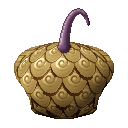{ .mod-icon }

| | |
|---|---|
| **Type** | Zoan |
| **Box** | { .box-icon } Iron |
| **Chance per opening** | iron **1.48%**, wooden **0.074%** ([how it works](index.md#box-odds)) |
| **Abilities** | 7: 7 active, 0 passive |
| **Transformations** | [King Cobra Heavy Point](#king-cobra-heavy-point), [King Cobra Walk Point](#king-cobra-walk-point) |
| **Effects applied** | { .effect-mini }[Coiled](../effects.md#effect-coiled), { .effect-mini }[Corroded](../effects.md#effect-corroded), { .effect-mini }[Frightened](../effects.md#effect-frightened) |

In 3D: drag to turn, scroll or pinch to zoom.

<!-- animations -->
??? example "Animations"

    

    <figure markdown="span">
      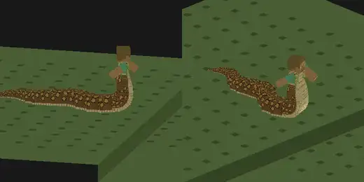{ loading=lazy }
      <figcaption>Hybrid: crawl</figcaption>
    </figure>
    <figure markdown="span">
      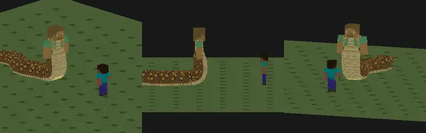{ loading=lazy }
      <figcaption>Heavy Stick</figcaption>
    </figure>
    <figure markdown="span">
      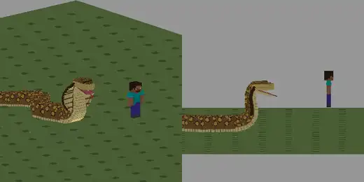{ loading=lazy }
      <figcaption>Hebigami-Tsuki: Salamander</figcaption>
    </figure>
    <figure markdown="span">
      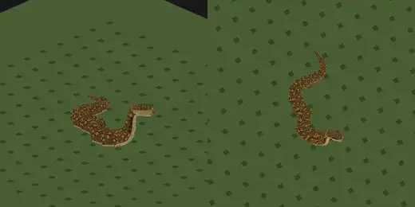{ loading=lazy }
      <figcaption>Cobra: crawl</figcaption>
    </figure>
    <figure markdown="span">
      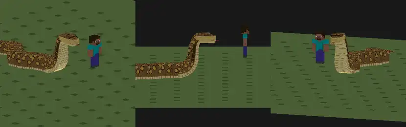{ loading=lazy }
      <figcaption>Ikaku</figcaption>
    </figure>
    <figure markdown="span">
      { loading=lazy }
      <figcaption>Modoku</figcaption>
    </figure>
    <figure markdown="span">
      { loading=lazy }
      <figcaption>Makitsuki</figcaption>
    </figure>
    

<!-- /animations -->

Found in the base mod's **iron Devil Fruit box**. Eat it and its abilities appear in the ability menu, grouped under the fruit.

!!! note "About the values"
    The values are those of the ability's tooltip in game, with the base mod's default settings. Damage is shown on the base mod's scale, as in the ability screen.

## King Cobra Heavy Point { #king-cobra-heavy-point }

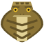{ .ability-icon } *Active · Transformation*

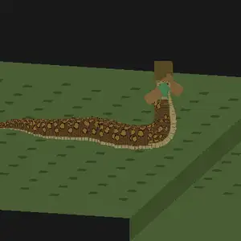{ .form-picture }

Transforms the user into a half-snake, their upper body on a long king cobra tail that gives their blows reach.

## King Cobra Walk Point { #king-cobra-walk-point }

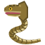{ .ability-icon } *Active · Transformation*

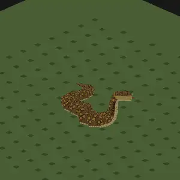{ .form-picture }

Transforms the user into a huge king cobra, ten blocks long, its hood raised.

## Modoku { #modoku }

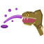{ .ability-icon } *Active*

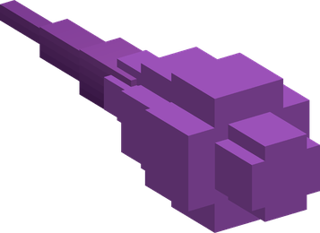{ .form-picture }

Applies { .effect-mini }[Corroded](../effects.md#effect-corroded)

The user spits a corrosive purple venom where they look. The enemy it hits is poisoned and its armor corroded. If it misses, it leaves a cloud of poison smoke

| Stat | Value |
|---|---|
| Damage type | Projectile |
| Haki | Special |
| Cooldown | 10 s |
| Damage | 10 |
| Spit Range | 20  blocks |
| Poison II | 5 s |
| Armor Corroded | -20 % |
| Smoke Cloud on a Miss | 6 s |

## Heavy Stick { #heavy-stick }

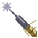{ .ability-icon } *Active*

The user hardens their tail with Armament Haki and thrusts it straight where they look, far ahead, into the first enemy in its way. Needs Armament Haki hardening unlocked

Needs Armament Haki mastery

| Stat | Value |
|---|---|
| Damage type | Physical |
| Haki | Hardening |
| Cooldown | 12 s |
| Haki Cost | 60 |
| Damage | 22 |
| Thrust Reach | 8–10  blocks |

## Makitsuki { #makitsuki }

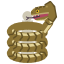{ .ability-icon } *Active*

Applies { .effect-mini }[Coiled](../effects.md#effect-coiled)

The user winds their long body round the enemy in front of them and squeezes it. It can't move, jump or strike and takes damage. A blow on the user lets it go. Use the ability again to let it go

| Stat | Value |
|---|---|
| Damage type | Physical |
| Haki | Hardening |
| Cooldown | 16 s |
| Held | 4 s |
| Damage | 16 |
| Reach | 4–5.4  blocks |

## Ikaku { #ikaku }

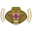{ .ability-icon } *Active*

Applies { .effect-mini }[Frightened](../effects.md#effect-frightened)

The user spreads their hood and hisses. Nearby enemies are frightened. Small creatures run away and the others are weakened and slowed. Modoku's poison lasts twice as long on a frightened enemy

| Stat | Value |
|---|---|
| Cooldown | 20 s |
| Hiss Radius | 8  blocks |
| Frightened | 4 s |

## Hebigami-Tsuki: Salamander { #hebigami-tsuki-salamander }

{ .ability-icon } *Active*

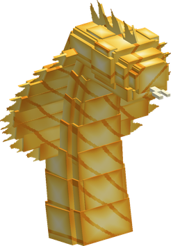{ .form-picture }

Two cobras of flames rise out of the ground beside the user and bite the nearby enemies in turn from both sides, setting them on fire

| Stat | Value |
|---|---|
| Haki | Special |
| Cooldown | 35 s |
| Damage | 30 |
| Bites | 6 |
| Range | 10  blocks |
| Burning | 4 s |
