# Hobi Hobi no Mi

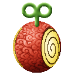{ .mod-icon }

| | |
|---|---|
| **Type** | Paramecia |
| **Theme** | Toys |
| **Box** | { .box-icon } Iron |
| **Chance per opening** | iron **1.37%**, wooden **0.069%** ([how it works](index.md#box-odds)) |
| **Abilities** | 7: 6 active, 1 passive |
| **Effects applied** | { .effect-mini }[Toy](../effects.md#effect-toy) |

In 3D: drag to turn, scroll or pinch to zoom.

<!-- animations -->
??? example "Animations"

    Taken in game, at size 1, third person.

    

    <figure markdown="span">
      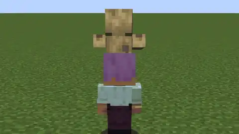{ loading=lazy }
      <figcaption>Omocha</figcaption>
    </figure>
    <figure markdown="span">
      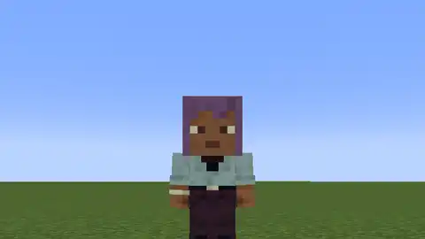{ loading=lazy }
      <figcaption>Omocha ready: sparks at her hand</figcaption>
    </figure>
    <figure markdown="span">
      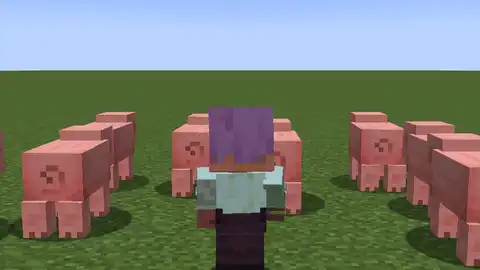{ loading=lazy }
      <figcaption>Little Black Bears</figcaption>
    </figure>
    <figure markdown="span">
      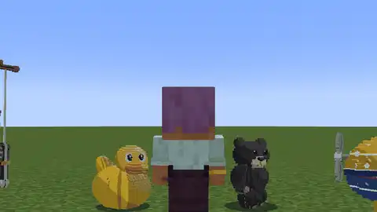{ loading=lazy }
      <figcaption>Atamawari Ningyo</figcaption>
    </figure>
    <figure markdown="span">
      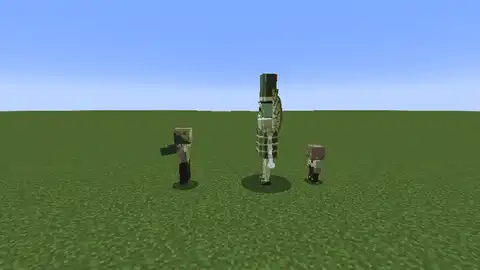{ loading=lazy }
      <figcaption>The Headcracker Doll bites</figcaption>
    </figure>
    <figure markdown="span">
      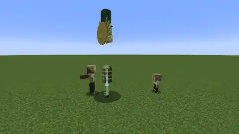{ loading=lazy }
      <figcaption>The doll comes apart into its toys</figcaption>
    </figure>
    <figure markdown="span">
      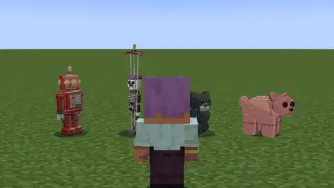{ loading=lazy }
      <figcaption>Zettai Meirei</figcaption>
    </figure>
    

<!-- /animations -->

Found in the base mod's **iron Devil Fruit box**. Eat it and its abilities appear in the ability menu, grouped under the fruit.

!!! note "About the values"
    The values are those of the ability's tooltip in game, with the base mod's default settings. Damage is shown on the base mod's scale, as in the ability screen.

## Omocha { #omocha }

{ .ability-icon } *Active · Punch*

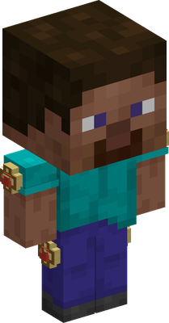{ .form-picture }

Applies { .effect-mini }[Toy](../effects.md#effect-toy)

The next touch of the user's bare hand turns the target into a toy for as long as the curse lasts. A new toy only defends itself until Keiyaku is used on it.

## Keiyaku { #keiyaku }

{ .ability-icon } *Active*

Makes a contract with a toy the user made. A creature then follows and fights for the user, and a player can no longer attack the user.

| Stat | Value |
|---|---|
| Cooldown | 1 s |
| Charge | under 1 s |
| Range | 10 blocks (line) |

## Little Black Bears { #little-black-bears }

{ .ability-icon } *Active*

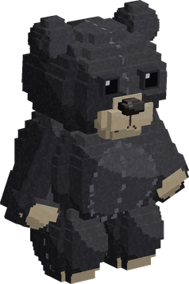{ .form-picture }

The user dashes around touching up to 8 nearby creatures and turns them into small black teddy bears, already under contract.

| Stat | Value |
|---|---|
| Cooldown | 45 s |
| Charge | 1 s |
| Range | 6 blocks (area) |

## Atamawari Ningyo { #atamawari-ningyo }

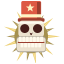{ .ability-icon } *Active*

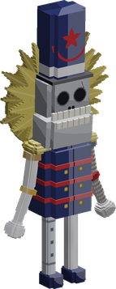{ .form-picture }

Builds 8 of the user's toys under contract into a giant nutcracker that fights for the user. When its time is up or it is destroyed, it comes apart into the same toys.

| Stat | Value |
|---|---|
| Cooldown | 120 s |
| Charge | under 1 s |
| Hold | 60 s |
| Range | 16 blocks (area) |

## Noroi { #noroi }

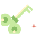{ .ability-icon } *Passive*

The fruit keeps the user as a child, smaller and weaker. All the toys are turned back if the user dies, is knocked out, loses their powers or leaves.

## Zettai Meirei { #zettai-meirei }

{ .ability-icon } *Active*

Gives an absolute order to every toy under contract near the user. For 10 seconds they hit harder, move faster and take less damage.

| Stat | Value |
|---|---|
| Cooldown | 30 s |
| Charge | under 1 s |
| Hold | 10 s |
| Range | 24 blocks (area) |
| Toys' Damage | x1.5 |

## Kaijo { #kaijo }

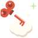{ .ability-icon } *Active*

The user turns the toy they are looking at back into what it was. The other toys stay toys.

| Stat | Value |
|---|---|
| Cooldown | 5 s |
| Charge | under 1 s |
| Range | 10 blocks (line) |
