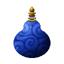
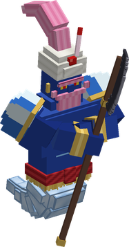
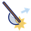
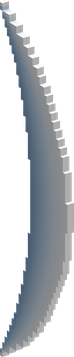
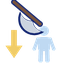

# Hoya Hoya no Mi

{ .mod-icon }

| | |
|---|---|
| **Type** | Paramecia |
| **Theme** | Genie |
| **Box** | { .box-icon } Iron |
| **Chance per opening** | iron **1.51%**, wooden **0.075%** ([how it works](index.md#box-odds)) |
| **Abilities** | 9: 8 active, 1 passive (1 hidden, not in the ability menu) |
| **Effects applied** | { .effect-mini }[Genie Master](../effects.md#effect-genie-master) |

In 3D: drag to turn, scroll or pinch to zoom.

Found in the base mod's **iron Devil Fruit box**. Eat it and its abilities appear in the ability menu, grouped under the fruit.

!!! note "About the values"
    The values are those of the ability's tooltip in game, with the base mod's default settings. Damage is shown on the base mod's scale, as in the ability screen.

## Genie { #hoya-genie }

{ .ability-icon } *Active*

{ .form-picture }

Applies { .effect-mini }[Genie Master](../effects.md#effect-genie-master)

The user rubs their belly and a huge genie comes out. It floats in front of the user and attacks nearby enemies by itself. The other abilities are orders for the genie

While the genie is out the user walks slowly and can't attack or use items

The genie can be attacked. It disappears if it has no health left or if the user takes a heavy hit or gets stunned

| Stat | Value |
|---|---|
| Damage type | Physical, Indirect |
| Haki | Special |
| Cooldown | 15–60 s |
| Hold | ∞ s |
| Damage | 8 |

## Genie Command { #hoya-command }

{ .ability-icon } *Active*

The user points at the enemy they look at and the genie goes for it first

| Stat | Value |
|---|---|
| Cooldown | 1 s |
| Range | 32 blocks (line) |

## Maji Giren { #hoya-maji-giren }

{ .ability-icon } *Active*

The genie slams its halberd down where the user looks. It hits the enemies around that spot and sweeps them away

| Stat | Value |
|---|---|
| Damage type | Physical, Indirect |
| Haki | Special |
| Cooldown | 8 s |
| Damage | 16 |
| Range | 2.5 blocks (area) |

## Majin Saidan { #hoya-majin-saidan }

{ .ability-icon } *Active*

{ .form-picture }

The genie swings its halberd and sends a great flying slash where the user looks. It goes through every enemy in its way

| Stat | Value |
|---|---|
| Damage type | Physical, Projectile |
| Haki | Special |
| Cooldown | 12 s |
| Damage | 22 |

## Maji Karu { #hoya-maji-karu }

{ .ability-icon } *Active*

The genie brings its halberd down with all its weight on the enemy the user looks at. The enemy is driven into the ground and can't move for a moment

| Stat | Value |
|---|---|
| Damage type | Physical, Indirect |
| Haki | Special |
| Cooldown | 15 s |
| Damage | 26 |

## Genie Shield { #hoya-shield }

{ .ability-icon } *Active*

The genie guards the user with its halberd. While it is held the genie takes the hits that come from the front instead of the user. It can't attack while guarding

| Stat | Value |
|---|---|
| Cooldown | 15 s |
| Hold | 4 s |

## Smoke { #hoya-smoke }

{ .ability-icon } *Active*

The genie turns to smoke for 3 seconds. Nothing can hit it but it can't attack

| Stat | Value |
|---|---|
| Cooldown | 15 s |
| Hold | 3 s |

## Great Genie { #hoya-great-genie }

{ .ability-icon } *Active*

The genie grows gigantic for a while. It reaches twice as far and all its attacks hit harder and wider

| Stat | Value |
|---|---|
| Cooldown | 45 s |
| Hold | 15 s |

## Genie's Life { #hoya-genie-life }

{ .ability-icon } *Passive*

!!! info "Hidden ability"
    It does not appear in the ability menu.

Shows the health of the genie. The genie keeps its health when it goes back in and slowly recovers while it is not out
