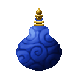
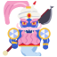
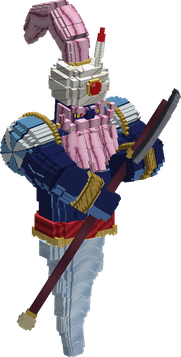
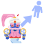
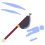
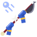
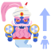

# Hoya Hoya no Mi

{ .mod-icon }

| | |
|---|---|
| **Type** | Paramecia |
| **Theme** | Genie |
| **Box** | { .box-icon } Iron |
| **Chance per opening** | iron **1.37%**, wooden **0.069%** ([how it works](index.md#box-odds)) |
| **Abilities** | 9: 8 active, 1 passive (1 hidden, not in the ability menu) |
| **Effects applied** | { .effect-mini }[Genie Master](../effects.md#effect-genie-master) |

In 3D: drag to turn, scroll or pinch to zoom.

Found in the base mod's **iron Devil Fruit box**. Eat it and its abilities appear in the ability menu, grouped under the fruit.

!!! note "About the values"
    The values are those of the ability's tooltip in game, with the base mod's default settings. Damage is shown on the base mod's scale, as in the ability screen.

## Genie { #hoya-genie }

{ .ability-icon } *Active*

{ .form-picture }

Applies { .effect-mini }[Genie Master](../effects.md#effect-genie-master)

The user rubs their belly and a huge genie comes out, tied to them by a trail of smoke. It hunts the enemies around by itself and strikes them with its halberd. The other abilities are orders for the genie

While the genie is out the user walks slowly and can't attack or use items

The genie can be attacked. It goes back in when it has no health left, or when the user takes a heavy hit or gets stunned. It keeps its health and slowly heals while it is in

| Stat | Value |
|---|---|
| Damage type | Physical, Indirect |
| Haki | Special |
| Cooldown | 15–60 s |
| Hold | ∞ s |
| Damage | 8 |
| Genie Strikes Every | 1.5 s |
| Genie Health | 120 |
| Genie Goes Up To | 24 blocks |
| User Speed | -40 % |
| Sent Back by a Hit Over | 15 % of health |

## Genie Command { #hoya-command }

{ .ability-icon } *Active*

The user points at the enemy they look at, and the genie goes for it before any other

| Stat | Value |
|---|---|
| Cooldown | 1 s |
| Range | 24 blocks (line) |

## Maji Giren { #hoya-maji-giren }

{ .ability-icon } *Active*

The genie slams its halberd down on the enemy it is fighting. It hits the enemies around and sweeps them away. One that guards is swept twice as far

With the **Alt key** it is **Maji Karu**: the genie brings its halberd down with all its weight on the enemy it is fighting. The enemy is driven into the ground and can't move for a moment

| Stat | Maji Giren | Maji Karu |
|---|---|---|
| Damage type | Physical, Indirect | Physical, Indirect |
| Haki | Special | Special |
| Cooldown | 8 s | 15 s |
| Damage | 18 | 28 |
| Range | 2.5 blocks (area) |  |
| Held in the Ground |  | 1.5 s |

## Majin Saidan { #hoya-majin-saidan }

{ .ability-icon } *Active*

{ .form-picture }

The genie swings its halberd and sends a great flying slash at the enemy it is fighting. It goes through every enemy in its way and cuts through wood, leaves, glass and wool

| Stat | Value |
|---|---|
| Damage type | Physical, Projectile |
| Haki | Special |
| Cooldown | 10 s |
| Damage | 24 |

## Genie Grab { #hoya-grab }

{ .ability-icon } *Active*

The genie seizes the enemy it is fighting in its hand and holds it. The enemy can't move or attack while held, and the genie can still take orders. Using it again lets go

| Stat | Value |
|---|---|
| Damage type | Physical, Indirect |
| Haki | Special |
| Cooldown | 14 s |
| Damage | 6 |
| Held | 3 s |
| Held, a Player or a Boss | 1 s |

## Genie Shield { #hoya-shield }

{ .ability-icon } *Active*

The genie comes back in front of the user and guards them with its halberd. While it is held, the genie takes the hits that come from the front instead of the user, and sends back what is shot at them. It can't attack while guarding

| Stat | Value |
|---|---|
| Cooldown | 15 s |
| Hold | 4 s |

## Smoke { #hoya-smoke }

{ .ability-icon } *Active*

The genie turns to smoke for a moment. Nothing can hit it, but it can't attack

| Stat | Value |
|---|---|
| Cooldown | 15 s |
| Duration | 3 s |

## Great Genie { #hoya-great-genie }

{ .ability-icon } *Active*

The genie grows gigantic for a while. Its halberd reaches much farther, and all its attacks hit harder and wider

| Stat | Value |
|---|---|
| Cooldown | 45 s |
| Hold | 15 s |
| Genie Size | x3 |
| Halberd Reach | 9 blocks |
| Genie Damage | +25 % |

## Genie's Life { #hoya-genie-life }

{ .ability-icon } *Passive*

!!! info "Hidden ability"
    It does not appear in the ability menu.

Shows the health of the genie. The genie keeps its health when it goes back in, and slowly heals while it is not out
