# Inu Inu no Mi, Model: Dachshund

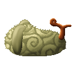{ .mod-icon }

| | |
|---|---|
| **Type** | Zoan |
| **Box** | { .box-icon } Wooden |
| **Chance per opening** | wooden **1.81%** ([how it works](index.md#box-odds)) |
| **Abilities** | 6: 6 active, 0 passive |
| **Transformations** | [Dachshund Heavy Point](#dachshund-heavy-point), [Dachshund Walk Point](#dachshund-walk-point) |

In 3D: drag to turn, scroll or pinch to zoom.

<!-- animations -->
??? example "Animations"

    

    <figure markdown="span">
      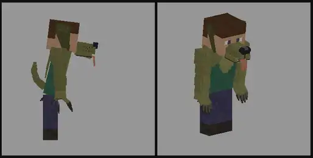{ loading=lazy }
      <figcaption>Hybrid: Badger Hunt</figcaption>
    </figure>
    <figure markdown="span">
      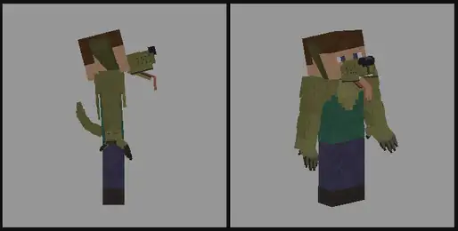{ loading=lazy }
      <figcaption>Hybrid: Big Bark</figcaption>
    </figure>
    <figure markdown="span">
      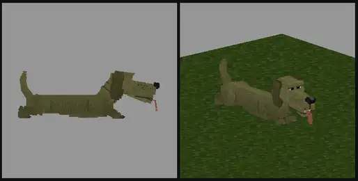{ loading=lazy }
      <figcaption>Dog: Low Run</figcaption>
    </figure>
    <figure markdown="span">
      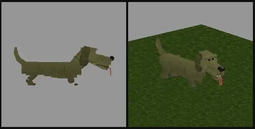{ loading=lazy }
      <figcaption>Dog: digging</figcaption>
    </figure>
    <figure markdown="span">
      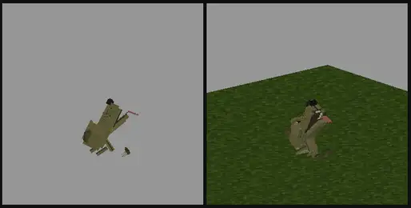{ loading=lazy }
      <figcaption>Dog: bursting out</figcaption>
    </figure>
    <figure markdown="span">
      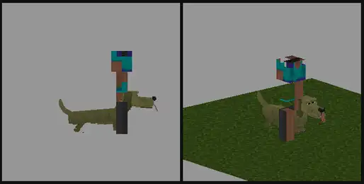{ loading=lazy }
      <figcaption>Dog: Won't Let Go</figcaption>
    </figure>
    

<!-- /animations -->

Found in the base mod's **wooden Devil Fruit box**. Eat it and its abilities appear in the ability menu, grouped under the fruit.

!!! note "About the values"
    The values are those of the ability's tooltip in game, with the base mod's default settings. Damage is shown on the base mod's scale, as in the ability screen.

## Dachshund Heavy Point { #dachshund-heavy-point }

{ .ability-icon } *Active · Transformation*

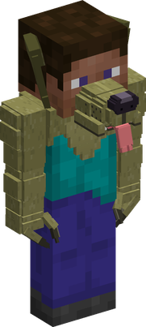{ .form-picture }

Transforms the user into a dachshund hybrid, a small dog man that bites and barks a lot.

## Dachshund Walk Point { #dachshund-walk-point }

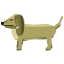{ .ability-icon } *Active · Transformation*

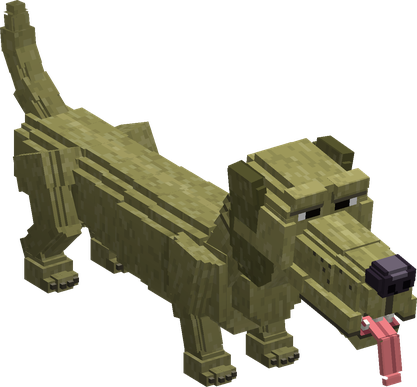{ .form-picture }

Transforms the user into a dachshund, a long dog on short legs that fits through a one block gap.

## Badger Hunt { #badger-hunt }

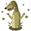{ .ability-icon } *Active*

While in the full dachshund form and on soft ground, the user goes under the ground straight to the target and jumps out under it, throwing it in the air

| Stat | Value |
|---|---|
| Damage type | Physical |
| Haki | Hardening |
| Cooldown | 12 s |
| Damage | 10 |
| Reach Underground | 12  blocks |

## Big Bark { #big-bark }

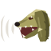{ .ability-icon } *Active*

The user barks way too loud for their size at the enemies in front of them. Small creatures run away and the others are slowed and lose their target for a moment

| Stat | Value |
|---|---|
| Cooldown | 12 s |
| Bark Reach | 8  blocks |
| Slowed | 3 s |
| Target Lost | 2 s |
| Small Creatures Flee | 5 s |

## Won't Let Go { #wont-let-go }

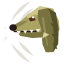{ .ability-icon } *Active*

The user jumps at the target and bites it and just won't let go, hanging on it and nibbling it. A strong enough hit shakes them off, use the ability again to let go

| Stat | Value |
|---|---|
| Damage type | Physical |
| Haki | Hardening |
| Cooldown | 15 s |
| Damage | 2 |
| Hangs On | 6 s |
| Total Damage | 12 |
| Shaken Off By A Hit Of | 4 |

## Low Run { #low-run }

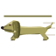{ .ability-icon } *Active*

While in the full dachshund form, the user flattens down and runs fast close to the ground, so low they can go under a slab. Use the ability again to stand up

| Stat | Value |
|---|---|
| Cooldown | 8 s |
| Hold | 8 s |
| Speed | +50 % |
| Height | 0.45  blocks |
