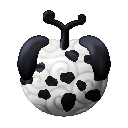
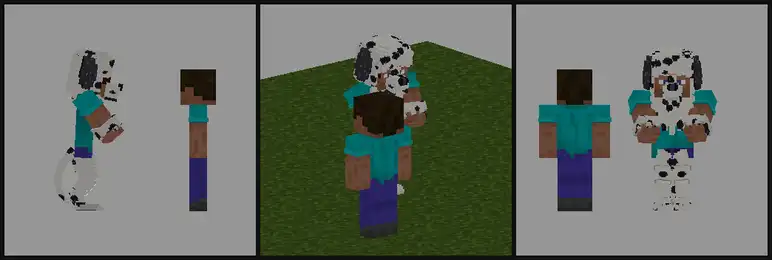
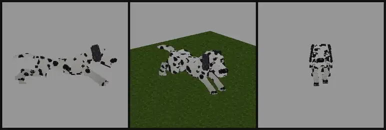
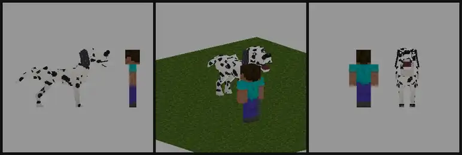
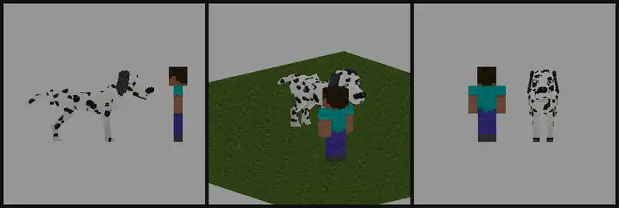
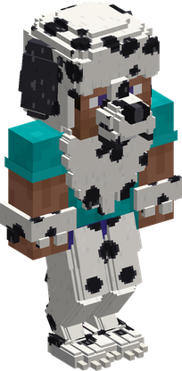
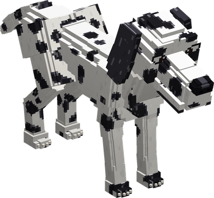

# Inu Inu no Mi, Model: Dalmatian

{ .mod-icon }

| | |
|---|---|
| **Type** | Zoan |
| **Box** | { .box-icon } Wooden |
| **Chance per opening** | wooden **1.81%** ([how it works](index.md#box-odds)) |
| **Abilities** | 12: 12 active, 0 passive |
| **Transformations** | [Dalmatian Heavy Point](#dalmatian-heavy-point), [Dalmatian Walk Point](#dalmatian-walk-point) |

In 3D: drag to turn, scroll or pinch to zoom.

<!-- animations -->
??? example "Animations"

    

    <figure markdown="span">
      { loading=lazy }
      <figcaption>Tekkai: Kaeshi Kiba</figcaption>
    </figure>
    <figure markdown="span">
      { loading=lazy }
      <figcaption>Soru: Inazuma</figcaption>
    </figure>
    <figure markdown="span">
      { loading=lazy }
      <figcaption>O Rankyaku</figcaption>
    </figure>
    <figure markdown="span">
      { loading=lazy }
      <figcaption>Dog: run</figcaption>
    </figure>
    <figure markdown="span">
      { loading=lazy }
      <figcaption>Kamikudaki</figcaption>
    </figure>
    <figure markdown="span">
      { loading=lazy }
      <figcaption>Kyoken</figcaption>
    </figure>
    

<!-- /animations -->

Found in the base mod's **wooden Devil Fruit box**. Eat it and its abilities appear in the ability menu, grouped under the fruit.

!!! note "About the values"
    The values are those of the ability's tooltip in game, with the base mod's default settings. Damage is shown on the base mod's scale, as in the ability screen.

## Dalmatian Heavy Point { #dalmatian-heavy-point }

{ .ability-icon } *Active · Transformation*

{ .form-picture }

Transforms the user into a dalmatian hybrid, a tall spotted dog man that runs fast and guards its friends.

## Dalmatian Walk Point { #dalmatian-walk-point }

{ .ability-icon } *Active · Transformation*

{ .form-picture }

Transforms the user into a big dalmatian, a fast running dog with black spots.

## Kamikudaki { #kamikudaki }

{ .ability-icon } *Active*

The user bites hard the enemy in front of them

| Stat | Value |
|---|---|
| Damage type | Physical |
| Haki | Hardening |
| Cooldown | 5 s |
| Damage | 7–8 |
| Range | 2.5 blocks (line) |

## Tobikakari { #tobikakari }

{ .ability-icon } *Active*

The user jumps on the target and knocks it down, holding it on the ground with their paws so it cant move for a moment

| Stat | Value |
|---|---|
| Damage type | Physical |
| Haki | Hardening |
| Cooldown | 12 s |
| Damage | 8 |
| Spring Reach | 8  blocks |
| Pinned Down | 1.5 s |

## Hoegoe { #hoegoe }

{ .ability-icon } *Active*

The user barks very sharp, the enemies around are pushed back and stop what they were doing

| Stat | Value |
|---|---|
| Cooldown | 10 s |
| Bark Radius | 5  blocks |
| Pushed Back | 2  blocks |
| Abilities Cut For | 1 s |

## Banken { #banken }

{ .ability-icon } *Active*

The user guards the ally they look at and takes part of the hits for them, and growls so the enemies close by deal less damage

| Stat | Value |
|---|---|
| Cooldown | 20 s |
| Hold | 10 s |
| Guard Reach | 6  blocks |
| Ally Damage Taken Instead | 50 % |
| Nearby Enemies Damage | -25 % |

## Miburui { #miburui }

{ .ability-icon } *Active*

The user shakes like a wet dog and gets rid of slowness, water and fire, the fire wont catch them again for a moment

| Stat | Value |
|---|---|
| Cooldown | 15 s |
| No Fire For | 2 s |

## Kyoken { #kyoken }

{ .ability-icon } *Active*

The user throws themself on the target like a mad dog and bites and claws it again and again, faster and faster, without letting it go

| Stat | Value |
|---|---|
| Damage type | Physical |
| Haki | Hardening |
| Cooldown | 30 s |
| Damage | 1.8 |
| Hits | 10 |
| Total Damage | 18 |

## Kiba Shigan { #kiba-shigan }

{ .ability-icon } *Active*

While in the hybrid form, the user darts at the enemy and bites it as fast as a Shigan, the fangs go through the armour and the wound bleeds

| Stat | Value |
|---|---|
| Damage type | Physical |
| Haki | Hardening |
| Cooldown | 8 s |
| Damage | 12 |
| Through Armour | 40 % |
| Bleeding | 3 s |

## O Rankyaku { #o-rankyaku }

{ .ability-icon } *Active*

While in the hybrid form, the user flicks their tail so fast it throws a thin air blade

| Stat | Value |
|---|---|
| Damage type | Projectile |
| Element | Wind |
| Haki | Imbuing |
| Cooldown | 12 s |
| Damage | 10 |
| Range | 24 blocks (line) |

## Tekkai: Kaeshi Kiba { #tekkai-kaeshi-kiba }

{ .ability-icon } *Active*

While in the hybrid form, the user freezes in Tekkai and takes less damage, the first enemy that hits them gets bitten back

| Stat | Value |
|---|---|
| Damage type | Physical |
| Haki | Hardening |
| Cooldown | 10 s |
| Damage Taken | -60 % |
| Damage | 10 |
| Holds Up To | 3 s |

## Soru: Inazuma { #soru-inazuma }

{ .ability-icon } *Active*

While in the hybrid form, the user zigzags with Soru from one enemy to the next and bites each of them

| Stat | Value |
|---|---|
| Damage type | Physical |
| Haki | Hardening |
| Cooldown | 10 s |
| Damage | 5 |
| Enemies Bitten | 4 |
| Reach | 10  blocks |
