# Inu Inu no Mi, Model: Jackal

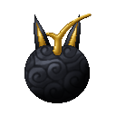{ .mod-icon }

| | |
|---|---|
| **Type** | Zoan |
| **Box** | { .box-icon } Iron |
| **Chance per opening** | iron **1.48%**, wooden **0.074%** ([how it works](index.md#box-odds)) |
| **Abilities** | 8: 6 active, 2 passive |
| **Transformations** | [Jackal Heavy Point](#jackal-heavy-point), [Jackal Walk Point](#jackal-walk-point) |
| **Effects applied** | 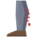{ .effect-mini }[Hamstrung](../effects.md#effect-hamstrung) |

In 3D: drag to turn, scroll or pinch to zoom.

<!-- animations -->
??? example "Animations"

    

    <figure markdown="span">
      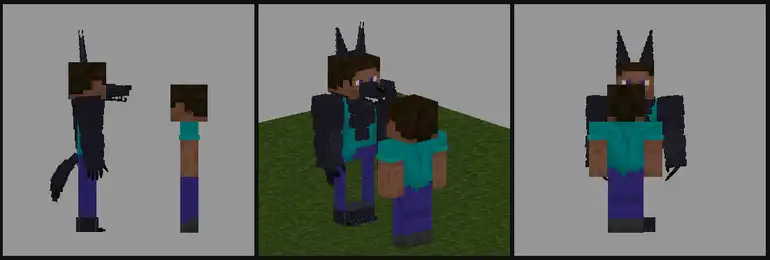{ loading=lazy }
      <figcaption>Hybrid: claws</figcaption>
    </figure>
    <figure markdown="span">
      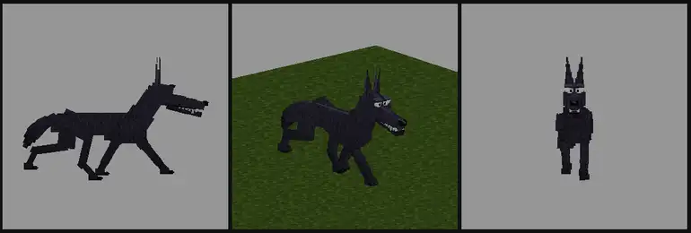{ loading=lazy }
      <figcaption>Jackal: trot</figcaption>
    </figure>
    <figure markdown="span">
      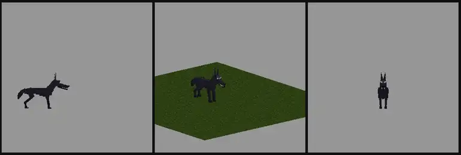{ loading=lazy }
      <figcaption>Choyaku</figcaption>
    </figure>
    <figure markdown="span">
      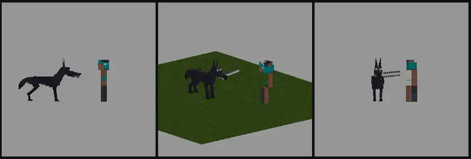{ loading=lazy }
      <figcaption>Narikiba</figcaption>
    </figure>
    <figure markdown="span">
      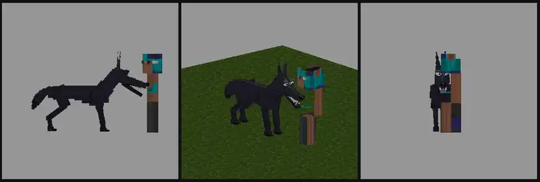{ loading=lazy }
      <figcaption>Hikagami Gari</figcaption>
    </figure>
    <figure markdown="span">
      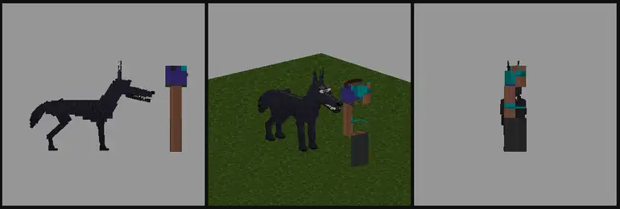{ loading=lazy }
      <figcaption>Anubisu no Shinpan</figcaption>
    </figure>
    

<!-- /animations -->

Found in the base mod's **iron Devil Fruit box**. Eat it and its abilities appear in the ability menu, grouped under the fruit.

!!! note "About the values"
    The values are those of the ability's tooltip in game, with the base mod's default settings. Damage is shown on the base mod's scale, as in the ability screen.

## Jackal Heavy Point { #jackal-heavy-point }

{ .ability-icon } *Active · Transformation*

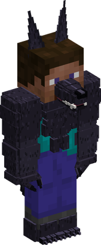{ .form-picture }

Transforms the user into a jackal hybrid, a tall black dog man with long legs and big ears.

## Jackal Walk Point { #jackal-walk-point }

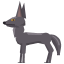{ .ability-icon } *Active · Transformation*

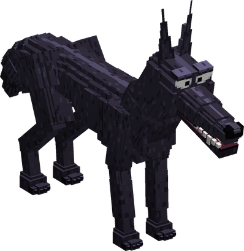{ .form-picture }

Transforms the user into a big black jackal that runs very fast.

## Narikiba { #narikiba }

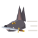{ .ability-icon } *Active*

While in the jackal form, the user takes their sword in the mouth and dashes forward cutting all enemies on the way. The sword damage is added to the cut

| Stat | Value |
|---|---|
| Damage type | Slash, Physical |
| Haki | Imbuing |
| Cooldown | 10 s |
| Damage | 10 |
| Dash Length | 14 blocks |

## Choyaku { #choyaku }

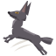{ .ability-icon } *Active*

While in a jackal form, the user leaps very high where they look and lands without getting hurt. The whole jackal goes higher

| Stat | Value |
|---|---|
| Cooldown | 8 s |
| Leap Height | 7–10 blocks |

## Hikagami Gari { #hikagami-gari }

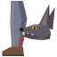{ .ability-icon } *Active*

Applies { .effect-mini }[Hamstrung](../effects.md#effect-hamstrung)

The user jumps at the target and bites the back of its legs, the target is much slower and cant jump for a while

| Stat | Value |
|---|---|
| Damage type | Physical |
| Haki | Hardening |
| Cooldown | 12 s |
| Damage | 4 |
| Target Slowed | -60 % |
| Hamstrung Lasts | 5 s |

## Anubisu no Shinpan { #anubisu-no-shinpan }

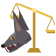{ .ability-icon } *Active*

The user jumps at the target and bites it to finish it off, it does almost nothing to a healthy target but a lot to a target that is low on health

| Stat | Value |
|---|---|
| Damage type | Physical |
| Haki | Hardening |
| Cooldown | 15 s |
| Damage | 3 |
| Damage on a Weak Target | 30 |
| Weak Target Under | 20 % health |

## Sabaku Bashiri { #sabaku-bashiri }

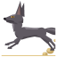{ .ability-icon } *Passive*

While in a jackal form the user runs faster in the desert and soul sand does not slow them down

| Stat | Value |
|---|---|
| Speed in the Desert | +20 % |

## Shiniku Gui { #shiniku-gui }

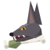{ .ability-icon } *Passive*

While in a jackal form the user can eat rotten flesh without getting sick and heals a bit when they finish off a creature

| Stat | Value |
|---|---|
| Healing per Kill | +3 |
