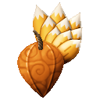
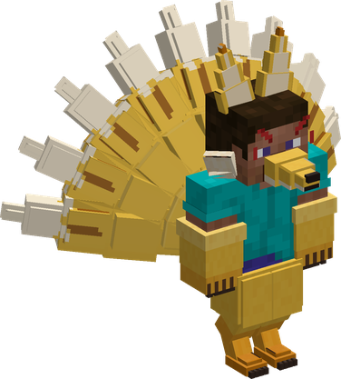
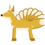
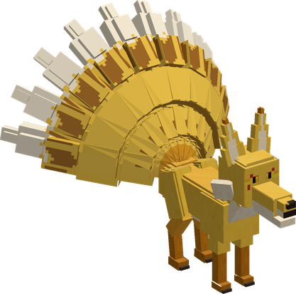
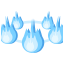
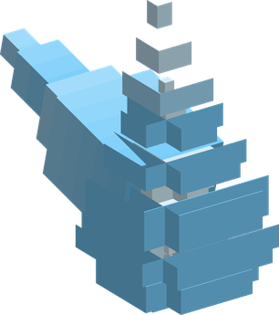

# Inu Inu no Mi, Model: Kyubi no Kitsune

{ .mod-icon }

| | |
|---|---|
| **Type** | Mythical Zoan |
| **Box** | { .box-icon } Golden |
| **Chance per opening** | golden **2.57%**, iron **0.128%**, wooden **0.006%** ([how it works](index.md#box-odds)) |
| **Abilities** | 9: 9 active, 0 passive |
| **Transformations** | [Kyubi Heavy Point](#kyubi-heavy-point), [Kyubi Walk Point](#kyubi-walk-point) |
| **Effects applied** | { .effect-mini }[Vanished](../effects.md#effect-vanished) |

In 3D: drag to turn, scroll or pinch to zoom.

Found in the base mod's **golden Devil Fruit box**. Eat it and its abilities appear in the ability menu, grouped under the fruit.

!!! note "About the values"
    The values are those of the ability's tooltip in game, with the base mod's default settings. Damage is shown on the base mod's scale, as in the ability screen.

## Kyubi Heavy Point { #kyubi-heavy-point }

{ .ability-icon } *Active · Transformation*

{ .form-picture }

Transforms the user into a fox-woman hybrid with nine tails, which focuses on agility and strength.

## Kyubi Walk Point { #kyubi-walk-point }

{ .ability-icon } *Active · Transformation*

{ .form-picture }

Transforms the user into a great nine-tailed fox, which focuses on speed and long jumps.

## Face Touch { #face-touch }

{ .ability-icon } *Active*

The user touches whoever they look at and remembers their look. The one touched is not hurt and is not told.

The ability mode key opens the memory

| Stat | Value |
|---|---|
| Cooldown | 2 s |
| Range | 4 blocks (line) |

## Disguise { #kyubi-disguise }

{ .ability-icon } *Active*

The user takes the look of someone they have touched with Face Touch, and keeps it until they use the ability again or receive a blow. Taking a look ends the fox forms

The ability mode key opens the memory, where the look is chosen

| Stat | Value |
|---|---|
| Cooldown | 5 s |
| Hold | ∞ s |

## Tail Sweep { #kyubi-tail-sweep }

{ .ability-icon } *Active*

The user sweeps their nine tails all around them, hitting every enemy nearby and throwing them away

Only in the hybrid or the fox form

| Stat | Value |
|---|---|
| Damage type | Physical |
| Haki | Hardening |
| Cooldown | 10 s |
| Damage | 20–24 |
| Range | 3.5–5 blocks (area) |

## Nine Tails { #kyubi-nine-tails }

{ .ability-icon } *Active*

The user's nine tails strike in front of them one after the other, hitting every enemy there nine times

Only in the hybrid or the fox form

| Stat | Value |
|---|---|
| Damage type | Physical |
| Haki | Hardening |
| Cooldown | 40 s |
| Damage | 54–63 |
| Range | 4.5–6.5 blocks (line) |

## Fox Fire { #kyubi-fox-fire }

{ .ability-icon } *Active*

{ .form-picture }

The user sends three pale flames that follow the enemy they look at, or the nearest monster, and set it on fire

Only in the hybrid or the fox form

| Stat | Value |
|---|---|
| Damage type | Projectile |
| Haki | Special |
| Cooldown | 12 s |
| Damage | 27 |
| Flames | 3 |
| Range | 30 blocks (line) |

## Fox Fire Ring { #kyubi-fox-fire-ring }

{ .ability-icon } *Active*

{ .form-picture }

Pale flames turn around the user and burn the enemies they touch, each one is spent when it burns

Used again the flames left fly at the enemy they look at

Only in the hybrid or the fox form

| Stat | Value |
|---|---|
| Damage type | Projectile |
| Haki | Special |
| Cooldown | 25 s |
| Hold | 10 s |
| Damage | 30 |
| Flames | 5 |
| Range | 30 blocks (line) |

## Vanish { #kyubi-vanish }

{ .ability-icon } *Active*

Applies { .effect-mini }[Vanished](../effects.md#effect-vanished)

The user vanishes for a short time and leaves a false image of themselves where they stood. Monsters go for the image, which dissipates at the first blow

Striking a blow makes the user seen again

Only in the hybrid or the fox form

| Stat | Value |
|---|---|
| Cooldown | 20 s |
| Hold | 4 s |
