# Inu Inu no Mi, Model: Okuchi no Makami

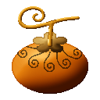{ .mod-icon }

| | |
|---|---|
| **Type** | Mythical Zoan |
| **Box** | { .box-icon } Golden |
| **Chance per opening** | golden **2.26%**, iron **0.113%**, wooden **0.006%** ([how it works](index.md#box-odds)) |
| **Abilities** | 7: 7 active, 0 passive |
| **Transformations** | [Okuchi Heavy Point](#okuchi-heavy-point), [Okuchi Walk Point](#okuchi-walk-point) |

In 3D: drag to turn, scroll or pinch to zoom.

<!-- animations -->
??? example "Animations"

    Taken in game, at size 1.

    

    <figure markdown="span">
      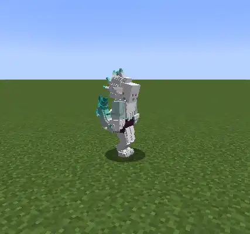{ loading=lazy }
      <figcaption>Hybrid</figcaption>
    </figure>
    <figure markdown="span">
      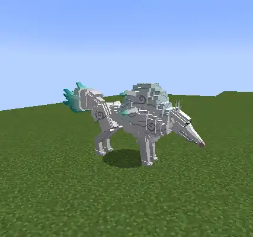{ loading=lazy }
      <figcaption>Wolf god</figcaption>
    </figure>
    <figure markdown="span">
      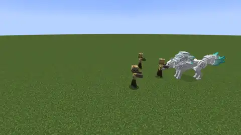{ loading=lazy }
      <figcaption>Namuji Hyoga</figcaption>
    </figure>
    <figure markdown="span">
      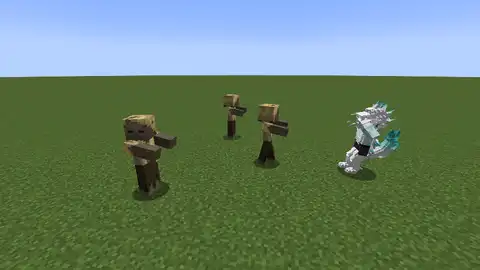{ loading=lazy }
      <figcaption>Himorogiri</figcaption>
    </figure>
    <figure markdown="span">
      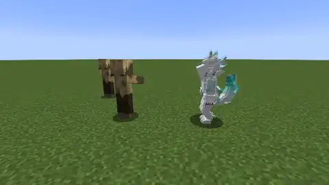{ loading=lazy }
      <figcaption>Kagamiyama</figcaption>
    </figure>
    <figure markdown="span">
      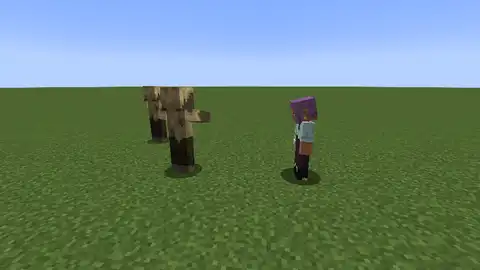{ loading=lazy }
      <figcaption>Frost Weapon</figcaption>
    </figure>
    <figure markdown="span">
      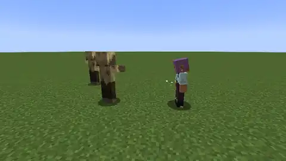{ loading=lazy }
      <figcaption>Mahoroba</figcaption>
    </figure>
    <figure markdown="span">
      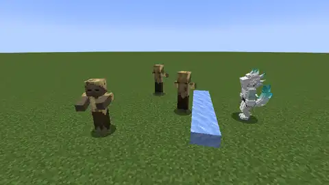{ loading=lazy }
      <figcaption>Ice Wall</figcaption>
    </figure>
    

<!-- /animations -->

Found in the base mod's **golden Devil Fruit box**. Eat it and its abilities appear in the ability menu, grouped under the fruit.

!!! note "About the values"
    The values are those of the ability's tooltip in game, with the base mod's default settings. Damage is shown on the base mod's scale, as in the ability screen.

## Okuchi Heavy Point { #okuchi-heavy-point }

{ .ability-icon } *Active · Transformation*

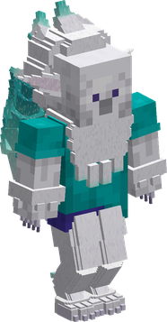{ .form-picture }

Transforms the user into the hybrid of the wolf god, which focuses on strength and its weapons of ice.

## Okuchi Walk Point { #okuchi-walk-point }

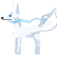{ .ability-icon } *Active · Transformation*

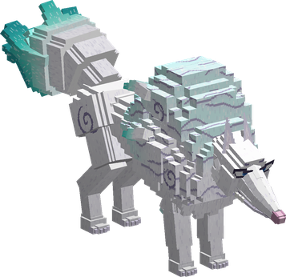{ .form-picture }

Transforms the user into the great white wolf god, which focuses on speed, weight and its breath of ice.

## Namuji Hyoga { #namuji-hyoga }

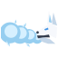{ .ability-icon } *Active*

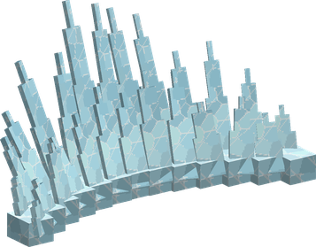{ .form-picture }

The user rears back and breathes out a blast of cold air that throws a wave of ice straight ahead, freezing the first enemy it hits

Only in the hybrid or the wolf form, stronger from the wolf

| Stat | Value |
|---|---|
| Damage type | Indirect |
| Element | Ice |
| Haki | Special |
| Cooldown | 30 s |
| Charge | 1 s |
| Damage | 24–30 |
| Range | 20 blocks (line) |
| Frozen | 3 s |

## Kagamiyama { #kagamiyama }

{ .ability-icon } *Active*

The user coats themselves in ice that takes the blows for them. While it holds, their other abilities hit harder and freeze longer

When it breaks, or when the ability is used again, it cracks off like glass, hurting and slowing the enemies around. Only in the hybrid or the wolf form

| Stat | Value |
|---|---|
| Damage type | Indirect |
| Element | Ice |
| Haki | Special |
| Cooldown | 50 s |
| Hold | 20 s |
| Harm Taken by the Ice | 30 |
| Damage | 8 |
| Range | 4 blocks (area) |

## Himorogiri { #himorogiri }

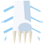{ .ability-icon } *Active*

The user leaps, spins their weapon with a swirl of ice round their claws and strikes down from above, freezing the enemies where they land

Only in the hybrid form, the bare claws strike when no weapon is held

| Stat | Value |
|---|---|
| Damage type | Slash, Physical |
| Element | Ice |
| Haki | Imbuing |
| Cooldown | 12 s |
| Damage | 26 |
| Range | 3 blocks (area) |
| Frozen | 2 s |

## Frost Weapon { #okuchi-frost-weapon }

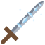{ .ability-icon } *Active*

The user coats what they fight with in ice, press the Alt key to switch between the two, in any form or none

With Frost Weapon the held weapon, or the bare hand, is coated in ice for a while and every blow hits harder and slows

With Mahoroba the weapon wrapped in a frosty aura strikes the enemy in front hard and freezes it

| Stat | Value |
|---|---|
| Damage type | Physical |
| Element | Ice |
| Haki | Imbuing |
| Cooldown | 15–10 s |
| Hold | 45 s |
| Damage per Blow | +5 |
| Charge | 1 s |
| Damage | 22 |
| Frozen | 3 s |

## Ice Wall { #okuchi-ice-wall }

{ .ability-icon } *Active*

A wall of ice rises in front of the user and stops enemies and projectiles for a while. Using the ability again brings the wall down

Only in the hybrid or the wolf form

| Stat | Value |
|---|---|
| Cooldown | 15 s |
| Hold | 12 s |
