# Inu Inu no Mi, Model: Wolf

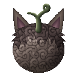{ .mod-icon }

| | |
|---|---|
| **Type** | Zoan |
| **Box** | { .box-icon } Iron |
| **Chance per opening** | iron **1.37%**, wooden **0.069%** ([how it works](index.md#box-odds)) |
| **Abilities** | 13: 12 active, 1 passive |
| **Transformations** | [Wolf Walk Point](#wolf-walk-point), [Wolf Heavy Point](#wolf-heavy-point) |

In 3D: drag to turn, scroll or pinch to zoom.

<!-- animations -->
??? example "Animations"

    Taken in game, at size 1.

    

    <figure markdown="span">
      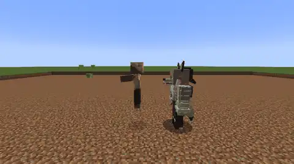{ loading=lazy }
      <figcaption>Hybrid</figcaption>
    </figure>
    <figure markdown="span">
      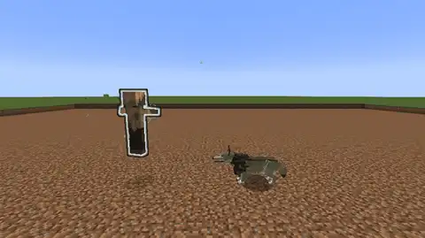{ loading=lazy }
      <figcaption>Wolf</figcaption>
    </figure>
    <figure markdown="span">
      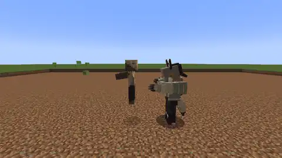{ loading=lazy }
      <figcaption>Jusshigan</figcaption>
    </figure>
    <figure markdown="span">
      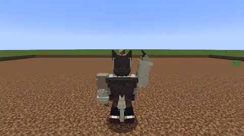{ loading=lazy }
      <figcaption>Gekko Jusshigan</figcaption>
    </figure>
    <figure markdown="span">
      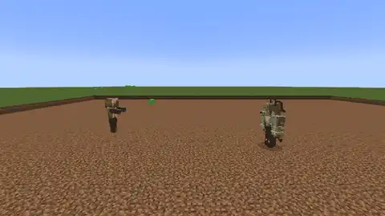{ loading=lazy }
      <figcaption>Rankyaku: Koro</figcaption>
    </figure>
    <figure markdown="span">
      { loading=lazy }
      <figcaption>Lupus Fall</figcaption>
    </figure>
    <figure markdown="span">
      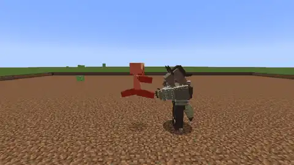{ loading=lazy }
      <figcaption>Tekkai Kenpo: Don Poro</figcaption>
    </figure>
    <figure markdown="span">
      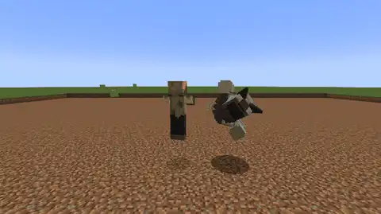{ loading=lazy }
      <figcaption>Matenro</figcaption>
    </figure>
    <figure markdown="span">
      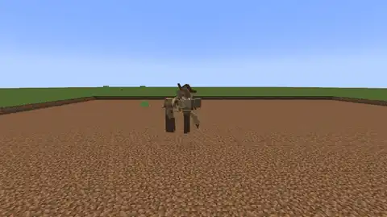{ loading=lazy }
      <figcaption>Rokaru Area Network</figcaption>
    </figure>
    <figure markdown="span">
      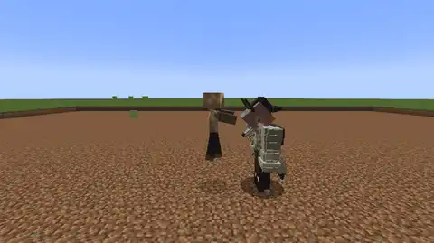{ loading=lazy }
      <figcaption>Roga</figcaption>
    </figure>
    <figure markdown="span">
      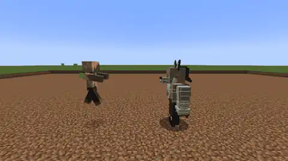{ loading=lazy }
      <figcaption>Toboe</figcaption>
    </figure>
    <figure markdown="span">
      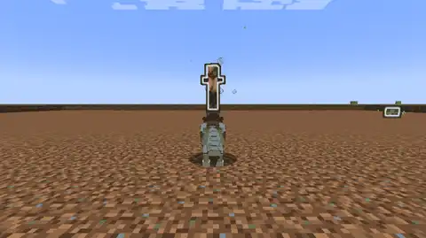{ loading=lazy }
      <figcaption>Kamitsuki</figcaption>
    </figure>
    <figure markdown="span">
      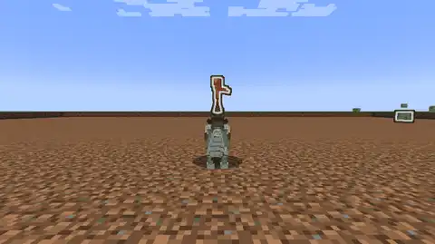{ loading=lazy }
      <figcaption>Shippu</figcaption>
    </figure>
    

<!-- /animations -->

Found in the base mod's **iron Devil Fruit box**. Eat it and its abilities appear in the ability menu, grouped under the fruit.

!!! note "About the values"
    The values are those of the ability's tooltip in game, with the base mod's default settings. Damage is shown on the base mod's scale, as in the ability screen.

## Wolf Walk Point { #wolf-walk-point }

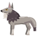{ .ability-icon } *Active · Transformation*

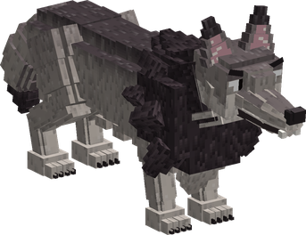{ .form-picture }

Transforms the user into a wolf, which focuses on speed and long jumps.

## Wolf Heavy Point { #wolf-heavy-point }

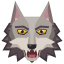{ .ability-icon } *Active · Transformation*

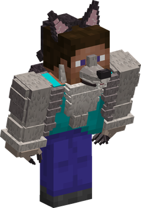{ .form-picture }

Transforms the user into a wolf-man hybrid with claws, which focuses on strength.

## Kamitsuki { #kamitsuki }

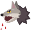{ .ability-icon } *Active*

The user jumps at the target and bites it, making it bleed. The whole wolf bites harder.

| Stat | Value |
|---|---|
| Damage type | Physical |
| Haki | Hardening |
| Cooldown | 6 s |
| Damage | 9 |
| Damage in the Wolf Form | 12 |

## Shippu { #shippu }

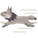{ .ability-icon } *Active*

While in the wolf form, the user runs at full speed knocking down all enemies in their path.

| Stat | Value |
|---|---|
| Damage type | Blunt, Physical |
| Haki | Hardening |
| Cooldown | 8 s |
| Damage | 9 |

## Toboe { #toboe }

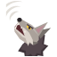{ .ability-icon } *Active*

The user howls, weakening and slowing all nearby enemies. During the night the user also hits harder and runs faster for a while.

| Stat | Value |
|---|---|
| Cooldown | 20 s |
| Range | 12 blocks (area) |
| Attack Damage at Night | +3 |
| Speed at Night | +20 % |
| Hunt at Night | 30 s |

## Kyukaku { #kyukaku }

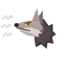{ .ability-icon } *Active*

The user smells all nearby creatures, making them glow for 10 seconds even through walls.

| Stat | Value |
|---|---|
| Cooldown | 20 s |
| Range | 32 blocks (area) |

## Yako { #yako }

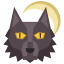{ .ability-icon } *Passive*

While in a wolf form, the user can see in the dark. During the night they are also faster and stronger, and they regenerate health.

| Stat | Value |
|---|---|
| Speed at Night | +20 % |
| Attack Damage at Night | +3 |
| Healing at Night | +0.4 /s |

## Jusshigan { #jusshigan }

{ .ability-icon } *Active*

While in the hybrid form, the user joins both hands and stabs the enemy in front of them with all 10 clawed fingers at once.

| Stat | Value |
|---|---|
| Damage type | Physical |
| Haki | Hardening |
| Cooldown | 8 s |
| Damage | 9 |

## Gekko Jusshigan { #gekko-jusshigan }

{ .ability-icon } *Active*

While in the hybrid form, the user springs up off the air and plunges onto the target, stabbing it with all 10 claws. Deals more damage during the night.

| Stat | Value |
|---|---|
| Damage type | Physical |
| Haki | Hardening |
| Cooldown | 15 s |
| Damage | 18 |
| Damage at Night | x1.3 |

## Rankyaku: Koro { #rankyaku-koro }

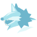{ .ability-icon } *Active*

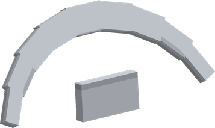{ .form-picture }

While in the hybrid form, the user kicks a blade of air that skips across the ground towards the target. In the alternate mode, Lupus Fall, they kick four wolves of air that burst on what they hit.

| Stat | Value |
|---|---|
| Damage type | Slash, Projectile |
| Element | Wind |
| Haki | Imbuing |
| Cooldown | 7 s |
| Damage | 12 |
| Lupus Fall Damage | 20 |
| Lupus Fall Cooldown | 12 s |

## Tekkai Kenpo: Roga no Kamae { #tekkai-kenpo-roga-no-kamae }

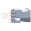{ .ability-icon } *Active*

While in the hybrid form, the user hardens their body like iron, taking less damage and no knockback but moving slower. Their punches become Okami Hajiki, which sends the target flying.

| Stat | Value |
|---|---|
| Hold | 15 s |
| Damage Taken | -40 % |
| Movement Speed | -35 % |
| Okami Hajiki Damage | +3 |

## Tekkai Kenpo: Don Poro { #tekkai-kenpo }

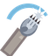{ .ability-icon } *Active*

While in the hybrid form, the user punches the enemy in front of them in the stomach with an iron fist, leaving them winded. In the alternate mode, Matenro, they drop onto their hands and kick the enemy up into the air.

| Stat | Value |
|---|---|
| Damage type | Physical |
| Haki | Hardening |
| Cooldown | 8 s |
| Damage | 10 |
| Target Winded | 2 s |
| Matenro Damage | 8 |
| Matenro Cooldown | 10 s |
| Matenro Cast | 0.6 s |

## Rokaru Area Network { #rokaru-area-network }

{ .ability-icon } *Active*

While in the hybrid form, the user rushes at the enemy in sight with Soru and slashes them with both hands so fast they seem to have many.

| Stat | Value |
|---|---|
| Damage type | Physical |
| Haki | Hardening |
| Cooldown | 10 s |
| Damage | 12 |
| Slashes | 8 |
