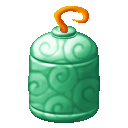
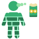
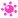

# Iro Iro no Mi

{ .mod-icon }

| | |
|---|---|
| **Type** | Paramecia |
| **Theme** | Paint |
| **Box** | { .box-icon } Wooden |
| **Chance per opening** | wooden **1.53%** ([how it works](index.md#box-odds)) |
| **Abilities** | 4: 4 active, 0 passive |

Found in the base mod's **wooden Devil Fruit box**. Eat it and its abilities appear in the ability menu, grouped under the fruit.

!!! note "About the values"
    The values are those of the ability's tooltip in game, with the base mod's default settings. Damage is shown on the base mod's scale, as in the ability screen.

## Camouflapaint { #camouflapaint }

{ .ability-icon } *Active*

The user sprays themselves and their allies around with paint the colours of what is behind them, so nobody sees them for a while. Their crew, the creatures that serve them and their own beasts are painted, an ally player only if they sneak. Hitting or being hit washes the paint off. Observation Haki sees through it. Use it again to wash all the paint off, the cooldown is only for the time spent

| Stat | Value |
|---|---|
| Hold | 20 s |
| Cooldown | 40 s |
| Range | 6 blocks (area) |

## Copy Paint { #copy-paint }

{ .ability-icon } *Active*

The user paints themselves to look like a person they have seen, for 60 seconds. The paint is crude so up close nobody is fooled, and Observation Haki sees through it. It falls when they hit or are hit

Whoever the user looks at is remembered. The ability mode key opens the memory, where the look is chosen

| Stat | Value |
|---|---|
| Cooldown | 45 s |
| Hold | 60 s |
| Seen Through Within | 5  blocks |

## Migawari Nuri { #migawari-nuri }

{ .ability-icon } *Active*

The user paints a crude double of themselves that stands still. Monsters around go for it instead of the user until it is struck down or its time is over. Observation Haki sees through it

| Stat | Value |
|---|---|
| Cooldown | 30 s |
| Range | 12 blocks (area) |
| Double Lasts | 20 s |
| Double Health | 20 |

## Hade Iro { #hade-iro }

{ .ability-icon } *Active*

Applies { .effect-mini }[Hade Iro](../effects.md#effect-hade-iro), { .effect-mini }[Uragiri Iro](../effects.md#effect-uragiri-iro)

The user sprays a bright colour on the one they look at. For a while it glows through walls for the user and their allies, and it cannot hide or turn unseen

{ .effect-mini }With the **Alt key** it is **Uragiri Iro**: the user paints the creature they look at in the colours of another side. The creatures around attack it for a while. Not on players nor bosses

| Stat | Hade Iro | Uragiri Iro |
|---|---|---|
| Cooldown | 15 s | 30 s |
| Range | 16 blocks (line) | 16 blocks (line), 10 blocks round it |
| Seen Through Walls For | 30 s |  |
| Attacked For |  | 10 s |
