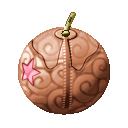
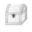
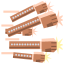

# Jake Jake no Mi

{ .mod-icon }

| | |
|---|---|
| **Type** | Paramecia |
| **Theme** | Jacket |
| **Box** | { .box-icon } Iron |
| **Chance per opening** | iron **1.33%**, wooden **0.067%** ([how it works](index.md#box-odds)) |
| **Abilities** | 3: 3 active, 0 passive |
| **Effects applied** | { .effect-mini }[Possessed](../effects.md#effect-jake-possessed) |

Found in the base mod's **iron Devil Fruit box**. Eat it and its abilities appear in the ability menu, grouped under the fruit.

!!! note "About the values"
    The values are those of the ability's tooltip in game, with the base mod's default settings. Damage is shown on the base mod's scale, as in the ability screen.

## Possession { #jake-possession }

{ .ability-icon } *Active*

Applies { .effect-mini }[Possessed](../effects.md#effect-jake-possessed)

The user turns into a jacket and jumps on a creature, that has to wear them and fights for them for a while. Each hit it takes makes it shorter. The user sees through it and takes a quarter of what it takes. Players cant be possessed, a boss only struggles a moment before throwing the user off. Use it again to get off

| Stat | Value |
|---|---|
| Cooldown | 40 s |
| Range | 8 blocks (area) |
| Possessed For | 15 s |
| Less per Hit Taken | 1 s |
| Boss Struggles For | 5 s |
| Wearer Damage Taken | 25 % |

## Jake Jake Ninin-baori { #jake-ninin-baori }

{ .ability-icon } *Active*

The user becomes the jacket of an ally, a crewmate who crouches to agree or one of their own creatures. The ally keeps moving as they want and gets the user strength and reflexes, more with more Doriki. Use it again to get off, a crewmate takes it off by crouching again

| Stat | Value |
|---|---|
| Cooldown | 60 s |
| Range | 4 blocks (area) |
| Worn For | 30 s |
| Ally Melee Damage | 15 % |
| Ally Attack Speed | 10 % |
| Ally Speed | 5 % |
| Ally Knockback Taken | -20 % |

## Rarara Ranbo { #jake-rarara-ranbo }

{ .ability-icon } *Active*

While the user is a jacket, they throw a storm of punches with the arms of the one wearing them. Only while worn

| Stat | Value |
|---|---|
| Damage type | Physical |
| Haki | Hardening |
| Cooldown | 5 s |
| Damage | 2 |
| Rarara Ranbo Punches | 6 |
| ability.inomissing.stat.name.jake_ranbo_total | 12 |
