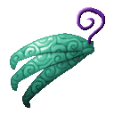
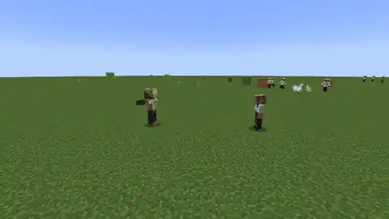
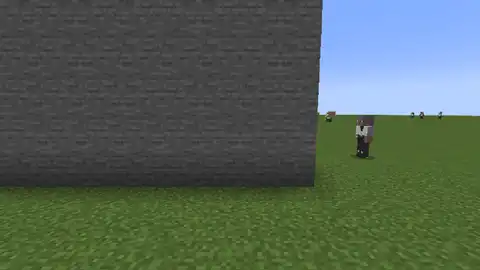
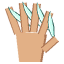
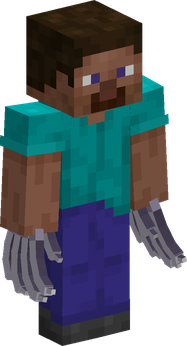
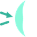

# Kama Kama no Mi

{ .mod-icon }

| | |
|---|---|
| **Type** | Paramecia |
| **Theme** | Sickle |
| **Box** | { .box-icon } Wooden |
| **Chance per opening** | wooden **1.65%** ([how it works](index.md#box-odds)) |
| **Abilities** | 8: 8 active, 0 passive |
| **Transformations** | [Kama Tsume](#kama-tsume) |

In 3D: drag to turn, scroll or pinch to zoom.

<!-- animations -->
??? example "Animations"

    Taken in game, at size 1.

    

    <figure markdown="span">
      { loading=lazy }
      <figcaption>Midareuchi</figcaption>
    </figure>
    <figure markdown="span">
      { loading=lazy }
      <figcaption>Kamaitachi through rock</figcaption>
    </figure>
    

<!-- /animations -->

Found in the base mod's **wooden Devil Fruit box**. Eat it and its abilities appear in the ability menu, grouped under the fruit.

!!! note "About the values"
    The values are those of the ability's tooltip in game, with the base mod's default settings. Damage is shown on the base mod's scale, as in the ability screen.

## Kama Tsume { #kama-tsume }

{ .ability-icon } *Active · Transformation*

{ .form-picture }

The user extends their nails into long sickles, increasing the damage of their punches while active. A bare hand with the nails out counts as a sword. A Black Leg user grows them on the feet instead.

| Stat | Value |
|---|---|
| Damage type | Slash, Fist, Physical |
| Element | Wind |

**Stats while active**

| Stat | Value |
|---|---|
| Punch Damage | +3 |

## Kama Kama no Kamaitachi { #kama-kama-no-kamaitachi }

{ .ability-icon } *Active*

The user swipes their nails launching a small and fast air blade that cuts through a few blocks, rock too

| Stat | Value |
|---|---|
| Damage type | Slash, Projectile |
| Element | Wind |
| Haki | Imbuing |
| Cooldown | 3 s |
| Projectile damage | 6 |

## Kama Kama no Tsumujikaze { #kama-kama-no-tsumujikaze }

{ .ability-icon } *Active*

Launches a big air blade that cuts through a few blocks, rock too, stays on the first enemy it hits and cuts it 3 times.

If used while crouching, launches two crossed blades instead which deals more damage

| Stat | Value |
|---|---|
| Damage type | Slash, Projectile |
| Element | Wind |
| Haki | Imbuing |
| Cooldown | 10–15 s |
| Damage | 9–15 |

## Kama Kama no Kamaitachi Midareuchi { #kama-kama-no-kamaitachi-midareuchi }

{ .ability-icon } *Active*

The user slashes the air multiple times launching a lot of air blades, after which a whirlwind is created where the user was looking.

| Stat | Value |
|---|---|
| Damage type | Slash, Projectile |
| Element | Wind |
| Haki | Imbuing |
| Cooldown | 30 s |
| Range | 3 blocks (area) |
| Damage | 3 |

## Kama Kama no Renzan { #kama-kama-no-renzan }

{ .ability-icon } *Active*

While the nails are out, the user slashes the enemies in front of them many times, very fast. The last slash pushes them back.

| Stat | Value |
|---|---|
| Damage type | Slash, Physical |
| Haki | Hardening |
| Cooldown | 10 s |
| Damage | 16 |
| Range | 3 blocks (line) |

## Kama Kama no Tsuji Giri { #kama-kama-no-tsuji-giri }

{ .ability-icon } *Active*

While the nails are out, the user dashes forward in a straight line cutting all enemies in their path

| Stat | Value |
|---|---|
| Damage type | Slash, Physical |
| Haki | Hardening |
| Cooldown | 10 s |
| Damage | 10 |
| Range | 14.4 blocks (line) |

## Kama Kama no Kiri Harai { #kama-kama-no-kiri-harai }

{ .ability-icon } *Active*

The user sweeps the air with their nails for a short time, cutting all enemy projectiles that are coming from the front

| Stat | Value |
|---|---|
| Cooldown | 12 s |
| Hold | 2 s |
| Range | 3.5 blocks (area) |

## Kama Kama no Enbu { #kama-kama-no-enbu }

{ .ability-icon } *Active*

The user spins and launches 8 air blades all around them

| Stat | Value |
|---|---|
| Damage type | Slash, Projectile |
| Element | Wind |
| Haki | Imbuing |
| Cooldown | 15 s |
| Damage | 8 |
