# Kote Kote no Mi

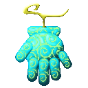{ .mod-icon }

| | |
|---|---|
| **Type** | Paramecia |
| **Theme** | Gauntlet |
| **Box** | { .box-icon } Iron |
| **Chance per opening** | iron **1.37%**, wooden **0.069%** ([how it works](index.md#box-odds)) |
| **Abilities** | 10: 10 active, 0 passive |

In 3D: drag to turn, scroll or pinch to zoom.

<!-- animations -->
??? example "Animations"

    Taken in game, at size 1, third person.

    

    <figure markdown="span">
      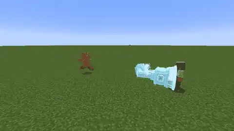{ loading=lazy }
      <figcaption>Gauntlet Punch</figcaption>
    </figure>
    <figure markdown="span">
      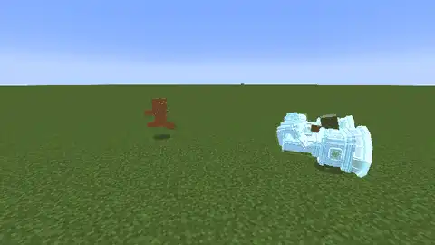{ loading=lazy }
      <figcaption>Gauntlet Rush</figcaption>
    </figure>
    <figure markdown="span">
      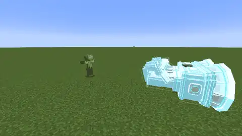{ loading=lazy }
      <figcaption>Gauntlet Hammer</figcaption>
    </figure>
    <figure markdown="span">
      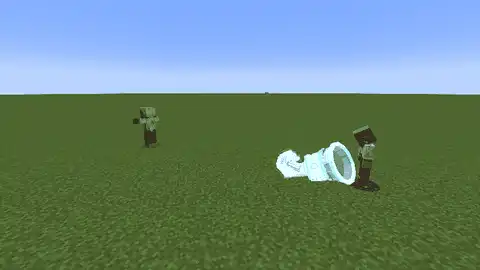{ loading=lazy }
      <figcaption>Gauntlet Grab</figcaption>
    </figure>
    <figure markdown="span">
      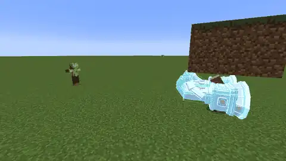{ loading=lazy }
      <figcaption>Gauntlet Boulder</figcaption>
    </figure>
    <figure markdown="span">
      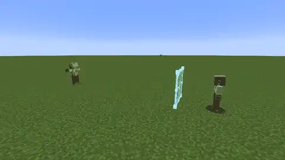{ loading=lazy }
      <figcaption>Lightning Barrier</figcaption>
    </figure>
    <figure markdown="span">
      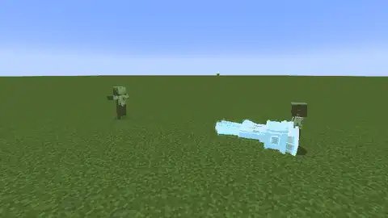{ loading=lazy }
      <figcaption>Lightning Catch</figcaption>
    </figure>
    <figure markdown="span">
      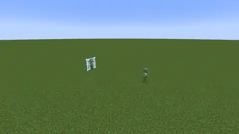{ loading=lazy }
      <figcaption>Tensei Hoshi</figcaption>
    </figure>
    <figure markdown="span">
      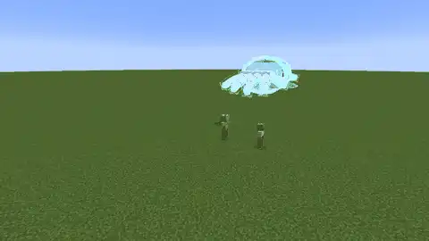{ loading=lazy }
      <figcaption>Grande</figcaption>
    </figure>
    <figure markdown="span">
      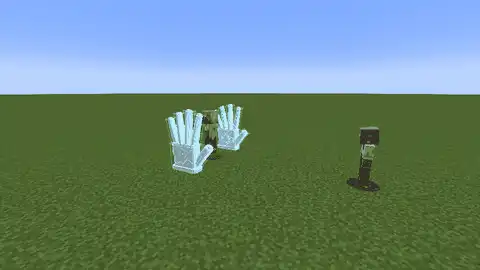{ loading=lazy }
      <figcaption>Gauntlet Vise</figcaption>
    </figure>
    <figure markdown="span">
      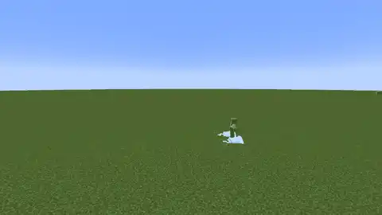{ loading=lazy }
      <figcaption>Gauntlet Lift</figcaption>
    </figure>
    <figure markdown="span">
      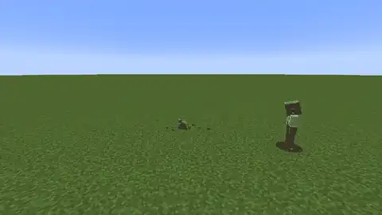{ loading=lazy }
      <figcaption>Solmente</figcaption>
    </figure>
    <figure markdown="span">
      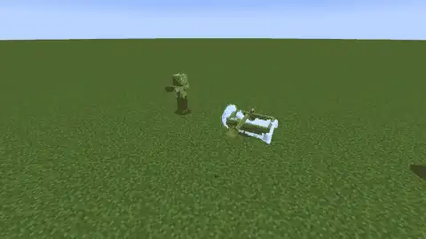{ loading=lazy }
      <figcaption>A Jien Te</figcaption>
    </figure>
    

<!-- /animations -->

Found in the base mod's **iron Devil Fruit box**. Eat it and its abilities appear in the ability menu, grouped under the fruit.

!!! note "About the values"
    The values are those of the ability's tooltip in game, with the base mod's default settings. Damage is shown on the base mod's scale, as in the ability screen.

## Gauntlet Punch { #gauntlet-punch }

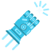{ .ability-icon } *Active*

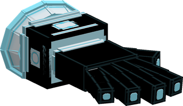{ .form-picture }

The user sends a giant gauntlet that punches where they are looking. It damages and pushes back every enemy around where it lands. Takes one of the user's two gauntlets.

With the **Alt key** it is **Gauntlet Rush**: both gauntlets strike in turn, six blows of 5 in a little more than a second. Each blow goes where the user is looking at that moment. Used again it stops. Takes both of the user's gauntlets.

| Stat | Gauntlet Punch | Gauntlet Rush |
|---|---|---|
| Damage type | Fist, Indirect, Physical | Fist, Indirect, Physical |
| Haki | Hardening | Hardening |
| Cooldown | 5 s | 12 s |
| Damage | 16 | 5 a blow, six blows |
| Range | 16 blocks (line) | 16 blocks (line) |

## Gauntlet Hammer { #gauntlet-hammer }

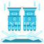{ .ability-icon } *Active*

The user's two gauntlets, clasped, rise over the spot they are looking at and crash down on it. Every enemy around it is hurt and thrown up. Takes both of the user's gauntlets.

| Stat | Value |
|---|---|
| Damage type | Blunt, Indirect |
| Haki | Hardening |
| Cooldown | 14 s |
| Charge | 0.4 s |
| Damage | 30 |
| Range | 3 blocks (area) |

## Gauntlet Grab { #gauntlet-grab }

{ .ability-icon } *Active*

The user sends a gauntlet that rips out the block they are looking at and holds it. Only plain blocks no harder than cobblestone can be taken. Takes one of the user's two gauntlets.

Using it again throws the block where the user is looking. It hurts what it hits and stays where it lands. A block held too long falls by itself.

With the **Alt key** it is **Gauntlet Boulder**: both gauntlets tear out a mass of ground under the block the user is looking at and hold it over their head. Used again it is thrown and bursts on what it hits, hurting every enemy around. The hole closes after a while. Takes both of the user's gauntlets.

| Stat | Gauntlet Grab | Gauntlet Boulder |
|---|---|---|
| Damage type | Blunt, Projectile | Blunt, Projectile |
| Haki | Special | Special |
| Cooldown | 8 s | 16 s |
| Hold | 20 s | 10 s |
| Damage | 16 | 32 |
| Range | 12 blocks (line) | 3 blocks (area), a mass of 3 x 3 x 2 blocks |

## Lightning Barrier { #lightning-barrier }

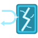{ .ability-icon } *Active*

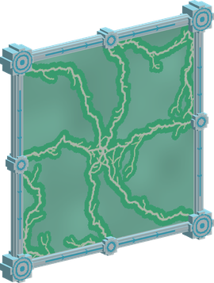{ .form-picture }

The user raises a pane of solid lightning in front of them. It sends back every projectile that reaches it.

With the **Alt key** it is **Lightning Catch**: for 3 seconds a gauntlet waits before the user and catches the first enemy projectile that comes near, then throws it at the one who sent it, half as strong again. Takes one of the user's two gauntlets.

| Stat | Lightning Barrier | Lightning Catch |
|---|---|---|
| Cooldown | 14 s | 10 s |
| Duration | 8 s | 3 s |
| Range | | 3 blocks (area) |
| Thrown back | | x1.5 damage |

## Tensei Hoshi { #tensei-hoshi }

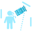{ .ability-icon } *Active*

The user sets panes of lightning around the enemy they are looking at. The user's own projectiles that miss it bounce off the panes and fly back at it.

A Gauntlet Punch or a thrown block that hits it bounces off a pane and strikes it again from behind.

Use the ability again to remove the panes.

| Stat | Value |
|---|---|
| Cooldown | 16 s |
| Hold | 8 s |
| Range | 20 blocks (line) |

## Grande { #grande }

{ .ability-icon } *Active*

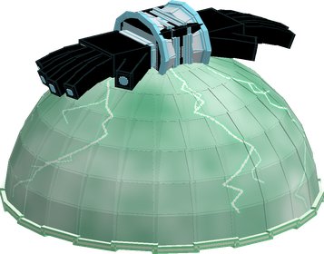{ .form-picture }

Two giant gauntlets raise a dome of lightning over the user. Projectiles from outside are sent back, enemies inside are thrown out, and the user and their allies inside take less damage. Every second a giant gauntlet crashes on the nearest enemy in the dome or near its wall. Takes both of the user's gauntlets.

Use the ability again to lower the dome.

| Stat | Value |
|---|---|
| Element | Lightning |
| Haki | Special |
| Cooldown | 24 s |
| Hold | 8 s |
| Damage | 12 |
| Range | 5 blocks (area) |
| Damage Taken | -20 % |

## Gauntlet Vise { #gauntlet-vise }

{ .ability-icon } *Active*

Two gauntlets close on the enemy the user is looking at and crush it, then hold it in place for a moment. Takes both of the user's gauntlets.

| Stat | Value |
|---|---|
| Damage type | Blunt, Indirect |
| Haki | Special |
| Cooldown | 14 s |
| Duration | 2 s |
| Damage | 24 |
| Range | 12 blocks (line) |

## Gauntlet Lift { #gauntlet-lift }

{ .ability-icon } *Active*

The user's gauntlets throw them high in the air where they are looking. The fall that follows doesn't hurt. Three times in a row, in the air too, all three back once the user lands. Takes both of the user's gauntlets.

| Stat | Value |
|---|---|
| Cooldown | 8 s |
| Stacks | 3 |

## Solmente { #solmente }

{ .ability-icon } *Active*

Two gauntlets close on the small animal the user is looking at and make it the user's ally for a while. It follows them, defends them and obeys the Command ability. Takes both of the user's gauntlets.

| Stat | Value |
|---|---|
| Cooldown | 40 s |
| Duration | 60 s |
| Range | 10 blocks (line) |

## A Jien Te { #a-jien-te }

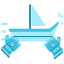{ .ability-icon } *Active*

Two gauntlets seize the boat or minecart the user is looking at and steer it where the user is looking. An enemy it runs into is hurt and thrown. Takes both of the user's gauntlets.

Use the ability again to let go.

| Stat | Value |
|---|---|
| Damage type | Blunt, Indirect |
| Haki | Special |
| Cooldown | 20 s |
| Hold | 10 s |
| Damage | 10 |
| Range | 24 blocks (line) |
