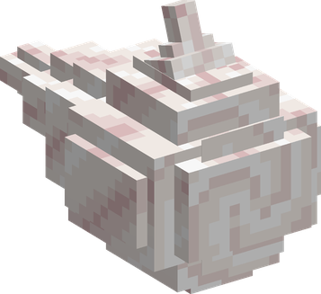
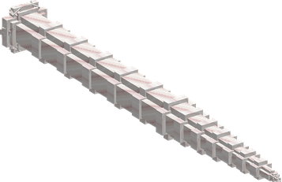
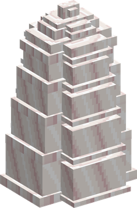

# Kuri Kuri no Mi

{ .mod-icon }

| | |
|---|---|
| **Type** | Paramecia |
| **Theme** | Cream |
| **Box** | { .box-icon } Iron |
| **Chance per opening** | iron **1.59%**, wooden **0.079%** ([how it works](index.md#box-odds)) |
| **Abilities** | 7: 6 active, 1 passive |
| **Effects applied** | { .effect-mini }[Cream Burn](../effects.md#effect-cream-burn), [Spared by the Cream](../effects.md#effect-spared-by-the-cream) |

In 3D: drag to turn, scroll or pinch to zoom.

Found in the base mod's **iron Devil Fruit box**. Eat it and its abilities appear in the ability menu, grouped under the fruit.

!!! note "About the values"
    The values are those of the ability's tooltip in game, with the base mod's default settings. Damage is shown on the base mod's scale, as in the ability screen.

## Cream Ball { #cream-ball }

{ .ability-icon } *Active*

{ .form-picture }

Applies { .effect-mini }[Cream Burn](../effects.md#effect-cream-burn)

The user throws a ball of cream where they look. It hits the first enemy in its way, burns it and slows it for a moment

| Stat | Value |
|---|---|
| Damage type | Blunt, Projectile |
| Haki | Special |
| Cooldown | 5 s |
| Damage | 6 |

## Cream Grab { #cream-grab }

{ .ability-icon } *Active*

{ .form-picture }

Applies { .effect-mini }[Cream Burn](../effects.md#effect-cream-burn)

A tentacle of cream shoots at the enemy the user looks at, burns it and pulls it to the user

| Stat | Value |
|---|---|
| Damage type | Blunt, Indirect |
| Haki | Special |
| Cooldown | 10 s |
| Damage | 5 |
| Range | 10 blocks (line) |

## Cream Wave { #cream-wave }

{ .ability-icon } *Active*

Applies { .effect-mini }[Cream Burn](../effects.md#effect-cream-burn)

The user sends a wave of cream in front of them, which hits all enemies in its path, pushes them back and burns them

| Stat | Value |
|---|---|
| Damage type | Blunt, Indirect |
| Haki | Special |
| Cooldown | 14 s |
| Damage | 10 |
| Range | 10 blocks (line) |

## Cream Flood { #cream-flood }

{ .ability-icon } *Active*

Applies [Spared by the Cream](../effects.md#effect-spared-by-the-cream)

The user spreads cream on the ground around them. Enemies that walk in it are slowed and burnt by the cream

Using it again takes the cream back

| Stat | Value |
|---|---|
| Cooldown | 18 s |
| Hold | 10 s |
| Range | 8 blocks (area) |

## Cream Monster { #cream-monster }

{ .ability-icon } *Active*

{ .form-picture }

Applies { .effect-mini }[Cream Burn](../effects.md#effect-cream-burn)

A puddle of cream spreads around the user and follows them. Tentacles spring out of it at the enemies that come close, burn them and hold them for a moment

The user keeps moving and using other abilities while it lasts

| Stat | Value |
|---|---|
| Damage type | Blunt, Indirect |
| Haki | Special |
| Cooldown | 25 s |
| Hold | 10 s |
| Damage | 6 |
| Range | 6 blocks (area) |

## Cream Shell { #cream-shell }

{ .ability-icon } *Active*

{ .form-picture }

Applies { .effect-mini }[Cream Burn](../effects.md#effect-cream-burn)

The user shuts themselves in a thick shell of cream. Inside it the user takes almost no damage but can't move, can't attack and can't use other abilities of the fruit

Whoever hits the shell with a bare hand is burnt. The shell breaks after stopping enough damage

| Stat | Value |
|---|---|
| Cooldown | 20 s |
| Hold | 8 s |
| Shell Health | 60 |
| Damage Stopped | 90 % |
| Burn on Bare Hands | 5 s |

## Cream Body { #cream-body }

{ .ability-icon } *Passive*

The body of the user is always covered with cream. Whoever hits the user with a bare hand is burnt by the cream. A weapon is not
