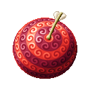
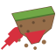

# Mato Mato no Mi

{ .mod-icon }

| | |
|---|---|
| **Type** | Paramecia |
| **Theme** | Target |
| **Box** | { .box-icon } Wooden |
| **Chance per opening** | wooden **1.53%** ([how it works](index.md#box-odds)) |
| **Abilities** | 5: 5 active, 0 passive |
| **Effects applied** | { .effect-mini }[Marked](../effects.md#effect-marked) |

Found in the base mod's **wooden Devil Fruit box**. Eat it and its abilities appear in the ability menu, grouped under the fruit.

!!! note "About the values"
    The values are those of the ability's tooltip in game, with the base mod's default settings. Damage is shown on the base mod's scale, as in the ability screen.

## Mato Tsuke { #mato-tsuke }

{ .ability-icon } *Active*

Applies { .effect-mini }[Marked](../effects.md#effect-marked)

The user touches the one they look at with their hand and marks them. Each hand holds one mark until it touches someone else with this ability, the right hand and the left hand each have their own mark. Everything the fruit throws flies to the mark of the hand in use

The user sees where each mark is, from anywhere in the same world. A mark on a player lasts 10 minutes

| Stat | Value |
|---|---|
| Cooldown | 2 s |
| Range | 3 blocks (line) |

## Mato Nage { #mato-nage }

{ .ability-icon } *Active*

Applies { .effect-mini }[Marked](../effects.md#effect-marked)

For a while, everything the user shoots or throws flies to the mark of the hand in use and follows it. A thrown weapon hits with twice its attack, its enchantments counted. A shot that meets a block, a shield or someone else on its way flies on as a plain one

| Stat | Value |
|---|---|
| Damage type | Physical |
| Haki | Imbuing |
| Cooldown | 25 s |
| Hold | 20 s |
| Range | 64 blocks (line) |
| Thrown Weapon's Attack | 2 x |

## Nikudan { #mato-nikudan }

{ .ability-icon } *Active*

Applies { .effect-mini }[Marked](../effects.md#effect-marked)

The user touches a creature next to them and it flies at the mark of the hand in use. Both get hurt when it lands, harder the farther it flew. A wall on the way stops it. Players and bosses can't be thrown

| Stat | Value |
|---|---|
| Damage type | Blunt, Indirect |
| Haki | Special |
| Cooldown | 15 s |
| ability.inomissing.stat.name.mato_touch_reach | 3 blocks |
| Range | 64 blocks (line) |
| Damage | 6 |

## Tobi Nori { #mato-tobi-nori }

{ .ability-icon } *Active*

Applies { .effect-mini }[Marked](../effects.md#effect-marked)

A block of the ground breaks off under the user or where they look, and they ride it through the air to the mark of the hand in use. They step off near the mark or on a wall, and the block goes back to its place

| Stat | Value |
|---|---|
| Cooldown | 30 s |
| Hold | 8 s |
| Range | 150 blocks (line) |

## Hakobune { #mato-hakobune }

{ .ability-icon } *Active*

Applies { .effect-mini }[Marked](../effects.md#effect-marked)

The user lays both hands on the ground and a large mass of it breaks off in front of them, rises and rushes through walls and ground at the mark of the hand in use, crushing and throwing aside everyone on its way, and bursts on the mark. Without a mark it flies straight ahead and bursts on the first one it meets

The hole closes after a while. A heavy blow to the user makes the mass fall

| Stat | Value |
|---|---|
| Damage type | Blunt, Indirect |
| Haki | Special |
| Cooldown | 90 s |
| Charge | 2 s |
| Range | 64 blocks (line) |
| Damage | 20 |
