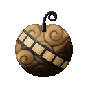
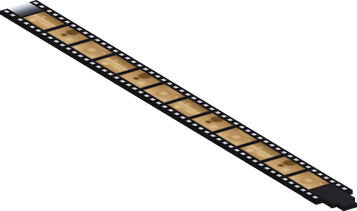

# Memo Memo no Mi

{ .mod-icon }

| | |
|---|---|
| **Type** | Paramecia |
| **Theme** | Memory |
| **Box** | { .box-icon } Wooden |
| **Chance per opening** | wooden **1.88%** ([how it works](index.md#box-odds)) |
| **Abilities** | 4: 4 active, 0 passive |
| **Effects applied** | { .effect-mini }[Flashback](../effects.md#effect-flashback), { .effect-mini }[Forgotten Quarrel](../effects.md#effect-forgotten-quarrel) |

In 3D: drag to turn, scroll or pinch to zoom.

Found in the base mod's **wooden Devil Fruit box**. Eat it and its abilities appear in the ability menu, grouped under the fruit.

!!! note "About the values"
    The values are those of the ability's tooltip in game, with the base mod's default settings. Damage is shown on the base mod's scale, as in the ability screen.

## Memories Fil Flashback { #memo-flashback }

{ .ability-icon } *Active*

Applies { .effect-mini }[Flashback](../effects.md#effect-flashback)

The user sends threads from their palms to the enemies in front. The touched enemies live old memories again and stand still for a moment, they can't move, hit or use abilities

| Stat | Value |
|---|---|
| Cooldown | 14 s |
| Range | 8 blocks (line) |
| Lost in Memories | 3 s |

## Cut { #memo-cut }

{ .ability-icon } *Active*

{ .form-picture }

Applies { .effect-mini }[Forgotten Quarrel](../effects.md#effect-forgotten-quarrel)

The user pulls the memories of the creature they look at as a film and cuts its quarrel out. The creature drops its target and its anger until something hits it. Needs shears in the bag

The cut frames are kept as a reel that remembers who the creature was angry at

| Stat | Value |
|---|---|
| Cooldown | 15 s |
| Range | 5 blocks (line) |
| Quarrel Forgotten | 10 s |

## Paste { #memo-paste }

{ .ability-icon } *Active*

{ .form-picture }

The user pastes a false memory in the film of the creature they look at. The creature takes the user for a friend and fights for them for a while. Bosses can't be fooled. Needs shears in the bag

With a reel in a hand the creature gets the anger kept on it and goes for whoever that anger was for. The reel is used up

| Stat | Value |
|---|---|
| Cooldown | 30 s |
| Range | 5 blocks (line) |
| False Friend | 30 s |

## Forgotten Skill { #memo-forgotten-skill }

{ .ability-icon } *Active*

{ .form-picture }

The user pulls the memories of the enemy they look at as a film and cuts frames out. The enemy forgets 3 to 6 random abilities of their current bar and can't use them for a while. Needs shears in the bag

| Stat | Value |
|---|---|
| Cooldown | 40 s |
| Range | 5 blocks (line) |
| Abilities Forgotten | 15 s |
