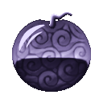
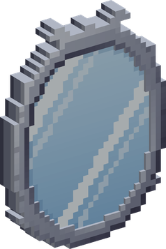
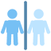

# Mira Mira no Mi

{ .mod-icon }

| | |
|---|---|
| **Type** | Paramecia |
| **Theme** | Mirror |
| **Box** | { .box-icon } Wooden |
| **Chance per opening** | wooden **1.88%** ([how it works](index.md#box-odds)) |
| **Abilities** | 6: 6 active, 0 passive |

In 3D: drag to turn, scroll or pinch to zoom.

Found in the base mod's **wooden Devil Fruit box**. Eat it and its abilities appear in the ability menu, grouped under the fruit.

!!! note "About the values"
    The values are those of the ability's tooltip in game, with the base mod's default settings. Damage is shown on the base mod's scale, as in the ability screen.

## Reflection { #mira-reflection }

{ .ability-icon } *Active*

{ .form-picture }

The user raises a mirror in front of them for a few seconds. Projectiles coming from the front are sent back, and melee hits from the front are stopped. Nothing is stopped from behind

| Stat | Value |
|---|---|
| Cooldown | 12 s |
| Hold | 4 s |

## Mirror { #mira-mirror }

{ .ability-icon } *Active*

The user lays a standing mirror where they look. Using one of their mirrors sends the user to the hall of Mirro-World, and each door of the hall leads back to its mirror

A mirror stays until someone breaks it, and a broken mirror leads nowhere. There is no limit to their number

| Stat | Value |
|---|---|
| Cooldown | 3 s |
| Range | 6 blocks (line) |

## Mirro-World { #mirro-world }

{ .ability-icon } *Active · Punch*

The next punch of the user raises a mirror behind the target and pushes it into Mirro-World. The mirror stays where it rose

A creature stays inside until the user lets it out by sneaking and using that mirror. A player comes out when someone else uses that mirror, when the user is knocked out, dies or leaves, or by dying. Bosses can't be pushed in

## Mirror Image { #mira-image }

{ .ability-icon } *Active*

The user takes the look of whoever they look at. Creatures on the side of the one copied leave the user alone, and creatures that go for the one copied may go for the user instead

The look falls when the user is hit or uses the ability again. It gives no strength and no abilities

| Stat | Value |
|---|---|
| Cooldown | 20 s |
| Hold | 30 s |
| Range | 6 blocks (line) |

## Decoys { #mira-decoys }

{ .ability-icon } *Active*

The animals around the user take the look of whoever the user looks at. Creatures that go for the one copied may go for one of the animals instead

An animal loses the look when it is hit

| Stat | Value |
|---|---|
| Cooldown | 30 s |
| Range | 12 blocks (line) |
| Range | 10 blocks (area) |

## Ask the Mirrors { #mira-ask }

{ .ability-icon } *Active*

The mirrors of the user tell them which players passed in front of them, how long ago and where

| Stat | Value |
|---|---|
| Cooldown | 5 s |
