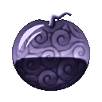
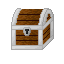
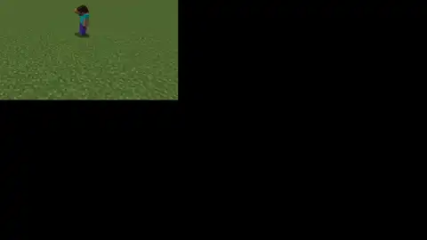
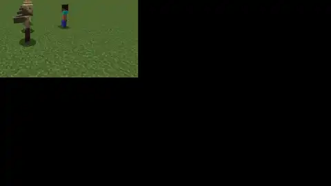
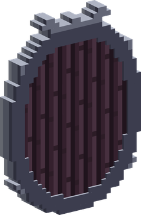
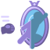
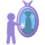
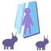

# Mira Mira no Mi

{ .mod-icon }

| | |
|---|---|
| **Type** | Paramecia |
| **Theme** | Mirror |
| **Box** | { .box-icon } Wooden |
| **Chance per opening** | wooden **1.53%** ([how it works](index.md#box-odds)) |
| **Abilities** | 6: 6 active, 0 passive |

In 3D: drag to turn, scroll or pinch to zoom.

<!-- animations -->
??? example "Animations"

    Taken in game, at size 1, third person.

    

    <figure markdown="span">
      { loading=lazy }
      <figcaption>Reflection</figcaption>
    </figure>
    <figure markdown="span">
      { loading=lazy }
      <figcaption>Mirror: a standing mirror laid</figcaption>
    </figure>
    <figure markdown="span">
      { loading=lazy }
      <figcaption>Decoys</figcaption>
    </figure>
    

<!-- /animations -->

Found in the base mod's **wooden Devil Fruit box**. Eat it and its abilities appear in the ability menu, grouped under the fruit.

!!! note "About the values"
    The values are those of the ability's tooltip in game, with the base mod's default settings. Damage is shown on the base mod's scale, as in the ability screen.

## Reflection { #mira-reflection }

{ .ability-icon } *Active*

{ .form-picture }

The user raises a mirror in front of them for a few seconds. Projectiles coming from the front are sent back, and melee hits from the front are stopped. Nothing is stopped from behind.

| Stat | Value |
|---|---|
| Cooldown | 12 s |
| Hold | 4 s |

## Mirror { #mira-mirror }

{ .ability-icon } *Active*

The user lays a standing mirror where they look. Using a mirror sends the user into Mirro-World, and each mirror inside leads back to its twin outside. A mirror laid inside Mirro-World makes its twin in the world.

Others can only follow the user through a mirror for a few seconds, but anyone can walk out of Mirro-World. A mirror stays until someone breaks it, and a broken mirror leads nowhere.

| Stat | Value |
|---|---|
| Cooldown | 3 s |
| Range | 6 blocks (line) |

## Mirro-World { #mirro-world }

{ .ability-icon } *Active · Punch*

The next punch of the user raises a mirror behind the target and pushes it into Mirro-World. The mirror stays where it rose.

A creature stays inside until the user lets it out by sneaking and using that mirror. For a player every mirror inside stays shut for a minute. They come out sooner if the user is knocked out, dies or leaves, or if they follow the user through a mirror. Bosses can't be pushed in.

Used inside Mirro-World next to a mirror, the user's hand comes out of its twin and pulls in the first enemy standing in front of it.

## Mirror Image { #mira-image }

{ .ability-icon } *Active*

The user takes the look of whoever they look at. Creatures on the side of the one copied leave the user alone, and creatures that go for the one copied may go for the user instead.

The look falls when the user is hit or uses the ability again. It gives no strength and no abilities.

With the ability mode key the user gives the look of the last one they copied to whoever they look at instead. A player has to crouch to take it.

| Stat | Value |
|---|---|
| Cooldown | 20 s |
| Hold | 30 s |
| Range | 6 blocks (line) |

## Decoys { #mira-decoys }

{ .ability-icon } *Active*

The animals around the user take the look of whoever the user looks at. Creatures that go for the one copied may go for one of the animals instead.

An animal loses the look when it is hit.

| Stat | Value |
|---|---|
| Cooldown | 30 s |
| Range | 12 blocks (line) |
| Range | 10 blocks (area) |

## Ask the Mirrors { #mira-ask }

{ .ability-icon } *Active*

Every mirror of the world tells the user which players passed in front of it, how long ago and where.

| Stat | Value |
|---|---|
| Cooldown | 5 s |
