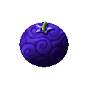
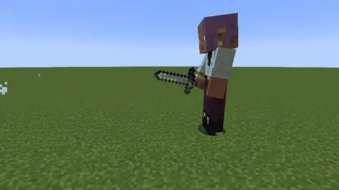
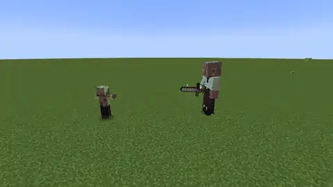
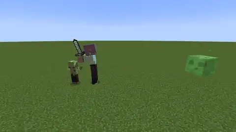
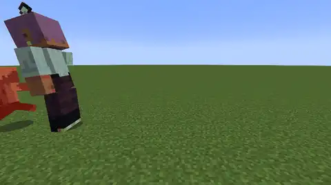
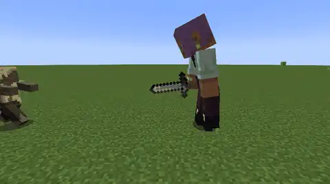
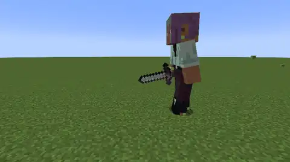
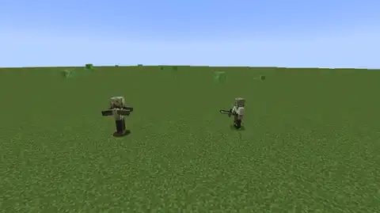
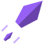
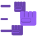

# Moa Moa no Mi

{ .mod-icon }

| | |
|---|---|
| **Type** | Paramecia |
| **Theme** | More |
| **Box** | { .box-icon } Iron |
| **Chance per opening** | iron **1.37%**, wooden **0.069%** ([how it works](index.md#box-odds)) |
| **Abilities** | 7: 7 active, 0 passive |

<!-- animations -->
??? example "Animations"

    Taken in game, at size 1.

    

    <figure markdown="span">
      { loading=lazy }
      <figcaption>Hyakubai Gan</figcaption>
    </figure>
    <figure markdown="span">
      { loading=lazy }
      <figcaption>Gojubai Ho</figcaption>
    </figure>
    <figure markdown="span">
      { loading=lazy }
      <figcaption>Gekitsui</figcaption>
    </figure>
    <figure markdown="span">
      { loading=lazy }
      <figcaption>Renda</figcaption>
    </figure>
    <figure markdown="span">
      { loading=lazy }
      <figcaption>Sandan</figcaption>
    </figure>
    <figure markdown="span">
      { loading=lazy }
      <figcaption>Soku</figcaption>
    </figure>
    <figure markdown="span">
      { loading=lazy }
      <figcaption>Giri</figcaption>
    </figure>
    

<!-- /animations -->

Found in the base mod's **iron Devil Fruit box**. Eat it and its abilities appear in the ability menu, grouped under the fruit.

!!! note "About the values"
    The values are those of the ability's tooltip in game, with the base mod's default settings. Damage is shown on the base mod's scale, as in the ability screen.

## Jubai Sandan { #jubai-sandan }

{ .ability-icon } *Active*

The user blows on specks of dust and enlarges them ten times, firing 8 pebbles in a cone where they are looking.

| Stat | Value |
|---|---|
| Damage type | Projectile |
| Haki | Imbuing |
| Cooldown | 8 s |
| Charge | 1 s |
| Range | 18.7 blocks (cone) |
| Damage | 32 |
| Damage per Pebble | 4 |

## Gojubai Ho { #gojubai-ho }

{ .ability-icon } *Active*

The user throws a handful of small things and enlarges them fifty times, firing 5 cannonballs that burst where they land.

| Stat | Value |
|---|---|
| Damage type | Projectile |
| Haki | Imbuing |
| Cooldown | 14 s |
| Charge | 0 s |
| Range | 60 blocks (line) |
| Damage | 40 |
| Damage per Cannonball | 8 |
| Burst Damage | 5 |

## Hyakubai Gan { #hyakubai-gan }

{ .ability-icon } *Active*

The next projectile fired by the user is enlarged a hundred times in flight and bursts where it lands.

Fired from a cannon, a cannonball becomes Hyakubai Ho, which hits harder and bursts wider.

| Stat | Value |
|---|---|
| Damage type | Projectile |
| Haki | Imbuing |
| Cooldown | 20 s |
| Charge | 0 s |
| Hold | 10 s |
| Range | 3 blocks (area) |
| Damage | 26 |
| Burst Damage | 10 |
| Hyakubai Ho Damage | 39 |
| Hyakubai Ho Burst Damage | 15 |

## Hyakubai Giri { #hyakubai-giri }

{ .ability-icon } *Active*

The user throws the weapon they are holding and enlarges it a hundred times, cutting every enemy on its way.

| Stat | Value |
|---|---|
| Damage type | Slash, Projectile |
| Haki | Imbuing |
| Cooldown | 16 s |
| Charge | 0 s |
| Range | 25.2 blocks (line) |
| Damage | 22 |

## Jubai Soku { #moa-soku }

{ .ability-icon } *Active*

The user multiplies their own speed by ten, thirty or a hundred. The faster they go, the shorter it lasts. The speed is chosen beforehand with the alternate mode.

Jubai Soku

Sanjubai Soku

Hyakubai Soku

| Stat | Value |
|---|---|
| Cooldown | 20 s |
| Charge | 0 s |
| Movement Speed | +80 % |
| Attack Speed | +20 % |
| Duration | 30 s |
| Movement Speed | +160 % |
| Attack Speed | +40 % |
| Duration | 15 s |
| Movement Speed | +300 % |
| Attack Speed | +80 % |
| Duration | 5 s |

## Hyakubai Soku: Renda { #hyakubai-soku-renda }

{ .ability-icon } *Active*

The user rushes at a hundred times their speed to the enemy they are looking at and hits everyone in front of them with a barrage of 12 punches.

| Stat | Value |
|---|---|
| Damage type | Fist, Physical |
| Haki | Hardening |
| Cooldown | 18 s |
| Range | 12 blocks (line) |
| Damage | 30 |
| Damage per Punch | 2.5 |

## Gojubai Soku: Gekitsui { #gojubai-soku-gekitsui }

{ .ability-icon } *Active*

The user rushes to the enemy they are looking at, grabs them and at fifty times their speed swings them around before slamming them into the ground.

A target at least twice as big as the user is swung over their head, hits the ground harder and the impact reaches further.

| Stat | Value |
|---|---|
| Damage type | Fist, Physical |
| Haki | Hardening |
| Cooldown | 20 s |
| Range | 10 blocks (line) |
| Damage | 26 |
| Burst Damage | 10 |
| Damage on a Big Target | 39 |
