# Mochi Mochi no Mi

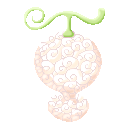{ .mod-icon }

| | |
|---|---|
| **Type** | Paramecia |
| **Theme** | Mochi |
| **Box** | 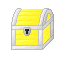{ .box-icon } Golden |
| **Chance per opening** | golden **2.97%**, iron **0.148%**, wooden **0.007%** ([how it works](index.md#box-odds)) |
| **Abilities** | 23: 22 active, 1 passive |
| **Effects applied** | { .effect-mini }[Stuck in Mochi](../effects.md#effect-stuck-in-mochi) |

In 3D: drag to turn, scroll or pinch to zoom.

Found in the base mod's **golden Devil Fruit box**. Eat it and its abilities appear in the ability menu, grouped under the fruit.

!!! note "About the values"
    The values are those of the ability's tooltip in game, with the base mod's default settings. Damage is shown on the base mod's scale, as in the ability screen.

## Stretching Arm { #mochi-stretching-arm }

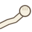{ .ability-icon } *Active*

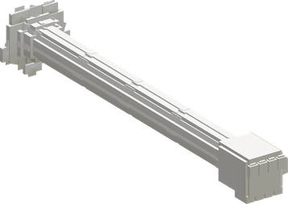{ .form-picture }

Applies { .effect-mini }[Stuck in Mochi](../effects.md#effect-stuck-in-mochi)

The user's arm of soft mochi stretches and punches the enemy they look at from far away. The mochi sticks to the enemy and holds it a moment

| Stat | Value |
|---|---|
| Damage type | Fist, Indirect, Physical |
| Haki | Hardening |
| Cooldown | 6 s |
| Damage | 7 |
| Range | 12 blocks (line) |
| Stuck | 1.5 s |

## Mochi Lump { #mochi-lump }

{ .ability-icon } *Active*

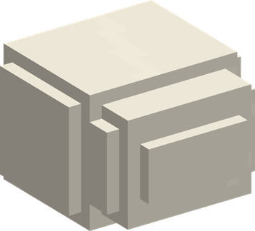{ .form-picture }

Applies { .effect-mini }[Stuck in Mochi](../effects.md#effect-stuck-in-mochi)

The user throws a lump of soft mochi where they look. The first enemy it hits is stuck in it. Water and rain free whoever is stuck, and a stuck player holds the use key to eat their way out

| Stat | Value |
|---|---|
| Damage type | Blunt, Projectile |
| Haki | Special |
| Cooldown | 7 s |
| Damage | 4 |
| Stuck | 2.5 s |

## Flowing Body { #mochi-flowing-body }

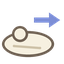{ .ability-icon } *Active*

The body of the user opens like soft mochi while they slip a few blocks where they are looking. Nothing can hit them while it is open

| Stat | Value |
|---|---|
| Cooldown | 8 s |
| Untouchable | 0.4 s |

## Extra Arms { #mochi-extra-arms }

{ .ability-icon } *Active*

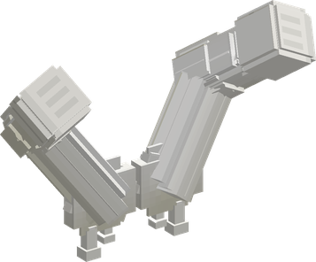{ .form-picture }

The user grows extra arms of soft mochi. For a while each of their own hits in close combat is followed by more punches from the extra arms

| Stat | Value |
|---|---|
| Damage type | Fist, Physical |
| Haki | Hardening |
| Cooldown | 20 s |
| Hold | 12 s |
| Extra Blows per Hit | 2 |
| Damage per Extra Blow | 3 |

## Kaku Mochi { #mochi-kaku }

{ .ability-icon } *Active*

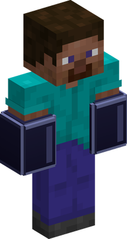{ .form-picture }

The user presses their forearms into square blocks of hardened mochi. Their punches hit far harder for a while. Needs Armament Haki hardening unlocked

| Stat | Value |
|---|---|
| Cooldown | 20 s |
| Hold | 15 s |
| Fist Damage | +8 |

## Naguri Mochi { #mochi-naguri }

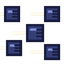{ .ability-icon } *Active*

{ .form-picture }

The user throws a barrage of square fists of hardened mochi where they are looking. Needs Armament Haki hardening unlocked

| Stat | Value |
|---|---|
| Damage type | Fist, Projectile, Physical |
| Haki | Hardening |
| Damage | 40 |

## Yaki Mochi { #mochi-yaki }

{ .ability-icon } *Active*

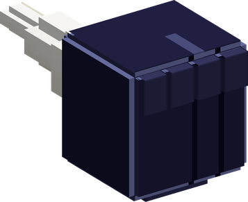{ .form-picture }

The user's forearm swells and shoots its fist far away, so fast that it catches fire. It hits every enemy in its way and sets them on fire. Needs Armament Haki hardening unlocked

| Stat | Value |
|---|---|
| Damage type | Fist, Projectile, Physical |
| Haki | Hardening |
| Cooldown | 11 s |
| Damage | 18 |

## Yanagi Mochi { #mochi-yanagi }

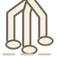{ .ability-icon } *Active*

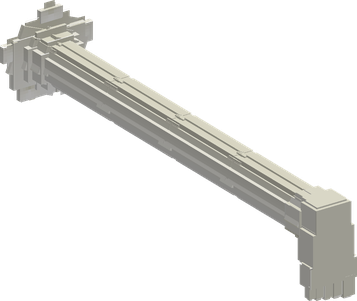{ .form-picture }

The user's raised leg grows many long legs of mochi that stamp the ground in front again and again. Every enemy under them is hit at each stamp

| Stat | Value |
|---|---|
| Damage type | Blunt, Indirect |
| Haki | Hardening |
| Cooldown | 15 s |
| Damage | 30 |
| Range | 2.5 blocks (area) |

## Tori Mochi { #mochi-tori }

{ .ability-icon } *Active*

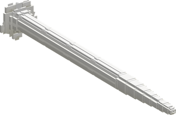{ .form-picture }

A whip of mochi winds around the enemy the user looks at and throws it where the user is looking

| Stat | Value |
|---|---|
| Damage type | Blunt, Indirect |
| Haki | Special |
| Cooldown | 10 s |
| Damage | 8 |
| Range | 14 blocks (line) |

## Mochi Tsuki { #mochi-tsuki }

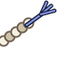{ .ability-icon } *Active*

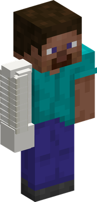{ .form-picture }

The user twists their arm of mochi tight and lets it go while it thrusts the weapon they hold. The drilling stab hits every enemy in a line and the weapon adds its damage. Needs a weapon in hand

| Stat | Value |
|---|---|
| Damage type | Physical |
| Haki | Imbuing |
| Cooldown | 10 s |
| Damage | 12 |
| Range | 7 blocks (line) |
| Most Damage from the Weapon | +12 |

## Mochi Hadan { #mochi-hadan }

{ .ability-icon } *Active*

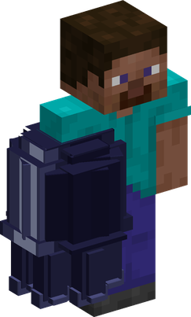{ .form-picture }

The user shoots a hardened fingertip as a bullet and their forearm becomes a Gatling gun of mochi. While it is out, holding right click with an empty hand fires a stream of bullets. Needs Armament Haki hardening unlocked

Use the ability again to put the Gatling gun away

| Stat | Value |
|---|---|
| Damage type | Blunt, Projectile |
| Haki | Hardening |
| Cooldown | 15 s |
| Hold | 12 s |
| Damage | 6 |
| Bullets | 20 |
| Damage per Bullet | 2 |

## Zan Giri Mochi { #mochi-zan-giri }

{ .ability-icon } *Active*

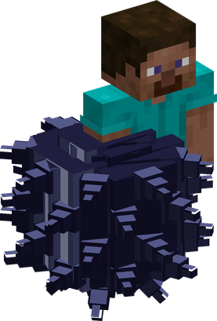{ .form-picture }

The user turns into a ring of mochi and rolls forward. The first enemy it meets is slammed by a huge spiked arm, stays stuck to it, is swung up in the air and smashed into the ground. Needs Armament Haki hardening unlocked

| Stat | Value |
|---|---|
| Damage type | Physical |
| Haki | Hardening |
| Cooldown | 20 s |
| Damage | 6 |
| Smash Damage | 22 |

## Mochi Wall { #mochi-wall }

{ .ability-icon } *Active*

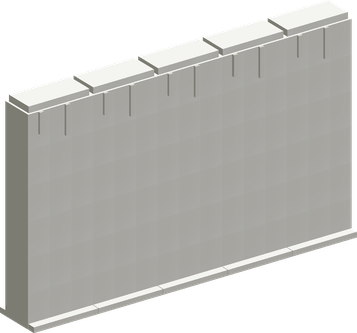{ .form-picture }

Applies { .effect-mini }[Stuck in Mochi](../effects.md#effect-stuck-in-mochi)

The user raises a wall of soft mochi in front of them. It stops bodies and hits, and an enemy who touches it gets stuck. Water and rain free whoever is stuck, and a stuck player holds the use key to eat their way out. Using the ability again brings the wall down

| Stat | Value |
|---|---|
| Cooldown | 20 s |
| Hold | 10 s |
| Stuck on Touch | 3 s |

## Nagare Mochi { #mochi-nagare }

{ .ability-icon } *Active*

Applies { .effect-mini }[Stuck in Mochi](../effects.md#effect-stuck-in-mochi)

Awakened. The ground around the enemy the user looks at turns to mochi and seizes it, even far away. The enemy and those next to it are stuck, and the mochi on the ground slows whoever walks in it

| Stat | Value |
|---|---|
| Damage type | Blunt, Indirect |
| Haki | Special |
| Cooldown | 20 s |
| Damage | 25 |
| Range | 28 blocks (line) |
| Stuck | 5 s |

## Kagami Mochi { #mochi-kagami }

{ .ability-icon } *Active*

Applies { .effect-mini }[Stuck in Mochi](../effects.md#effect-stuck-in-mochi)

Awakened. Mochi falls on the enemy the user looks at and buries it in a shell of mochi for a while. The shell goes by itself and the world is left as it was

| Stat | Value |
|---|---|
| Damage type | Blunt, Indirect |
| Haki | Special |
| Cooldown | 25 s |
| Damage | 45 |
| Range | 28 blocks (line) |
| Hold | 6 s |

## Amadare Mochi { #mochi-amadare }

{ .ability-icon } *Active*

Applies { .effect-mini }[Stuck in Mochi](../effects.md#effect-stuck-in-mochi)

Awakened. The ground around the user grows blunt arms of mochi that close on every enemy nearby and hold them a moment

| Stat | Value |
|---|---|
| Damage type | Blunt, Indirect |
| Haki | Special |
| Cooldown | 18 s |
| Damage | 30 |
| Range | 10 blocks (area) |

## Muso Donuts { #mochi-muso-donuts }

{ .ability-icon } *Active*

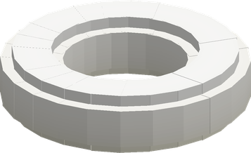{ .form-picture }

Awakened. Rings of mochi swell in the air around the user, each one turned its own way, and stay for a while. The giant arms and the spikes of the awakening come out of the rings that stand, without a ring they can't be used

Used again the rings go. The longer they stood the longer the cooldown

| Stat | Value |
|---|---|
| Damage type | Blunt, Indirect |
| Haki | Special |
| Cooldown | 10–35 s |
| Hold | 25 s |
| Rings | 4 |

## Chikara Mochi { #mochi-chikara }

{ .ability-icon } *Active*

{ .form-picture }

Awakened. A giant arm of hardened mochi shoots out of the nearest ring and punches the enemy the user looks at, sending it flying. Needs a ring of Muso Donuts

| Stat | Value |
|---|---|
| Damage type | Fist, Indirect, Physical |
| Haki | Hardening |
| Cooldown | 12 s |
| Damage | 70 |
| Range | 28 blocks (line) |

## Mochi Ginchaku { #mochi-ginchaku }

{ .ability-icon } *Active*

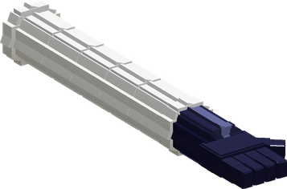{ .form-picture }

Awakened. Every ring of Muso Donuts throws its giant arm again and again at the enemy nearest to it. Needs a ring of Muso Donuts

| Stat | Value |
|---|---|
| Damage type | Fist, Indirect, Physical |
| Haki | Hardening |
| Cooldown | 25 s |
| Hold | 4 s |
| Damage per Punch | 4 |
| Range | 14 blocks (area) |

## Kuzu Mochi { #mochi-kuzu }

{ .ability-icon } *Active*

{ .form-picture }

Awakened. Nine giant arms of hardened mochi come out of the rings one after the other and pound the place the user is looking at. Needs a ring of Muso Donuts

| Stat | Value |
|---|---|
| Damage type | Fist, Indirect, Physical |
| Haki | Hardening |
| Cooldown | 30 s |
| Damage | 90 |
| Range | 3.5 blocks (area) |

## Kashiwa Mochi { #mochi-kashiwa }

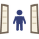{ .ability-icon } *Active*

{ .form-picture }

Applies { .effect-mini }[Stuck in Mochi](../effects.md#effect-stuck-in-mochi)

Awakened. Two giant open hands of mochi come out of the rings and clap on the enemy the user looks at, it stays stuck in their mochi. While right click is held they clap again and again. Needs a ring of Muso Donuts

| Stat | Value |
|---|---|
| Damage type | Blunt, Indirect |
| Haki | Special |
| Cooldown | 25 s |
| Damage | 26 |
| Range | 28 blocks (line) |
| Claps while Held | 4 |

## Kuri Mochi { #mochi-kuri }

{ .ability-icon } *Active*

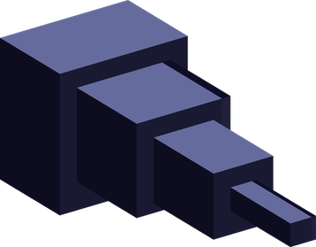{ .form-picture }

Awakened. The nearest ring bristles with hardened spikes and shoots them where the user is looking. Needs a ring of Muso Donuts

| Stat | Value |
|---|---|
| Damage type | Blunt, Projectile |
| Haki | Hardening |
| Cooldown | 20 s |
| Spikes | 24 |
| Damage per Spike | 6 |

## Mochi Body { #mochi-body }

{ .ability-icon } *Passive*

The user's body of mochi opens around the hits they see coming. Needs the future sight of Observation Haki unlocked
