# Mori Mori no Mi

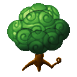{ .mod-icon }

| | |
|---|---|
| **Type** | Logia |
| **Theme** | Forest |
| **Box** | { .box-icon } Golden |
| **Chance per opening** | golden **2.32%**, iron **0.116%**, wooden **0.006%** ([how it works](index.md#box-odds)) |
| **Abilities** | 13: 9 active, 4 passive |
| **Transformations** | [Kinniku Mori Mori](#kinniku-mori-mori) |

In 3D: drag to turn, scroll or pinch to zoom.

<!-- animations -->
??? example "Animations"

    

    <figure markdown="span">
      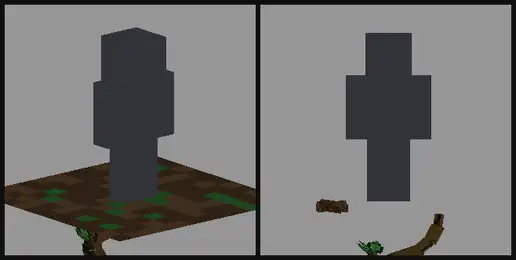{ loading=lazy }
      <figcaption>Jukon</figcaption>
    </figure>
    <figure markdown="span">
      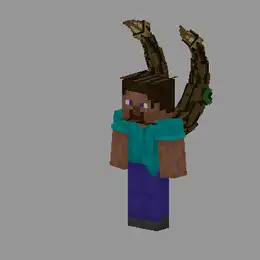{ loading=lazy }
      <figcaption>Konwan</figcaption>
    </figure>
    <figure markdown="span">
      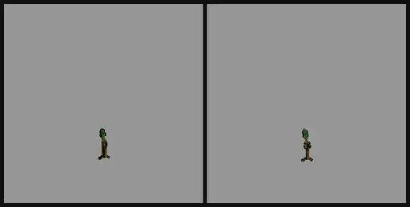{ loading=lazy }
      <figcaption>Sapling</figcaption>
    </figure>
    <figure markdown="span">
      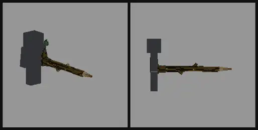{ loading=lazy }
      <figcaption>Branch</figcaption>
    </figure>
    <figure markdown="span">
      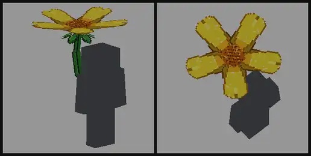{ loading=lazy }
      <figcaption>Flower</figcaption>
    </figure>
    

<!-- /animations -->

Found in the base mod's **golden Devil Fruit box**. Eat it and its abilities appear in the ability menu, grouped under the fruit.

!!! note "About the values"
    The values are those of the ability's tooltip in game, with the base mod's default settings. Damage is shown on the base mod's scale, as in the ability screen.

## Logia Invulnerability Mori { #logia-invulnerability-mori }

{ .ability-icon } *Passive*

Allows the user to avoid attacks by instinctively transforming parts of their body into their specific element

The user's body is made of living wood, fire always hurts them and deals 50% more damage.

## Kogosei { #kogosei }

{ .ability-icon } *Passive*

During the day and under the sky, the user does not get hungry and slowly regenerates health. Does not work during rain, night or under a roof

## Hosaku { #ryokuka }

{ .ability-icon } *Active*

Every plant around the user grows as with bone meal, crops, saplings and flowers, and the dirt turns into grass. Nothing grows in a claim the user can't build in

| Stat | Value |
|---|---|
| Cooldown | 10 s |
| Range | 6 blocks (area) |

## Jukon { #jukon }

{ .ability-icon } *Active*

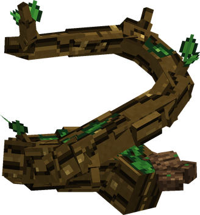{ .form-picture }

Roots comes out of the ground where the user is looking at and grabs up to 6 enemies, they are stuck in place but can still attack.

Use the ability again for Kyusui, the roots drains the enemies every second, healing the user and weakening them

The mode key switches between Jukon, the mode it starts in, and Jukai. Jukai sends a wave of roots forward through the ground, it hits every enemy on its way and tangles them for a moment

Jukon

Jukai

| Stat | Value |
|---|---|
| Damage type | Blunt, Indirect |
| Haki | Special |
| Cooldown | 16 s |
| Hold | 5 s |
| Damage | 20 |
| Range | 5 blocks (area) |
| Max Targets | 6 |
| Kyusui Drain per Second | 5 |
| Cooldown | 15 s |
| Damage | 28 |
| Wave Length | 18 blocks |
| Tangled | 2 s |

## Edayari { #edayari }

{ .ability-icon } *Active*

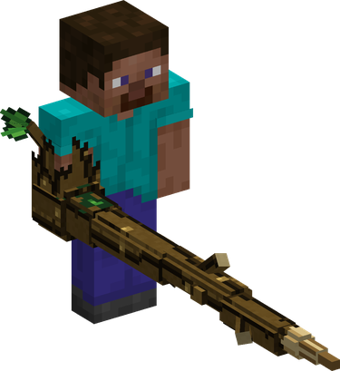{ .form-picture }

The user's arm extends into a long branch that pierces all enemies in a line, they are stuck in place but can still attack

Use the ability again for Kyusui, the branch drains the enemies every second, healing the user and weakening them.

The mode key switches between Edayari, the mode it starts in, and Eda Shigure. Eda Shigure thrusts the branch again and again where the user looks, hitting every enemy on the line each time

Edayari

Eda Shigure

| Stat | Value |
|---|---|
| Damage type | Physical |
| Haki | Hardening |
| Cooldown | 10 s |
| Hold | 3 s |
| Damage | 24 |
| Range | 12 blocks (line) |
| Cooldown | 16 s |
| Thrusts | 8 |
| Total Damage | 32 |
| Range | 12 blocks (line) |

## Senbon Kui { #senbon-kui }

{ .ability-icon } *Active*

Sharp wooden stakes burst out of the user's whole body, hitting every enemy around, making them bleed and throwing them back

| Stat | Value |
|---|---|
| Damage type | Physical |
| Haki | Hardening |
| Cooldown | 14 s |
| Damage | 22 |
| Range | 4.5 blocks (area) |
| Bleeding | 5 s |

## Konwan { #konwan }

{ .ability-icon } *Active*

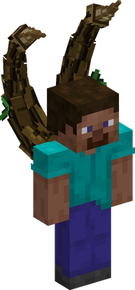{ .form-picture }

Two arms of sharp roots grow out of the user's back. While active, each of their own hits in close combat is followed by a hit of a root arm that makes the enemy bleed

| Stat | Value |
|---|---|
| Damage type | Physical |
| Haki | Hardening |
| Cooldown | 20 s |
| Hold | 30 s |
| Root Arm Blow | 7 |
| Bleeding | 3 s |

## Jurin Heki { #jurin-heki }

{ .ability-icon } *Active*

A wall of trees rises out of the ground in front of the user. It stops enemies and projectiles and takes hits until it breaks. Fire burns it unless Bokarin is active. Using the ability again brings the wall down

| Stat | Value |
|---|---|
| Cooldown | 20 s |
| Hold | 15 s |
| Wall Health | 150 |

## Kinniku Mori Mori { #kinniku-mori-mori }

{ .ability-icon } *Active · Transformation*

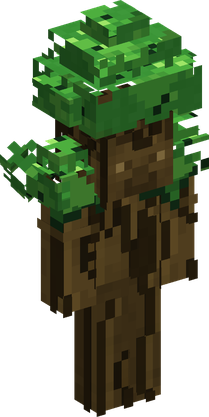{ .form-picture }

While standing on natural ground, the user transforms into a tree golem, increasing the damage and the range of their punches and their armor but making them slower. The other abilities are also stronger and bigger while in this form.

The size can be changed before using it, the giant golem lasts less and has a longer cooldown

Kinniku Mori Mori

Giant Kinniku Mori Mori

| Stat | Value |
|---|---|
| Cooldown | 6–30 s |
| Hold | 60 s |
| Size | x3 |
| Fist Damage | +14 |
| Armor | +8 |
| Cooldown | 18–90 s |
| Hold | 30 s |
| Size | x8 |
| Fist Damage | +30 |
| Armor | +14 |

## Wakagi { #wakagi }

{ .ability-icon } *Passive*

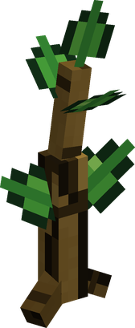{ .form-picture }

If the user would die while in the golem form, the golem falls instead and the user grows back from a sapling a few blocks away with a part of their health. Does not work if killed by fire.

| Stat | Value |
|---|---|
| Cooldown | 300 s |

## Bokarin { #bokarin }

{ .ability-icon } *Active*

The user fills their wood with water so fire doesn't deal extra damage to them anymore, except for very strong fire attacks. The user moves and attacks slower while active

| Stat | Value |
|---|---|
| Cooldown | 5 s |

**Stats while active**

| Stat | Value |
|---|---|
| Attack Speed | x0.8 |
| Speed | x0.8 |

## Hanaguruma { #hanaguruma }

{ .ability-icon } *Active*

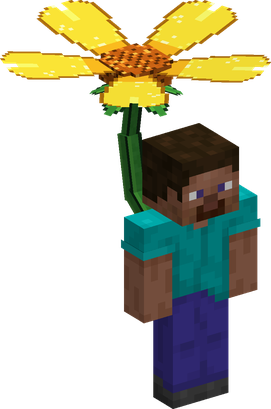{ .form-picture }

A giant flower grows on the user's back and spins like a propeller allowing them to fly. Fire burns the flower and stops the flight. Can't be used in the golem form.

## Hisho { #hisho }

{ .ability-icon } *Passive*

While the flower is spinning the user can fly, until they have no more stamina
