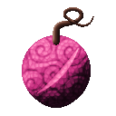

# Muchi Muchi no Mi

{ .mod-icon }

| | |
|---|---|
| **Type** | Paramecia |
| **Theme** | Whip |
| **Box** | { .box-icon } Iron |
| **Chance per opening** | iron **1.46%**, wooden **0.073%** ([how it works](index.md#box-odds)) |
| **Abilities** | 9: 9 active, 0 passive |
| **Effects applied** | { .effect-mini }[Kneeling](../effects.md#effect-kneeling) |

Found in the base mod's **iron Devil Fruit box**. Eat it and its abilities appear in the ability menu, grouped under the fruit.

!!! note "About the values"
    The values are those of the ability's tooltip in game, with the base mod's default settings. Damage is shown on the base mod's scale, as in the ability screen.

## Whip { #muchi-whip }

{ .ability-icon } *Active*

The user takes out their whip, the other techniques of the fruit need it in hand. Used again it is put away

The whip vanishes if it leaves the user's hands

| Stat | Value |
|---|---|
| Cooldown | 2 s |

## Lash { #muchi-lash }

{ .ability-icon } *Active*

The user lashes the enemy they look at with the whip. A player lashed obeys a short order, to stop, to step back or to drop what they hold

Needs the whip in hand, take it out with Whip

| Stat | Value |
|---|---|
| Damage type | Blunt |
| Haki | Imbuing |
| Cooldown | 3 s |
| Damage | 6 |
| Range | 12 blocks (line) |

## Obey { #muchi-obey }

{ .ability-icon } *Active*

The user lashes the creature they look at and it fights for them for a while. Three at most, never a boss

Needs the whip in hand, take it out with Whip

| Stat | Value |
|---|---|
| Cooldown | 15 s |
| Range | 12 blocks (line) |

## Move! { #muchi-move }

{ .ability-icon } *Active*

The user lashes the ground they look at. It tears itself out and flies at the nearest enemy, then bursts. The hole closes after a while

Needs the whip in hand, take it out with Whip

| Stat | Value |
|---|---|
| Damage type | Blunt |
| Haki | Imbuing |
| Cooldown | 20 s |
| Damage | 18 |
| Range | 12 blocks (line) |

## Close in! { #muchi-close-in }

{ .ability-icon } *Active*

The user lashes the enemy they look at and the ground closes round it, holding it for a moment. It lasts less on players and bosses

Needs the whip in hand, take it out with Whip

| Stat | Value |
|---|---|
| Damage type | Blunt |
| Haki | Imbuing |
| Cooldown | 20 s |
| Damage | 4 |
| Range | 12 blocks (line) |

## Back! { #muchi-back }

{ .ability-icon } *Active*

The user lashes a projectile flying at them and it turns back on the one who sent it

Needs the whip in hand, take it out with Whip

| Stat | Value |
|---|---|
| Cooldown | 8 s |
| Range | 12 blocks (line) |

## Stand! { #muchi-stand }

{ .ability-icon } *Active*

The user lashes the ground they look at and it rises as a wall that stops enemies and projectiles. Used again the wall comes down

Needs the whip in hand, take it out with Whip

| Stat | Value |
|---|---|
| Cooldown | 15 s |
| Hold | 10 s |

## Halt! { #muchi-halt }

{ .ability-icon } *Active*

The user lashes the one they look at and it cannot move for a few seconds. It can still fight back

Needs the whip in hand, take it out with Whip

| Stat | Value |
|---|---|
| Cooldown | 16 s |
| On a Player | 3 s |
| On a Creature | 5 s |
| Other order waits | 4 s |
| Range | 12 blocks (line) |

## Kneel! { #muchi-kneel }

{ .ability-icon } *Active*

Applies { .effect-mini }[Kneeling](../effects.md#effect-kneeling)

The user lashes the one they look at and for a few seconds it can not jump nor sprint and walks slower

Needs the whip in hand, take it out with Whip

| Stat | Value |
|---|---|
| Cooldown | 14 s |
| On a Player | 6 s |
| On a Creature | 10 s |
| Other order waits | 4 s |
| Range | 12 blocks (line) |
