# Mushi Mushi no Mi, Model: Kabutomushi

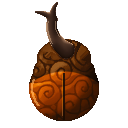{ .mod-icon }

| | |
|---|---|
| **Type** | Zoan |
| **Box** | { .box-icon } Iron |
| **Chance per opening** | iron **1.37%**, wooden **0.069%** ([how it works](index.md#box-odds)) |
| **Abilities** | 10: 8 active, 2 passive (1 hidden, not in the ability menu) |
| **Transformations** | [Kabutomushi Heavy Point](#kabutomushi-heavy-point), [Kabutomushi Walk Point](#kabutomushi-walk-point) |

In 3D: drag to turn, scroll or pinch to zoom.

<!-- animations -->
??? example "Animations"

    Taken in game, at size 1, third person.

    

    <figure markdown="span">
      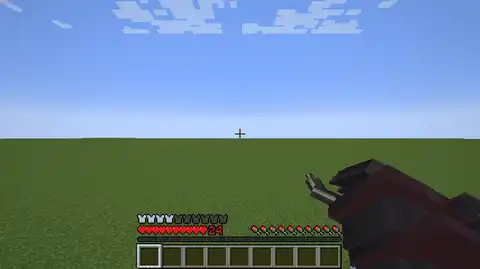{ loading=lazy }
      <figcaption>Hybrid, flying</figcaption>
    </figure>
    <figure markdown="span">
      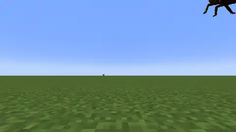{ loading=lazy }
      <figcaption>Beetle, flying</figcaption>
    </figure>
    <figure markdown="span">
      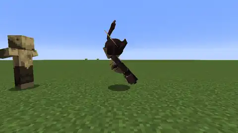{ loading=lazy }
      <figcaption>Beetle Upper</figcaption>
    </figure>
    <figure markdown="span">
      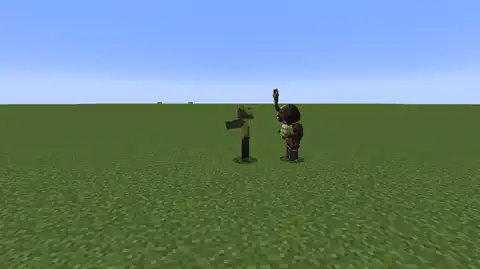{ loading=lazy }
      <figcaption>Horn Toss</figcaption>
    </figure>
    <figure markdown="span">
      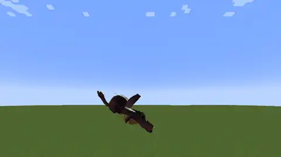{ loading=lazy }
      <figcaption>Horn Dive, hybrid</figcaption>
    </figure>
    <figure markdown="span">
      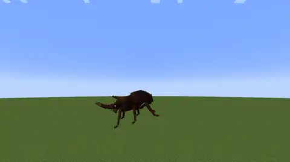{ loading=lazy }
      <figcaption>Horn Dive, beetle</figcaption>
    </figure>
    <figure markdown="span">
      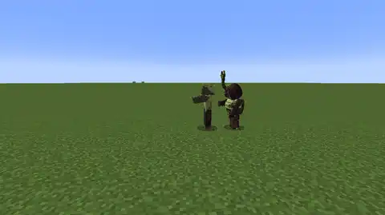{ loading=lazy }
      <figcaption>Four Arm Rush</figcaption>
    </figure>
    <figure markdown="span">
      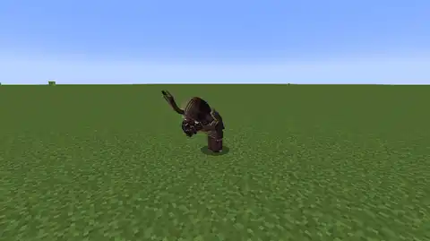{ loading=lazy }
      <figcaption>Shell Guard, hybrid</figcaption>
    </figure>
    <figure markdown="span">
      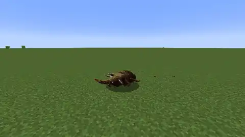{ loading=lazy }
      <figcaption>Shell Guard, beetle</figcaption>
    </figure>
    <figure markdown="span">
      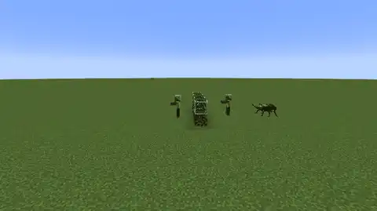{ loading=lazy }
      <figcaption>Beetle Ram</figcaption>
    </figure>
    

<!-- /animations -->

Found in the base mod's **iron Devil Fruit box**. Eat it and its abilities appear in the ability menu, grouped under the fruit.

!!! note "About the values"
    The values are those of the ability's tooltip in game, with the base mod's default settings. Damage is shown on the base mod's scale, as in the ability screen.

## Kabutomushi Heavy Point { #kabutomushi-heavy-point }

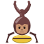{ .ability-icon } *Active · Transformation*

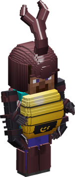{ .form-picture }

Transforms the user into a rhinoceros beetle hybrid, with a horn, a hard shell, four arms and wings to fly.

## Kabutomushi Walk Point { #kabutomushi-walk-point }

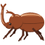{ .ability-icon } *Active · Transformation*

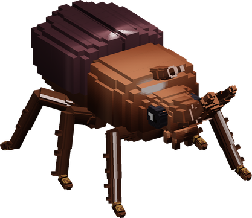{ .form-picture }

Transforms the user into a big rhinoceros beetle with a thick shell. It can fly and carry another player.

## Kabutomushi Flight { #kabutomushi-flight }

*Passive*

!!! info "Hidden ability"
    It does not appear in the ability menu.

Requires Kabutomushi Heavy Point or Kabutomushi Walk Point to be active.

## Kabutomushi Rideable { #kabutomushi-rideable }

{ .ability-icon } *Passive*

Allows another player to ride on the beetle's back.

Requires Kabutomushi Walk Point to be active.

## Beetle Upper { #beetle-upper }

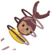{ .ability-icon } *Active*

While in the hybrid form, the user rushes forward at full speed while spinning and headbutts all enemies in their path, launching them into the air.

| Stat | Value |
|---|---|
| Damage type | Blunt, Physical |
| Haki | Hardening |
| Cooldown | 11 s |
| Charge | under 1 s |
| Damage | 16 |

## Horn Toss { #horn-toss }

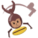{ .ability-icon } *Active*

The user scoops up the enemy in front of them with their horn and throws it over their back.

| Stat | Value |
|---|---|
| Damage type | Blunt |
| Haki | Hardening |
| Cooldown | 7 s |
| Charge | under 1 s |
| Damage | 6 |
| Range | 3 blocks (line) |

## Horn Dive { #horn-dive }

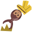{ .ability-icon } *Active*

While in the air, the user dives horn first where they are looking, damaging all enemies around the impact and sending them flying. The higher the dive, the more damage it deals.

| Stat | Value |
|---|---|
| Damage type | Blunt, Physical |
| Haki | Hardening |
| Cooldown | 14 s |
| Damage | 14–26 |
| Range | 24 blocks (line) |
| Range | 4 blocks (area) |

## Four Arm Rush { #four-arm-rush }

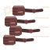{ .ability-icon } *Active*

While in the hybrid form, the user throws a flurry of fast punches with their four arms at the enemies in front of them. The last punch sends them flying.

| Stat | Value |
|---|---|
| Damage type | Blunt, Physical |
| Haki | Hardening |
| Cooldown | 12 s |
| Damage | 4–24 |
| Range | 3 blocks (line) |

## Shell Guard { #shell-guard }

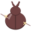{ .ability-icon } *Active*

The user closes their shell for a few seconds, taking much less damage and sending back enemy projectiles, but they cannot attack while it is closed. Using it again opens the shell.

| Stat | Value |
|---|---|
| Cooldown | 20 s |
| Hold | 5 s |
| Damage Taken | x0.25 |

## Beetle Ram { #beetle-ram }

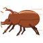{ .ability-icon } *Active*

While in the whole beetle form, the user charges forward with their horn, damaging all enemies in their path and pushing them aside. The charge also breaks leaves, glass and wood.

| Stat | Value |
|---|---|
| Damage type | Blunt, Physical |
| Haki | Hardening |
| Cooldown | 16 s |
| Damage | 22 |
