# Mushi Mushi no Mi, Model: Suzumebachi

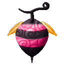{ .mod-icon }

| | |
|---|---|
| **Type** | Zoan |
| **Box** | { .box-icon } Iron |
| **Chance per opening** | iron **1.37%**, wooden **0.069%** ([how it works](index.md#box-odds)) |
| **Abilities** | 9: 8 active, 1 passive (1 hidden, not in the ability menu) |
| **Transformations** | [Suzumebachi Heavy Point](#suzumebachi-heavy-point), [Suzumebachi Walk Point](#suzumebachi-walk-point) |

In 3D: drag to turn, scroll or pinch to zoom.

<!-- animations -->
??? example "Animations"

    Taken in game, at size 1, third person.

    

    <figure markdown="span">
      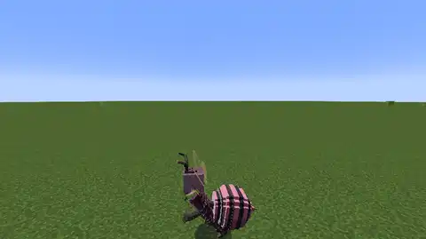{ loading=lazy }
      <figcaption>Hybrid, flying</figcaption>
    </figure>
    <figure markdown="span">
      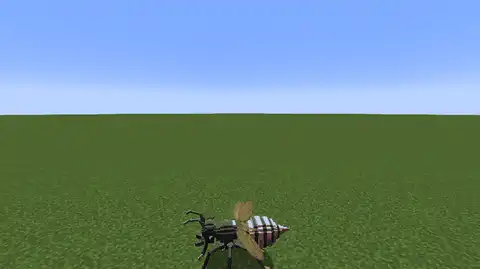{ loading=lazy }
      <figcaption>Hornet, flying</figcaption>
    </figure>
    <figure markdown="span">
      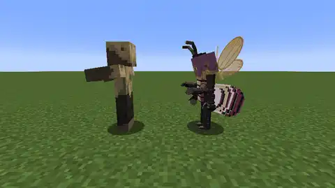{ loading=lazy }
      <figcaption>Stinger</figcaption>
    </figure>
    <figure markdown="span">
      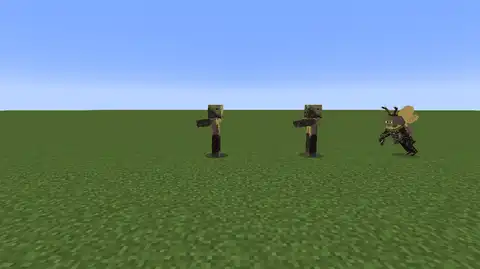{ loading=lazy }
      <figcaption>Needle Dash</figcaption>
    </figure>
    <figure markdown="span">
      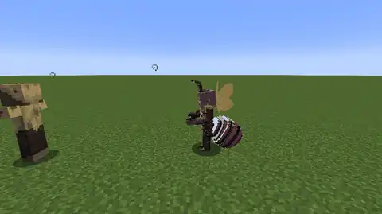{ loading=lazy }
      <figcaption>Pink Hornets</figcaption>
    </figure>
    <figure markdown="span">
      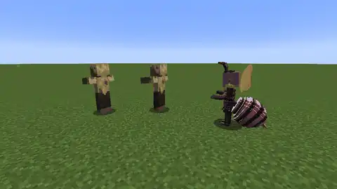{ loading=lazy }
      <figcaption>Venom Spray, hybrid</figcaption>
    </figure>
    <figure markdown="span">
      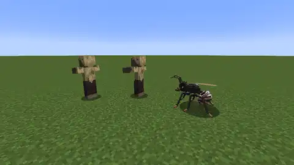{ loading=lazy }
      <figcaption>Venom Spray, hornet</figcaption>
    </figure>
    <figure markdown="span">
      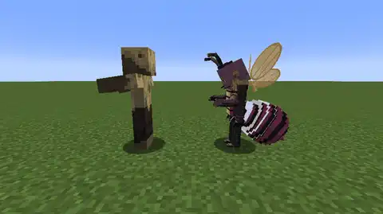{ loading=lazy }
      <figcaption>Mandible Bite</figcaption>
    </figure>
    

<!-- /animations -->

Found in the base mod's **iron Devil Fruit box**. Eat it and its abilities appear in the ability menu, grouped under the fruit.

!!! note "About the values"
    The values are those of the ability's tooltip in game, with the base mod's default settings. Damage is shown on the base mod's scale, as in the ability screen.

## Suzumebachi Heavy Point { #suzumebachi-heavy-point }

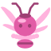{ .ability-icon } *Active · Transformation*

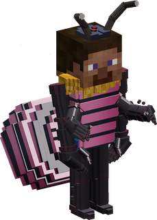{ .form-picture }

Transforms the user into a giant hornet hybrid with four arms that attack fast, wings to fly with and a poisonous stinger.

## Suzumebachi Walk Point { #suzumebachi-walk-point }

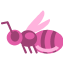{ .ability-icon } *Active · Transformation*

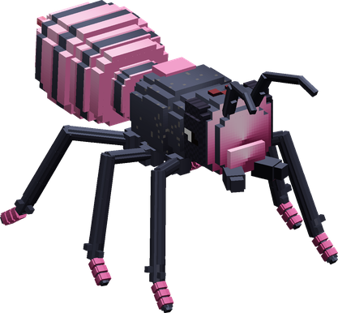{ .form-picture }

Transforms the user into a giant hornet, which is light, fast in the air and has a poisonous stinger.

## Suzumebachi Flight { #suzumebachi-flight }

*Passive*

!!! info "Hidden ability"
    It does not appear in the ability menu.

Requires Suzumebachi Heavy Point or Suzumebachi Walk Point to be active.

## Stinger { #stinger }

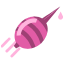{ .ability-icon } *Active*

The user stabs the enemy in front of them with their stinger and gives it a strong poison.

| Stat | Value |
|---|---|
| Damage type | Physical |
| Haki | Hardening |
| Cooldown | 6 s |
| Charge | under 1 s |
| Range | 3 blocks (line) |
| Damage | 7 |

## Pink Hornets { #pink-hornets }

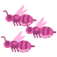{ .ability-icon } *Active*

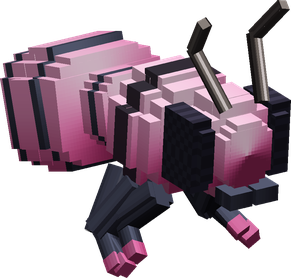{ .form-picture }

While in either form, the user calls four pink hornets for 15 seconds. They sting the enemy the user is looking at, or whoever fights the user, and poison it.

| Stat | Value |
|---|---|
| Cooldown | 30 s |
| Charge | under 1 s |
| Duration | 15 s |
| Damage | 2 |

## Needle Dash { #needle-dash }

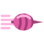{ .ability-icon } *Active*

The user dashes stinger first where they are looking, on the ground or in the air. Every enemy in the way is hurt and poisoned.

| Stat | Value |
|---|---|
| Damage type | Physical |
| Haki | Hardening |
| Cooldown | 10 s |
| Damage | 14 |

## Venom Spray { #venom-spray }

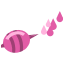{ .ability-icon } *Active*

The user sprays venom at the eyes of the enemies in front of them. They are hurt, blinded, slowed and poisoned, and a blinded mob loses its target.

| Stat | Value |
|---|---|
| Damage type | Internal |
| Haki | Special |
| Cooldown | 15 s |
| Charge | under 1 s |
| Damage | 5 |
| Range | 7 blocks (cone) |

## Numbing Sting { #numbing-sting }

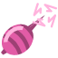{ .ability-icon } *Active*

The user stabs the enemy in front of them with their stinger. The venom paralyses it for 3 seconds.

| Stat | Value |
|---|---|
| Damage type | Physical |
| Haki | Hardening |
| Cooldown | 18 s |
| Charge | under 1 s |
| Range | 3 blocks (line) |
| Damage | 9 |

## Mandible Bite { #mandible-bite }

{ .ability-icon } *Active*

While in the hybrid form, the user bites the enemy in front of them with their mandibles, dealing heavy damage.

| Stat | Value |
|---|---|
| Damage type | Physical |
| Haki | Hardening |
| Cooldown | 14 s |
| Charge | under 1 s |
| Range | 3 blocks (line) |
| Damage | 22 |
