# Neko Neko no Mi, Model: Cheetah

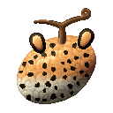{ .mod-icon }

| | |
|---|---|
| **Type** | Zoan |
| **Box** | { .box-icon } Iron |
| **Chance per opening** | iron **1.37%**, wooden **0.069%** ([how it works](index.md#box-odds)) |
| **Abilities** | 7: 7 active, 0 passive |
| **Transformations** | [Cheetah Heavy Point](#cheetah-heavy-point), [Cheetah Walk Point](#cheetah-walk-point) |

In 3D: drag to turn, scroll or pinch to zoom.

<!-- animations -->
??? example "Animations"

    Taken in game, at size 1.

    

    <figure markdown="span">
      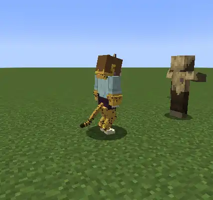{ loading=lazy }
      <figcaption>Hybrid</figcaption>
    </figure>
    <figure markdown="span">
      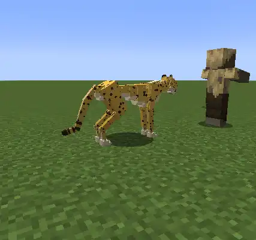{ loading=lazy }
      <figcaption>Cheetah</figcaption>
    </figure>
    <figure markdown="span">
      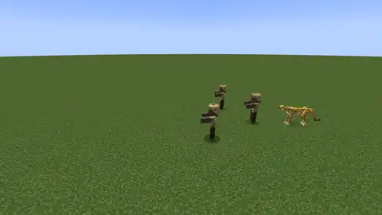{ loading=lazy }
      <figcaption>Sanbai-soku Rocket Dash</figcaption>
    </figure>
    <figure markdown="span">
      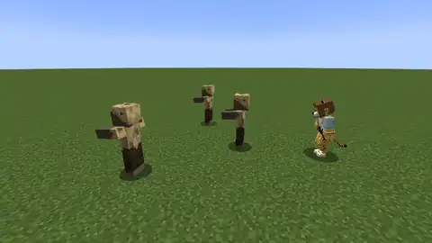{ loading=lazy }
      <figcaption>Hayatobi</figcaption>
    </figure>
    <figure markdown="span">
      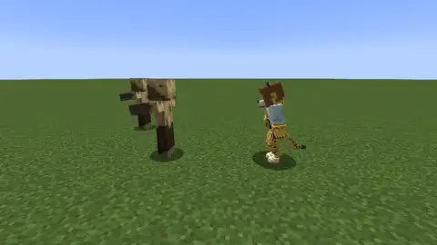{ loading=lazy }
      <figcaption>Tsumekake</figcaption>
    </figure>
    <figure markdown="span">
      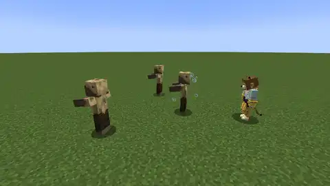{ loading=lazy }
      <figcaption>Zebra Rush</figcaption>
    </figure>
    <figure markdown="span">
      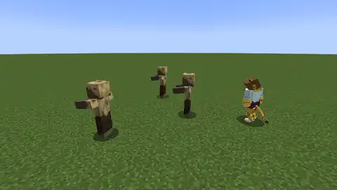{ loading=lazy }
      <figcaption>Kagitsuke</figcaption>
    </figure>
    

<!-- /animations -->

Found in the base mod's **iron Devil Fruit box**. Eat it and its abilities appear in the ability menu, grouped under the fruit.

!!! note "About the values"
    The values are those of the ability's tooltip in game, with the base mod's default settings. Damage is shown on the base mod's scale, as in the ability screen.

## Cheetah Heavy Point { #cheetah-heavy-point }

{ .ability-icon } *Active · Transformation*

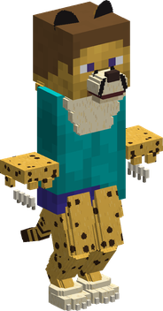{ .form-picture }

Transforms the user into a cheetah hybrid, very fast and light with sharp claws.

## Cheetah Walk Point { #cheetah-walk-point }

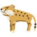{ .ability-icon } *Active · Transformation*

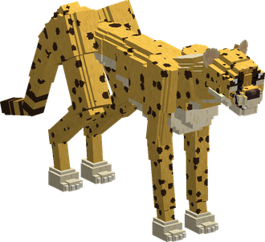{ .form-picture }

Transforms the user into a cheetah, the fastest runner of all with a keen nose.

## Sanbai-soku Rocket Dash { #sanbai-soku-rocket-dash }

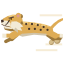{ .ability-icon } *Active*

While in the full cheetah form, the user runs more than twice as fast for a few seconds and turns sharp where they look, the tail keeps them on course. Enemies on the way get hurt and thrown aside

| Stat | Value |
|---|---|
| Damage type | Physical |
| Haki | Hardening |
| Cooldown | 15 s |
| Speed | +120 % |
| Lasts | 4 s |
| Damage | 10 |

## Kagitsuke { #kagitsuke }

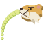{ .ability-icon } *Active*

While in a cheetah form, the user smells the creature they are looking at, even through walls. It glows, and the user alone sees the trail it left in the last 30 seconds and the one it leaves now

| Stat | Value |
|---|---|
| Cooldown | 40 s |
| Range | 48 blocks (line) |
| Trail Seen For | 30 s |

## Hayatobi { #hayatobi }

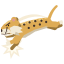{ .ability-icon } *Active*

While in a cheetah form, the user leaps on the target and strikes it. Deals more damage if the user was running

| Stat | Value |
|---|---|
| Damage type | Physical |
| Haki | Hardening |
| Cooldown | 8 s |
| Damage | 14–21 |

## Tsumekake { #tsumekake }

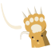{ .ability-icon } *Active*

While in a cheetah form, the user hooks the leg of the enemy in front of them with a claw. The enemy falls and can't move for a moment, then it is slow for a while

| Stat | Value |
|---|---|
| Damage type | Physical |
| Haki | Hardening |
| Cooldown | 9 s |
| Damage | 12 |
| Range | 2.5 blocks (line) |
| Knocked Down | 1.5 s |
| Then Slowed | 3 s |

## Zebra Rush { #zebra-rush }

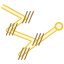{ .ability-icon } *Active*

While in a cheetah form, the user rushes through the enemies around in a lightning zigzag, 6 times in 3 seconds. Each enemy crossed by a pass gets hit by a claw

| Stat | Value |
|---|---|
| Damage type | Physical |
| Haki | Hardening |
| Cooldown | 40 s |
| Range | 12 blocks (area) |
| Damage | 5 |
| Passes | 6 |
