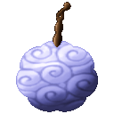
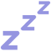
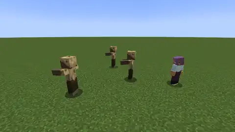
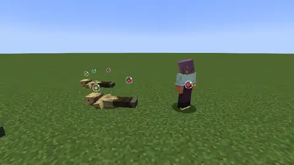
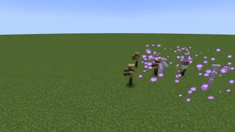
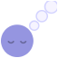

# Nemu Nemu no Mi

{ .mod-icon }

| | |
|---|---|
| **Type** | Paramecia |
| **Theme** | Sleep |
| **Box** | { .box-icon } Wooden |
| **Chance per opening** | wooden **1.65%** ([how it works](index.md#box-odds)) |
| **Abilities** | 5: 5 active, 0 passive |
| **Effects applied** | { .effect-mini }[Asleep](../effects.md#effect-asleep), { .effect-mini }[Haunted](../effects.md#effect-haunted), { .effect-mini }[Hypnotized](../effects.md#effect-hypnotized), { .effect-mini }[Memories Taken](../effects.md#effect-memories-taken), { .effect-mini }[Nemu Memories](../effects.md#effect-nemu-memories), { .effect-mini }[Nemu Puppet Link](../effects.md#effect-nemu-puppet-link) |

<!-- animations -->
??? example "Animations"

    Taken in game, at size 1.

    

    <figure markdown="span">
      { loading=lazy }
      <figcaption>Komoriuta</figcaption>
    </figure>
    <figure markdown="span">
      { loading=lazy }
      <figcaption>Yume Kui</figcaption>
    </figure>
    <figure markdown="span">
      { loading=lazy }
      <figcaption>Saimin</figcaption>
    </figure>
    <figure markdown="span">
      { loading=lazy }
      <figcaption>Omokage</figcaption>
    </figure>
    <figure markdown="span">
      { loading=lazy }
      <figcaption>Yume no Sekai</figcaption>
    </figure>
    

<!-- /animations -->

Found in the base mod's **wooden Devil Fruit box**. Eat it and its abilities appear in the ability menu, grouped under the fruit.

!!! note "About the values"
    The values are those of the ability's tooltip in game, with the base mod's default settings. Damage is shown on the base mod's scale, as in the ability screen.

## Komoriuta { #nemu-komoriuta }

{ .ability-icon } *Active*

Applies { .effect-mini }[Asleep](../effects.md#effect-asleep), { .effect-mini }[Memories Taken](../effects.md#effect-memories-taken), { .effect-mini }[Nemu Memories](../effects.md#effect-nemu-memories)

The user sings a low lullaby and the enemies around fall asleep. A sleeper can't move, hit or use abilities until something hits it. Bosses sleep half as long

| Stat | Value |
|---|---|
| Cooldown | 20 s |
| Range | 6 blocks (area) |
| Sleep | 8 s |
| Sleep of a Player | 4 s |

## Yume Kui { #nemu-yume-kui }

{ .ability-icon } *Active*

Applies { .effect-mini }[Memories Taken](../effects.md#effect-memories-taken), { .effect-mini }[Nemu Memories](../effects.md#effect-nemu-memories)

The user eats a memory of the sleeper they look at. The user gets stronger and the sleeper weaker for a while and it keeps sleeping

When the user gets hit one memory spills out and goes back to its owner

| Stat | Value |
|---|---|
| Cooldown | 3 s |
| Range | 4 blocks (line) |
| Damage a Memory | 10 % |
| Resistance a Memory | 5 % |
| Damage Lost by the Sleeper | 10 % |
| Most Memories | 5 |
| Memory Kept | 60 s |

## Saimin { #nemu-saimin }

{ .ability-icon } *Active*

Applies { .effect-mini }[Hypnotized](../effects.md#effect-hypnotized), { .effect-mini }[Memories Taken](../effects.md#effect-memories-taken), { .effect-mini }[Nemu Memories](../effects.md#effect-nemu-memories), { .effect-mini }[Nemu Puppet Link](../effects.md#effect-nemu-puppet-link)

The user looks in the eyes of a sleeper and hypnotizes it. A creature wakes up as the user puppet and fights for them for a while. A player only wakes up slowed. Bosses can't be hypnotized

| Stat | Value |
|---|---|
| Cooldown | 30 s |
| Range | 12 blocks (line) |
| Puppet | 15 s |
| Player Slowed | 50 % |
| Player Slowed For | 6 s |

## Omokage { #nemu-omokage }

{ .ability-icon } *Active*

Applies { .effect-mini }[Haunted](../effects.md#effect-haunted)

The user breathes out a purple smoke where the enemies see people from their past. The view of those inside gets blurry and monsters go after the images instead of the user

| Stat | Value |
|---|---|
| Cooldown | 25 s |
| Range | 5 blocks (area) |
| Hold | 6 s |
| Images | 3 |

## Yume no Sekai { #nemu-yume-no-sekai }

{ .ability-icon } *Active*

Applies { .effect-mini }[Asleep](../effects.md#effect-asleep), { .effect-mini }[Memories Taken](../effects.md#effect-memories-taken), { .effect-mini }[Nemu Memories](../effects.md#effect-nemu-memories)

The user sends a white wave and every enemy around falls asleep. The user eats a memory of each of them, up to four, swells up and floats while getting stronger for a while. With nobody around there is nothing to eat

Each hit the user gets gives back a part of the memories to everyone

Using it again ends the dream: the sleepers wake, the memories stay, and the cooldown is only for the time spent

| Stat | Value |
|---|---|
| Cooldown | 120 s |
| Range | 12 blocks (area) |
| Sleep | 6 s |
| Damage a Memory | 10 % |
| Resistance a Memory | 5 % |
| Dream | 20 s |
