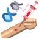

# Nomi Nomi no Mi

{ .mod-icon }

| | |
|---|---|
| **Type** | Paramecia |
| **Theme** | Brain |
| **Box** | { .box-icon } Golden |
| **Chance per opening** | golden **2.16%**, iron **0.108%**, wooden **0.005%** ([how it works](index.md#box-odds)) |
| **Abilities** | 8: 6 active, 2 passive |

Found in the base mod's **golden Devil Fruit box**. Eat it and its abilities appear in the ability menu, grouped under the fruit.

!!! note "About the values"
    The values are those of the ability's tooltip in game, with the base mod's default settings. Damage is shown on the base mod's scale, as in the ability screen.

## Knowledge { #nomi-knowledge }

{ .ability-icon } *Passive*

The user's brain grows as they study the world, up to 300 knowledge, and never forgets. Sampling a Zoan, pricking an animal, analysing a creature or a Devil Fruit, entering a new biome, seeing or taking a technique, making SMILEs, grafting traits and infusing weapons teach them. The first time teaches most, each repeat half as much, down to nothing. At 100 they can make SMILEs and graft traits, and at 300 they can make a weapon eat a Zoan fruit and graft the rarest traits.

## Perfect Memory { #nomi-perfect-memory }

{ .ability-icon } *Passive*

The user forgets nothing and learns faster, 25% more experience and 25% more Doriki from fights.

## Analysis { #nomi-analysis }

{ .ability-icon } *Active*

The user looks at a creature and understands it at once, its health, armour, Devil Fruit, grafted traits and weaknesses. A SMILE held in hand is identified at the same time. A new kind of creature and a new Devil Fruit teach them.

| Stat | Value |
|---|---|
| Cooldown | 3 s |

## Syringe { #nomi-syringe }

{ .ability-icon } *Active*

The user pricks a creature within reach, without hurting it, and takes its blood. The blood of a Zoan user in a Zoan form (hybrid or full) or of a creature with a graftable trait gives a Lineage Factor Sample holding all it carries, and an animal's teaches them about its kind. A player lets them only where PvP is on, or when they are allies.

| Stat | Value |
|---|---|
| Cooldown | 10 s |
| Range | 3 blocks (line) |

## SMILE Making { #nomi-smile-making }

{ .ability-icon } *Active*

From 100 knowledge, the user turns a Lineage Factor Sample and an apple into a SMILE of its Zoan. A SMILE is either a perfect copy of the Zoan in another colour or a failure that locks its eater in a strange body. A perfect copy comes out 50% of the time for a wooden box Zoan, 35% for an iron box one and 15% for a golden box one.

| Stat | Value |
|---|---|
| Cooldown | 120 s |
| Charge | 3 s |

## Lineage Graft { #nomi-lineage-graft }

{ .ability-icon } *Active*

From 100 knowledge, the user grafts on themselves the trait selected in a Lineage Factor Sample and uses the sample up. The rarest traits need 300 knowledge: the Lunarian traits and those of the warden, the wither skeleton, the enderman, the Wither and the Ender Dragon.

A body holds 3 traits stable; each one more takes 10% of max health and 15% of every trait's numbers.

With the **Alt key** it is **Graft Another**: From 100 knowledge, the user grafts the trait selected in a Lineage Factor Sample on the body within reach and uses the sample up: a player who crouches before them or one of their own creatures. The rarest traits need 300 knowledge: the Lunarian traits and those of the warden, the wither skeleton, the enderman, the Wither and the Ender Dragon.

| Stat | Self Graft | Graft Another |
|---|---|---|
| Cooldown | 120 s | 120 s |
| Charge | 3 s | 3 s |
| Range | — | 3 blocks (line) |

## Lineage Purge { #nomi-lineage-purge }

{ .ability-icon } *Active*

From 100 knowledge, the user draws their own newest grafted trait back out. It is lost.

No Lineage Factor Sample comes back.

With the **Alt key** it is **Purge Another**: From 100 knowledge, the user draws the newest grafted trait out of the body within reach: a player who crouches before them or one of their own creatures. It is lost.

| Stat | Self Purge | Purge Another |
|---|---|---|
| Cooldown | 120 s | 120 s |
| Charge | 3 s | 3 s |
| Range | — | 3 blocks (line) |

## Infusion { #nomi-infusion }

{ .ability-icon } *Active*

From 300 knowledge, with a Zoan fruit in one hand and a weapon or tool in the other, the user makes the weapon or tool eat the fruit and it gains a bonus from the animal while held. Whoever holds it then releases the Zoan's beast and calls it back.

| Stat | Value |
|---|---|
| Cooldown | 120 s |
| Charge | 3 s |
