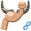
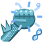
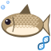
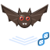
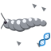
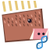
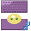
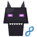

# Nomi Nomi no Mi

{ .mod-icon }

| | |
|---|---|
| **Type** | Paramecia |
| **Theme** | Brain |
| **Box** | { .box-icon } Golden |
| **Chance per opening** | golden **2.16%**, iron **0.108%**, wooden **0.005%** ([how it works](index.md#box-odds)) |
| **Abilities** | 8: 6 active, 2 passive |

Found in the base mod's **golden Devil Fruit box**. Eat it and its abilities appear in the ability menu, grouped under the fruit.

!!! note "About the values"
    The values are those of the ability's tooltip in game, with the base mod's default settings. Damage is shown on the base mod's scale, as in the ability screen.

## Knowledge { #nomi-knowledge }

{ .ability-icon } *Passive*

The user's brain grows as they study the world, up to 300 knowledge, and never forgets. Sampling a Zoan, pricking an animal, analysing a creature or a Devil Fruit, entering a new biome, seeing or taking a technique, making SMILEs, grafting traits and infusing weapons teach them. The first time teaches most, each repeat half as much, down to nothing: a Zoan sampled gives 40, then 20, 10, 5... A Devil Fruit analysed on its user gives 10, a biome entered for the first time 3, a technique seen within 16 blocks or taken 2 (not the user's own), a trait grafted 15. At 100 they can make SMILEs and graft traits, and at 300 they can make a weapon eat a Zoan fruit and graft the rarest traits.

## Perfect Memory { #nomi-perfect-memory }

{ .ability-icon } *Passive*

The user forgets nothing and learns faster, 25% more experience and 25% more Doriki from fights.

## Analysis { #nomi-analysis }

{ .ability-icon } *Active*

The user looks at a creature and understands it at once, its health, armour, Devil Fruit, grafted traits and weaknesses. A SMILE held in hand is identified at the same time. A new kind of creature and a new Devil Fruit teach them.

| Stat | Value |
|---|---|
| Cooldown | 3 s |

## Syringe { #nomi-syringe }

{ .ability-icon } *Active*

The user pricks a creature within reach, without hurting it, and takes its blood. The blood of a Zoan user in a Zoan form (hybrid or full) or of a creature with a graftable trait gives a Lineage Factor Sample holding all it carries, and an animal's teaches them about its kind. A player lets them only where PvP is on, or when they are allies.

| Stat | Value |
|---|---|
| Cooldown | 10 s |
| Range | 3 blocks (line) |

## SMILE Making { #nomi-smile-making }

{ .ability-icon } *Active*

From 100 knowledge, the user turns a Lineage Factor Sample and an apple into a SMILE of its Zoan. A SMILE is either a perfect copy of the Zoan in another colour or a failure that locks its eater in a strange body. A perfect copy comes out 50% of the time for a wooden box Zoan, 35% for an iron box one and 15% for a golden box one.

| Stat | Value |
|---|---|
| Cooldown | 120 s |
| Charge | 3 s |

## Lineage Graft { #nomi-lineage-graft }

{ .ability-icon } *Active*

From 100 knowledge, the user grafts on themselves the trait selected in a Lineage Factor Sample and uses the sample up. The rarest traits need 300 knowledge: the Lunarian traits and those of the warden, the wither skeleton, the enderman, the Wither and the Ender Dragon.

A body holds 3 traits stable; each one more takes 10% of max health and 15% of every trait's numbers.

With the **Alt key** it is **Graft Another**: From 100 knowledge, the user grafts the trait selected in a Lineage Factor Sample on the body within reach and uses the sample up: a player who crouches before them or one of their own creatures. The rarest traits need 300 knowledge: the Lunarian traits and those of the warden, the wither skeleton, the enderman, the Wither and the Ender Dragon.

| Stat | Self Graft | Graft Another |
|---|---|---|
| Cooldown | 120 s | 120 s |
| Charge | 3 s | 3 s |
| Range | — | 3 blocks (line) |

## Lineage Purge { #nomi-lineage-purge }

{ .ability-icon } *Active*

From 100 knowledge, the user draws their own newest grafted trait back out. It is lost.

No Lineage Factor Sample comes back.

With the **Alt key** it is **Purge Another**: From 100 knowledge, the user draws the newest grafted trait out of the body within reach: a player who crouches before them or one of their own creatures. It is lost.

| Stat | Self Purge | Purge Another |
|---|---|---|
| Cooldown | 120 s | 120 s |
| Charge | 3 s | 3 s |
| Range | — | 3 blocks (line) |

<!-- nomi-traits -->
## Lineage Factor traits { #lineage-factor-traits }

One prick of the [Syringe](#nomi-syringe) takes one creature's blood. The Lineage Factor Sample lists the creature, its race, its Zoan (in form) and every trait it carries; a right click on the sample picks the next trait. [Lineage Graft](#nomi-lineage-graft) puts the picked trait on a body, [Lineage Purge](#nomi-lineage-purge) takes the newest one off.

- Traits are passives always on: they cannot be paused in the abilities screen.
- Up to 3 traits are stable. More make the body unstable, and every trait weaker; [Analysis](#nomi-analysis) lists a body's traits, in red when it is unstable.
- With Race Race no Mi, a race keeps its race and gets the trait on top. A race's own trait cannot be grafted on it. The Lunarian Traits come only from a Lunarian of Race Race no Mi.
- Villagers, illagers, the wandering trader, the allay and the vex give no trait.
- Operators list, add, remove or clear the traits of players and creatures with `/missing nomi lineage <targets>`.

50 traits, with the knowledge needed to graft each:

| Trait | What it does | Numbers | Knowledge |
|---|---|---|---|
| { .ability-mini }**Steel Skin** | The Lineage Factor of an iron golem gives the bearer a steel exoskeleton, as Germa 66's modified children. | Armor +4, Armor Toughness +2, Knockback Resistance +20 % | 100 |
| { .ability-mini }**Regeneration** | The Lineage Factor of an axolotl makes the bearer heal on their own, as Germa 66's modified children. | Healing 1 HP / 4 s | 100 |
| { .ability-mini }**Superhuman Strength** | The Lineage Factor of a ravager gives the bearer the strength of Germa 66's modified children. | Damage +2, Speed +10 % | 100 |
| { .ability-mini }**Night Vision** | The Lineage Factor of a cat or an ocelot lets the bearer see in the dark. |  | 100 |
| { .ability-mini }**Giant Lineage** | The Lineage Factor of a body twice a man's size or more makes the bearer grow, over the size of their race. Never with a Dwarf Lineage. | Size x1.5 | 100 |
| { .ability-mini }**Dwarf Lineage** | The Lineage Factor of a body of 0.6 a man or less makes the bearer shrink, over the size of their race. Never with a Giant Lineage. | Size x0.6 | 100 |
| { .ability-mini }**Fish-Man Strength** | The Lineage Factor of a fish-man gives the bearer a fish-man's strength, breath under water and swimming. Never on a fish-man. | Damage +3, Swim Speed +30 % | 100 |
| { .ability-mini }**Lunarian Traits** | The Lineage Factor of a Lunarian gives the bearer the Lunarian traits of the Seraphim: a tough body, fire and burning do not hurt them (lava still does), Lunarian wings grow on their back, and holding jump in the air lets them glide down. Never on a Lunarian. | Damage Taken -15 %, Armor +2 | 300 |
| { .ability-mini }**Blaze Lineage** | The Lineage Factor of a blaze sets the bearer's bare fists ablaze: an unarmed blow sets the target on fire, and hits harder on a target already burning. | Unarmed Burn 3 s, Damage on Burning Targets +2 | 100 |
| { .ability-mini }**Bovine Lineage** | The Lineage Factor of a cow gives the bearer a sturdy, heavy body. | Max Health +5 % | 100 |
| { .ability-mini }**Pig Lineage** | The Lineage Factor of a pig gives the bearer a pig's stomach: all food fills them up more. | Food Eaten +50 % | 100 |
| { .ability-mini }**Wool Lineage** | The Lineage Factor of a sheep grows a thick fleece under the skin: tougher, and the cold of powder snow never freezes them. | Armor +2 | 100 |
| { .ability-mini }**Bird Lineage** | The Lineage Factor of a chicken or a parrot gives the bearer light bones that take falls well. | Fall Resistance +4  blocks | 100 |
| { .ability-mini }**Rabbit Lineage** | The Lineage Factor of a rabbit gives the bearer quick, springy legs. | Jump +1, Speed +10 % | 100 |
| { .ability-mini }**Horse Lineage** | The Lineage Factor of a horse, a donkey or a mule gives the bearer a long, fast stride. | Speed +15 %, Step Height +0.5  blocks | 100 |
| { .ability-mini }**Llama Lineage** | The Lineage Factor of a llama gives the bearer a pack animal's steady footing. | Max Health +5 %, Knockback Resistance +20 % | 100 |
| { .ability-mini }**Camel Lineage** | The Lineage Factor of a camel lets the bearer go long without eating. | Hunger -50 % | 100 |
| { .ability-mini }**Wolf Lineage** | The Lineage Factor of a wolf gives the bearer a hunter's bite and pace. | Damage +2, Speed +10 % | 100 |
| { .ability-mini }**Fox Lineage** | The Lineage Factor of a fox gives the bearer a fox's quick pounce. | Speed +10 %, Jump +0.5 | 100 |
| { .ability-mini }**Polar Bear Lineage** | The Lineage Factor of a polar bear gives the bearer heavy paws and a body the cold never freezes. | Damage +3, Max Health +5 % | 100 |
| { .ability-mini }**Panda Lineage** | The Lineage Factor of a panda gives the bearer a big, solid body. | Max Health +15 %, Knockback Resistance +20 % | 100 |
| { .ability-mini }**Goat Lineage** | The Lineage Factor of a goat gives the bearer a mountain goat's leaps and landings. | Jump +1, Fall Resistance +3  blocks | 100 |
| { .ability-mini }**Bee Lineage** | The Lineage Factor of a bee puts a sting in the bearer's bare fists: an unarmed blow poisons. | Unarmed Poison 3 s | 100 |
| { .ability-mini }**Frog Lineage** | The Lineage Factor of a frog gives the bearer a frog's great leaps. | Jump +1.5 | 100 |
| { .ability-mini }**Sniffer Lineage** | The Lineage Factor of a sniffer gives the bearer a digger's strength. | Mining Speed +25 % | 100 |
| { .ability-mini }**Fish Lineage** | The Lineage Factor of a fish gives the bearer gills: they breathe under water and swim faster. | Swim Speed +20 % | 100 |
| { .ability-mini }**Dolphin Lineage** | The Lineage Factor of a dolphin makes the bearer a fast swimmer. | Swim Speed +50 % | 100 |
| { .ability-mini }**Turtle Lineage** | The Lineage Factor of a turtle gives the bearer a shell's hard skin and a sea turtle's swim. | Armor +3, Swim Speed +10 % | 100 |
| { .ability-mini }**Squid Lineage** | The Lineage Factor of a squid gives the bearer an ink sac: whoever strikes them is blinded, now and then. | Blinds the Attacker 2 s, Cooldown 10 s | 100 |
| { .ability-mini }**Guardian Lineage** | The Lineage Factor of a guardian covers the bearer in spikes that hurt whoever strikes them up close. | Thorns +2 | 100 |
| { .ability-mini }**Bat Lineage** | The Lineage Factor of a bat gives the bearer echolocation: when they crouch, the creatures around them glow for a moment. | Reveals Creatures +16  blocks, Cooldown 10 s | 100 |
| { .ability-mini }**Undead Lineage** | The Lineage Factor of the walking dead gives the bearer flesh that takes a beating. | Max Health +10 %, Toughness +1 | 100 |
| { .ability-mini }**Skeleton Lineage** | The Lineage Factor of a skeleton gives the bearer an archer's eye: their arrows hit harder. | Arrow Damage +25 % | 100 |
| { .ability-mini }**Spider Lineage** | The Lineage Factor of a spider lets the bearer climb walls: walk into one to go up, crouch to hold on. |  | 100 |
| { .ability-mini }**Creeper Lineage** | The Lineage Factor of a creeper lets the bearer's body take explosions well. | Explosion Damage Taken -50 % | 100 |
| { .ability-mini }**Slime Lineage** | The Lineage Factor of a slime makes the bearer bouncy: no fall hurts them. | Jump +0.5 | 100 |
| { .ability-mini }**Silverfish Lineage** | The Lineage Factor of a silverfish gives the bearer a burrower's knack for stone. | Mining Speed +30 % | 100 |
| { .ability-mini }**Phantom Lineage** | The Lineage Factor of a phantom makes the bearer faster at night. | Speed at Night +20 % | 100 |
| { .ability-mini }**Witch Lineage** | The Lineage Factor of a witch hardens the bearer against magic. | Magic Damage Taken -50 % | 100 |
| { .ability-mini }**Snow Lineage** | The Lineage Factor of a snow golem chills the bearer's bare fists, and the cold never freezes them. | Unarmed Slowness 2 s | 100 |
| { .ability-mini }**Piglin Lineage** | The Lineage Factor of a piglin gives the bearer a brute's strength and hide. | Damage +2, Armor +1 | 100 |
| { .ability-mini }**Hoglin Lineage** | The Lineage Factor of a hoglin gives the bearer blows that throw back. | Attack Knockback +1, Max Health +5 % | 100 |
| { .ability-mini }**Strider Lineage** | The Lineage Factor of a strider lets the bearer's skin stand lava a little. | Lava Damage Taken -50 % | 100 |
| { .ability-mini }**Ghast Lineage** | The Lineage Factor of a ghast gives the bearer a great body of the Nether that fire burns less. | Max Health +10 %, Fire Damage Taken -50 % | 100 |
| { .ability-mini }**Wither Skeleton Lineage** | The Lineage Factor of a wither skeleton withers what the bearer's bare fists strike, and the Wither never takes them. | Unarmed Wither 3 s | 300 |
| { .ability-mini }**Ender Lineage** | The Lineage Factor of an enderman makes the bearer blink away from a projectile that would hit them, now and then. | Cooldown 10 s | 300 |
| { .ability-mini }**Shulker Lineage** | The Lineage Factor of a shulker gives the bearer a shell: crouching, they close up hard. | Armor While Crouching +8 | 100 |
| { .ability-mini }**Warden Lineage** | The Lineage Factor of a warden gives the bearer the might of the deep dark. | Damage +4, Max Health +10 %, Knockback Resistance +30 % | 300 |
| { .ability-mini }**Wither Lineage** | The Lineage Factor of the Wither gives the bearer its great body, which the Wither never takes. | Max Health +15 % | 300 |
| { .ability-mini }**Dragon Lineage** | The Lineage Factor of the Ender Dragon gives the bearer a dragon's body and might. | Max Health +15 %, Damage +3, Knockback Resistance +50 % | 300 |

<!-- /nomi-traits -->

## Infusion { #nomi-infusion }

{ .ability-icon } *Active*

From 300 knowledge, with a Zoan fruit in one hand and a weapon or tool in the other, the user makes the weapon or tool eat the fruit and it gains a bonus from the animal while held. Whoever holds it then releases the Zoan's beast and calls it back.

| Stat | Value |
|---|---|
| Cooldown | 120 s |
| Charge | 3 s |
