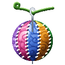
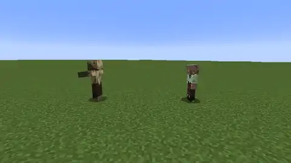
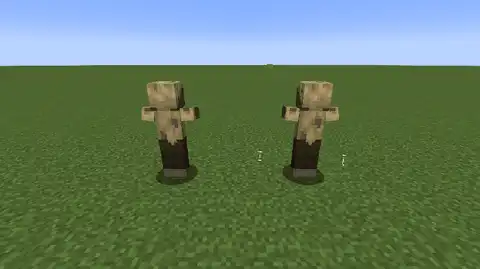
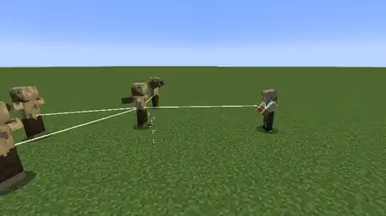
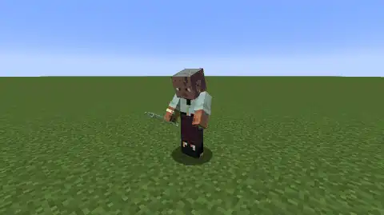
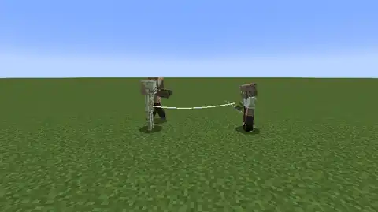
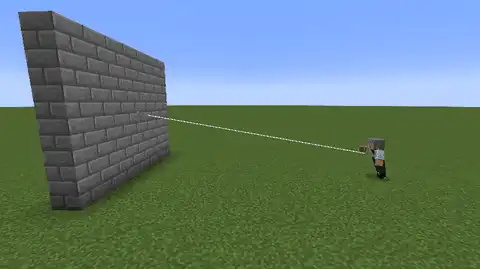
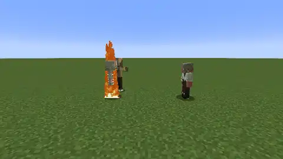
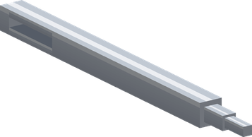

# Nui Nui no Mi

{ .mod-icon }

| | |
|---|---|
| **Type** | Paramecia |
| **Theme** | Stitch |
| **Box** | { .box-icon } Wooden |
| **Chance per opening** | wooden **1.65%** ([how it works](index.md#box-odds)) |
| **Abilities** | 7: 7 active, 0 passive |

In 3D: drag to turn, scroll or pinch to zoom.

<!-- animations -->
??? example "Animations"

    Taken in game, at size 1, third person.

    

    <figure markdown="span">
      { loading=lazy }
      <figcaption>Nuitsuke</figcaption>
    </figure>
    <figure markdown="span">
      { loading=lazy }
      <figcaption>Nuiawase</figcaption>
    </figure>
    <figure markdown="span">
      { loading=lazy }
      <figcaption>Haute Couture: Patchwork</figcaption>
    </figure>
    <figure markdown="span">
      { loading=lazy }
      <figcaption>Tsukuroi</figcaption>
    </figure>
    <figure markdown="span">
      { loading=lazy }
      <figcaption>Ude Nui</figcaption>
    </figure>
    <figure markdown="span">
      { loading=lazy }
      <figcaption>Nui Tobi</figcaption>
    </figure>
    <figure markdown="span">
      { loading=lazy }
      <figcaption>Hodoki</figcaption>
    </figure>
    

<!-- /animations -->

Found in the base mod's **wooden Devil Fruit box**. Eat it and its abilities appear in the ability menu, grouped under the fruit.

!!! note "About the values"
    The values are those of the ability's tooltip in game, with the base mod's default settings. Damage is shown on the base mod's scale, as in the ability screen.

## Nuitsuke { #nuitsuke }

{ .ability-icon } *Active*

{ .form-picture }

Throws a needle and thread at an enemy and sews it to the ground where it stands. It can't move but takes no damage.

An enemy at least twice as big as the user is sewn all over for 10 seconds instead, and its melee hits don't land.

| Stat | Value |
|---|---|
| Cooldown | 10 s |
| Charge | under 1 s |
| Duration | 6 s |

## Nuiawase { #nuiawase }

{ .ability-icon } *Active*

Throws a needle and thread at an enemy and sews it to the closest other enemy, so they can't get away from each other. With no other enemy close by, it is sewn to the ground instead.

| Stat | Value |
|---|---|
| Cooldown | 12 s |
| Charge | under 1 s |
| Duration | 6 s |

## Haute Couture: Patchwork { #haute-couture-patchwork }

{ .ability-icon } *Active*

Sews all the enemies and items around the target to it, then pulls the thread so they all crash into the target. The more things hit it, the more damage it takes.

| Stat | Value |
|---|---|
| Damage type | Blunt, Indirect |
| Haki | Special |
| Cooldown | 18 s |
| Charge | under 1 s |
| Damage | 4–20 |
| Range | 8 blocks (area) |
| Damage When Yanked | 3 |

## Tsukuroi { #tsukuroi }

{ .ability-icon } *Active*

Sews shut the wounds of the ally the user is looking at, or the user's own. It stops the bleeding and heals a little health over a few seconds.

| Stat | Value |
|---|---|
| Cooldown | 20 s |
| Regeneration | +4 |
| Duration | 5 s |

## Hodoki { #hodoki }

{ .ability-icon } *Active*

Undoes every stitch the user made, at once.

| Stat | Value |
|---|---|
| Cooldown | 1 s |
| Charge | under 1 s |

## Ude Nui { #ude-nui }

{ .ability-icon } *Active*

Sews the arms of the enemy the user is looking at to its body. For 4 seconds it can't hit or shoot arrows, but it can still move and use abilities.

| Stat | Value |
|---|---|
| Damage type | Physical, Indirect |
| Haki | Special |
| Cooldown | 15 s |
| Charge | under 1 s |
| Damage | 5 |
| Duration | 4 s |

## Nui Tobi { #nui-tobi }

{ .ability-icon } *Active*

Throws a needle and thread at the block the user is looking at, then the thread pulls the user to it. The fall right after does no damage. Using it again lets go.

| Stat | Value |
|---|---|
| Cooldown | 8 s |
| Range | 24 blocks (line) |
