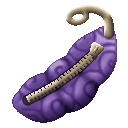
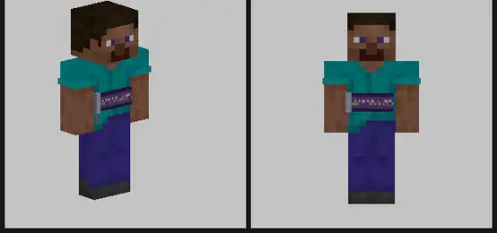
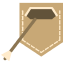

# Poke Poke no Mi

{ .mod-icon }

| | |
|---|---|
| **Type** | Paramecia |
| **Theme** | Pocket |
| **Box** | { .box-icon } Wooden |
| **Chance per opening** | wooden **1.81%** ([how it works](index.md#box-odds)) |
| **Abilities** | 3: 3 active, 0 passive |
| **Effects applied** | { .effect-mini }[Exhausted](../effects.md#effect-exhausted), { .effect-mini }[Just Woken](../effects.md#effect-just-woken), { .effect-mini }[Puppet](../effects.md#effect-puppet), { .effect-mini }[Wide Awake](../effects.md#effect-wide-awake) |

<!-- animations -->
??? example "Animations"

    

    <figure markdown="span">
      { loading=lazy }
      <figcaption>Swallowing Pocket</figcaption>
    </figure>
    

<!-- /animations -->

Found in the base mod's **wooden Devil Fruit box**. Eat it and its abilities appear in the ability menu, grouped under the fruit.

!!! note "About the values"
    The values are those of the ability's tooltip in game, with the base mod's default settings. Damage is shown on the base mod's scale, as in the ability screen.

## Pockets { #poke-pockets }

{ .ability-icon } *Active*

Opens the pockets in the user's body, they keep 54 stacks and stay with the user after death

Bows, crossbows, guns and cannons take their ammo from the pockets when the inventory has none

| Stat | Value |
|---|---|
| Cooldown | 2 s |

## Swallowing Pocket { #poke-swallow }

{ .ability-icon } *Active*

Applies { .effect-mini }[Exhausted](../effects.md#effect-exhausted), { .effect-mini }[Just Woken](../effects.md#effect-just-woken), { .effect-mini }[Puppet](../effects.md#effect-puppet), { .effect-mini }[Wide Awake](../effects.md#effect-wide-awake)

The user's belly swells and its zip opens into a big pocket that swallows the projectiles that come from the front

Arrows, tridents, bullets and cannon balls go in the user's pockets if there is room, the other projectiles are stopped and disappear

While the pocket is open the user cannot move or jump but can still turn

| Stat | Value |
|---|---|
| Cooldown | 20 s |
| Hold | 4 s |

## Store { #poke-store }

{ .ability-icon } *Active*

Puts things in the user's pockets without opening them, the ability mode key switches what is taken

Held Item puts the item in the user's hand in the pockets

Around puts the items lying on the ground around the user in the pockets

Held Item

Around

| Stat | Value |
|---|---|
| Cooldown | 2 s |
| Cooldown | 8 s |
| Reach | 5 blocks |
