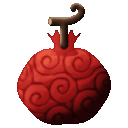
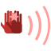

# Riki Riki no Mi

{ .mod-icon }

| | |
|---|---|
| **Type** | Paramecia |
| **Theme** | Strength |
| **Box** | { .box-icon } Iron |
| **Chance per opening** | iron **1.46%**, wooden **0.073%** ([how it works](index.md#box-odds)) |
| **Abilities** | 9: 8 active, 1 passive |

Found in the base mod's **iron Devil Fruit box**. Eat it and its abilities appear in the ability menu, grouped under the fruit.

!!! note "About the values"
    The values are those of the ability's tooltip in game, with the base mod's default settings. Damage is shown on the base mod's scale, as in the ability screen.

## Strength { #riki-strength }

{ .ability-icon } *Passive*

The user is abnormally strong. Their bare hits are harder, all their hits throw further and their hands break blocks faster

| Stat | Value |
|---|---|
| Punch Damage | +4 |
| Knockback | +1 |
| Breaks Blocks by Hand | x2 |

## Mountain Throw { #riki-mountain-throw }

{ .ability-icon } *Active*

The user tears a mass of ground out in front of them and lifts it over their head. Used again it is thrown where they look and bursts on what it hits

The hole closes after a while

| Stat | Value |
|---|---|
| Damage type | Blunt, Indirect |
| Haki | Special |
| Cooldown | 40 s |
| Hold | 10 s |
| Damage | 30 |
| Range | 5 blocks (area) |

## Lift { #riki-lift }

{ .ability-icon } *Active*

The user seizes the enemy in front of them and lifts it over their head. Used again it is thrown where they look and is hurt when it slams into something

Hits on the user set it free. It lasts less on players and bosses

| Stat | Value |
|---|---|
| Damage type | Blunt, Indirect |
| Haki | Hardening |
| Cooldown | 15 s |
| Hold | 5 s |
| Damage | 12 |

## Ground Slam { #riki-ground-slam }

{ .ability-icon } *Active*

The user slams both fists on the ground. The shock hurts the enemies around them and throws them up and away

| Stat | Value |
|---|---|
| Damage type | Blunt, Indirect |
| Haki | Hardening |
| Cooldown | 12 s |
| Damage | 14 |
| Range | 5 blocks (area) |

## Charged Punch { #riki-charged-punch }

{ .ability-icon } *Active*

The user draws their fist back and lets it go on the enemy in front of them. The longer it is drawn the harder it hits and the further it throws

| Stat | Value |
|---|---|
| Damage type | Fist, Physical |
| Haki | Hardening |
| Cooldown | 15 s |
| Charge | 3 s |
| Damage | 8–40 |
| Range | 3.5 blocks (line) |

## Leap { #riki-leap }

{ .ability-icon } *Active*

The user crouches to gather strength while the key is held then leaps high and far where they look. The longer it is held the higher they go

The fall does them no harm and its shock hurts and throws back the enemies around where they land, more from higher

| Stat | Value |
|---|---|
| Damage type | Blunt, Indirect |
| Haki | Hardening |
| Cooldown | 8–20 s |
| Charge | 4 s |
| Leap Height | 9–60 blocks |
| Damage | 4–24 |
| Range | 2.5–8 blocks (area) |

## Pillar Sweep { #riki-pillar-sweep }

{ .ability-icon } *Active*

The user tears out the tree trunk they look at, or a pillar of ground, and holds it like a club. Used again it sweeps in a half circle in front and throws back the enemies hit

The hole closes after a while

| Stat | Value |
|---|---|
| Damage type | Blunt, Indirect |
| Haki | Imbuing |
| Cooldown | 20 s |
| Hold | 10 s |
| Damage | 42 |
| Sweeps | 3 |
| Range | 6 blocks (area) |

## Rock Volley { #riki-rock-volley }

{ .ability-icon } *Active*

The user tears up the ground in front of them and smashes it into chunks that fly out in a fan and burst on what they hit

The hole closes after a while

| Stat | Value |
|---|---|
| Damage type | Blunt, Indirect |
| Haki | Special |
| Cooldown | 16 s |
| Damage | 35 |
| Chunks | 7 |
| Range | 30 blocks (line) |

## Clap { #riki-clap }

{ .ability-icon } *Active*

The user claps their hands and the shock goes out in front of them. The enemies hit are thrown back and stunned for a moment

| Stat | Value |
|---|---|
| Damage type | Indirect |
| Haki | Hardening |
| Cooldown | 14 s |
| Damage | 6 |
| Stun | 1.5 s |
| Range | 8 blocks (line) |
