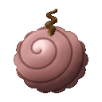
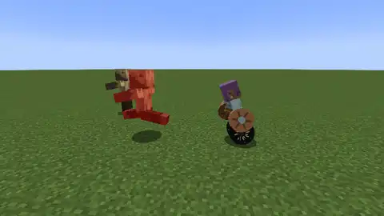
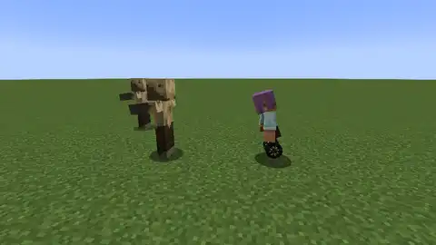
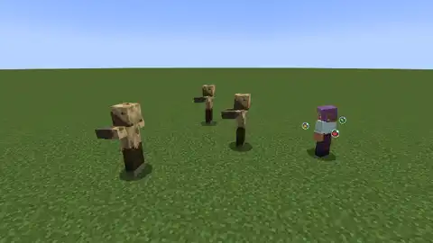
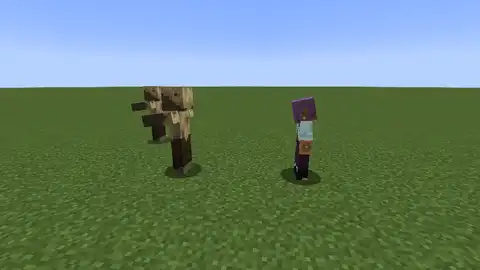
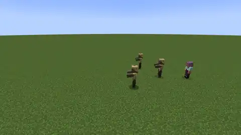
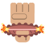
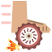
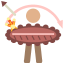

# Shari Shari no Mi

{ .mod-icon }

| | |
|---|---|
| **Type** | Paramecia |
| **Theme** | Wheel |
| **Box** | { .box-icon } Wooden |
| **Chance per opening** | wooden **1.65%** ([how it works](index.md#box-odds)) |
| **Abilities** | 5: 5 active, 0 passive |
| **Effects applied** | [Shari Wheels](../effects.md#effect-shari-wheels) |

<!-- animations -->
??? example "Animations"

    Taken in game, at size 1.

    

    <figure markdown="span">
      { loading=lazy }
      <figcaption>Wheel Arms</figcaption>
    </figure>
    <figure markdown="span">
      { loading=lazy }
      <figcaption>Wheel Feet</figcaption>
    </figure>
    <figure markdown="span">
      { loading=lazy }
      <figcaption>Wheel Roll</figcaption>
    </figure>
    <figure markdown="span">
      { loading=lazy }
      <figcaption>Spinning Top</figcaption>
    </figure>
    <figure markdown="span">
      { loading=lazy }
      <figcaption>Great Wheel</figcaption>
    </figure>
    

<!-- /animations -->

Found in the base mod's **wooden Devil Fruit box**. Eat it and its abilities appear in the ability menu, grouped under the fruit.

!!! note "About the values"
    The values are those of the ability's tooltip in game, with the base mod's default settings. Damage is shown on the base mod's scale, as in the ability screen.

## Wheel Arms { #shari-wheel-arms }

{ .ability-icon } *Active*

Applies [Shari Wheels](../effects.md#effect-shari-wheels)

The user's arms spin like grinding wheels for a while. Each punch with a bare hand keeps grinding and hits a few more times, and the armour of a player wears out twice as fast

Iron armour or better holds against the wheels, the extra hits barely scratch it

| Stat | Value |
|---|---|
| Damage type | Physical |
| Haki | Hardening |
| Cooldown | 15 s |
| Hold | 20 s |
| Extra Hits a Punch | +2 |
| Damage | 2 |
| Damage on Iron Armour | 1 |

## Wheel Feet { #shari-wheel-feet }

{ .ability-icon } *Active*

Applies [Shari Wheels](../effects.md#effect-shari-wheels)

The user's feet spin like wheels and they glide fast over the ground for a while, up the steps of a block. Their kicks grind and hit harder

| Stat | Value |
|---|---|
| Cooldown | 12 s |
| Hold | 15 s |
| Speed | +60 % |
| Damage per Kick | +4 |

## Wheel Roll { #shari-wheel-roll }

{ .ability-icon } *Active*

The user curls up into a whole grinding wheel and rolls fast where they look. They go through every enemy on the way, each one gets hurt and thrown aside. A wall stops the roll

| Stat | Value |
|---|---|
| Damage type | Physical |
| Haki | Hardening |
| Cooldown | 10 s |
| Range | 14 blocks (line) |
| Damage | 10 |

## Spinning Top { #shari-spinning-top }

{ .ability-icon } *Active*

Applies [Shari Wheels](../effects.md#effect-shari-wheels)

The user's upper body spins like a top for a few seconds. The enemies around get hit again and again and the projectiles coming from any side are sent back to their shooter. The user moves slower while spinning

| Stat | Value |
|---|---|
| Damage type | Physical |
| Haki | Hardening |
| Cooldown | 14 s |
| Hold | 3 s |
| Range | 2.5 blocks (area) |
| Damage | 3 |
| Speed | -50 % |

## Great Wheel { #shari-great-wheel }

{ .ability-icon } *Active*

A giant grinding wheel leaves the user's arm and rolls far ahead, up the small steps, grinding every enemy on the way. At the end or on a wall it rolls back to the user and grinds the enemies again on the way. It breaks no block

| Stat | Value |
|---|---|
| Damage type | Physical |
| Haki | Hardening |
| Cooldown | 60 s |
| Range | 24 blocks (line) |
| Damage | 14 |
| Hits on Each Enemy | 2 |
