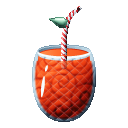

# Shibo Shibo no Mi

{ .mod-icon }

| | |
|---|---|
| **Type** | Paramecia |
| **Theme** | Wringing |
| **Box** | { .box-icon } Iron |
| **Chance per opening** | iron **1.48%**, wooden **0.074%** ([how it works](index.md#box-odds)) |
| **Abilities** | 5: 4 active, 1 passive |
| **Effects applied** | { .effect-mini }[Dried Out](../effects.md#effect-dried-out), [Juicy Giant](../effects.md#effect-juicy-giant) |

Found in the base mod's **iron Devil Fruit box**. Eat it and its abilities appear in the ability menu, grouped under the fruit.

!!! note "About the values"
    The values are those of the ability's tooltip in game, with the base mod's default settings. Damage is shown on the base mod's scale, as in the ability screen.

## Wringing Blade { #shibo-wringing-blade }

{ .ability-icon } *Passive*

The weapon held by the user wrings whoever it hits. Each hit dries them out a little and gives the user some juice

Shows the juice reserve the user filled by wringing people. Juicy Giant uses it and water never fills it

| Stat | Value |
|---|---|
| Max Health Dried per Hit | 3 % |
| Juice per Hit | +2 |
| Juice Reserve | 100 |

## Wring { #shibo-wring }

{ .ability-icon } *Active*

The user grabs the one in front of them and wrings the life juice out of them. It hurts through armour, dries them out so their max health goes down for a while and heals the user. Each wring fills the juice reserve and the good effects of the one wrung pass to the user. Water gives a dried body its health back

The mode key goes through three modes. Wring holds them 3 seconds. Twisting Throw holds them 1 second then throws them where the user looks, the drier the farther, and they get hurt with whoever they hit. Press holds them 1 second then crushes them to the ground, stunned, and their juice splashes and slows the enemies around

Wring

Twisting Throw

Press

| Stat | Value |
|---|---|
| Damage type | Internal |
| Haki | Special |
| Cooldown | 12 s |
| Wrung For | 3 s |
| Cooldown | 8 s |
| Wrung For | 1 s |
| Throw Speed, +0.5 per 20% Dried | 1.5 |
| Impact Damage | 6 |
| Cooldown | 14 s |
| Wrung For | 1 s |
| Crush Damage | 8 |
| Stunned For | 2 s |
| Splash Damage Around | 3 |
| Splash Radius | 4 |
| Slowness II For | 4 s |
| Damage per Second, Through Armour | 2 |
| Max Health Dried per Second | 10 % |
| Juice per Second | +10 |

## Self Wring { #shibo-self-wring }

{ .ability-icon } *Active*

The user wrings themself and the poison and every bad effect comes out of their body with a bit of their health

| Stat | Value |
|---|---|
| Cooldown | 20 s |
| Health Cost | 4 |

## Juice Drain { #shibo-juice-drain }

{ .ability-icon } *Active*

Applies { .effect-mini }[Dried Out](../effects.md#effect-dried-out)

The user drains the life juice of every enemy around while charging. They get dried out and slowed down and the juice goes in the reserve

Use it again to stop early, the juice already taken is kept

| Stat | Value |
|---|---|
| Cooldown | 20 s |
| Charge | 3 s |
| Drain Radius | 10 |
| Max Health Dried per Second | 10 % |
| Juice per Second per Enemy | +5 |

## Juicy Giant { #shibo-juicy-giant }

{ .ability-icon } *Active*

Applies [Juicy Giant](../effects.md#effect-juicy-giant)

The user grows into a giant as big as their juice reserve. The reserve empties little by little and the user gets smaller with it until they are back to normal. Their punches, reach and wrings grow with them

Use it again to stop being a giant

| Stat | Value |
|---|---|
| Cooldown | 10–60 s |
| Cooldown per Second as a Giant | 1 s |
| Juice Needed | 20 |
| Size, From the Juice | 1.5–3 x |
| Punch Damage, From the Size | +4–12 |
| Juice Lost per Second | 2 |
