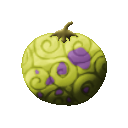
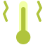
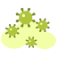

# Shiku Shiku no Mi

{ .mod-icon }

| | |
|---|---|
| **Type** | Paramecia |
| **Theme** | Disease |
| **Box** | { .box-icon } Iron |
| **Chance per opening** | iron **1.48%**, wooden **0.074%** ([how it works](index.md#box-odds)) |
| **Abilities** | 5: 5 active, 0 passive |

Found in the base mod's **iron Devil Fruit box**. Eat it and its abilities appear in the ability menu, grouped under the fruit.

!!! note "About the values"
    The values are those of the ability's tooltip in game, with the base mod's default settings. Damage is shown on the base mod's scale, as in the ability screen.

## Fever { #shiku-fever }

{ .ability-icon } *Active*

The user gives a fever to the enemy they look at. The sick one moves slower and hits weaker

It passes to everyone near the sick one but never back to the user. A strong Haki breaks it and cures the sick around

| Stat | Value |
|---|---|
| Cooldown | 15 s |
| Range | 8 blocks (line) |
| Lasts | 20 s |
| Spreads within | 2.5 blocks |
| Other diseases wait | 6 s |

## Wasting { #shiku-wasting }

{ .ability-icon } *Active*

The user makes the enemy they look at waste away. The sick one loses life little by little and nothing heals it

It passes to everyone near the sick one but never back to the user. A strong Haki breaks it and cures the sick around

| Stat | Value |
|---|---|
| Cooldown | 18 s |
| Range | 8 blocks (line) |
| Lasts | 15 s |
| Spreads within | 2.5 blocks |
| Other diseases wait | 6 s |

## Coughing Fit { #shiku-coughing-fit }

{ .ability-icon } *Active*

The user gives a coughing fit to the enemy they look at. Now and then one of its abilities fails and has to wait

It passes to everyone near the sick one but never back to the user. A strong Haki breaks it and cures the sick around

| Stat | Value |
|---|---|
| Cooldown | 20 s |
| Range | 8 blocks (line) |
| Lasts | 20 s |
| Spreads within | 2.5 blocks |
| Other diseases wait | 6 s |

## Feminization Disease { #shiku-feminization }

{ .ability-icon } *Active*

The user gives the Feminization Disease to the enemy they look at. A player takes the other build and anyone who catches it is dazed a moment

It lasts the longest and passes the furthest, to everyone near the sick one but never back to the user. A strong Haki breaks it and cures the sick around

| Stat | Value |
|---|---|
| Cooldown | 45 s |
| Range | 8 blocks (line) |
| Lasts | 120 s |
| Spreads within | 5 blocks |
| Other diseases wait | 6 s |

## Epidemic { #shiku-epidemic }

{ .ability-icon } *Active*

The user lays a cloud of the last disease they gave where they look. Everyone who is in it catches the disease, but never the user

| Stat | Value |
|---|---|
| Cooldown | 40 s |
| Hold | 5 s |
| Range | 5 blocks (area) |
