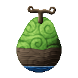
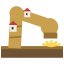
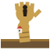
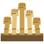
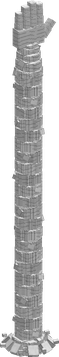
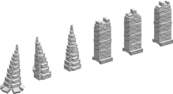
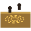

# Shima Shima no Mi

{ .mod-icon }

| | |
|---|---|
| **Type** | Paramecia |
| **Theme** | Island |
| **Box** | { .box-icon } Golden |
| **Chance per opening** | golden **2.71%**, iron **0.136%**, wooden **0.007%** ([how it works](index.md#box-odds)) |
| **Abilities** | 8: 7 active, 1 passive |
| **Effects applied** | { .effect-mini }[Island Spirit](../effects.md#effect-island-spirit) |

In 3D: drag to turn, scroll or pinch to zoom.

Found in the base mod's **golden Devil Fruit box**. Eat it and its abilities appear in the ability menu, grouped under the fruit.

!!! note "About the values"
    The values are those of the ability's tooltip in game, with the base mod's default settings. Damage is shown on the base mod's scale, as in the ability screen.

## Merge { #shima-merge }

{ .ability-icon } *Active*

Applies { .effect-mini }[Island Spirit](../effects.md#effect-island-spirit)

The user sinks into the ground and becomes the spirit of the island. Unseen and out of reach, they fly through everything around the place they sank and can raise the ground anywhere there. Used again they come back out where they aim, or by their face if they aim at nothing

Only their arms and face can be hurt, and that hurts them. A blow while sinking stops it

The more solid ground around, the bigger the arms, face and spikes rise

| Stat | Value |
|---|---|
| Cooldown | 10 s |
| Hold | ∞ s |
| Charge | 2 s |
| Land radius | 128 |

## Island Arm { #shima-island-arm }

{ .ability-icon } *Active*

{ .form-picture }

A giant arm of ground rises and strikes down where the user aims, hitting every enemy around the blow, then goes back into the ground. Hitting the arm while it is up hurts the user

Only while merged, anywhere on their land. The bigger the island the bigger and stronger it rises

| Stat | Value |
|---|---|
| Damage type | Physical |
| Haki | Special |
| Cooldown | 8–48 s |
| Damage | 26–156 |
| Range | 2.5–15 blocks (area) |

## Island Hand { #shima-island-hand }

{ .ability-icon } *Active*

{ .form-picture }

A giant hand of ground rises, seizes the one the user aims at and holds them up. Used again it throws them where the user looks. It holds less on players and bosses

Only while merged, anywhere on their land. The bigger the island the bigger and stronger it rises

| Stat | Value |
|---|---|
| Damage type | Physical |
| Haki | Special |
| Cooldown | 10–60 s |
| Hold | 4 s |
| Damage | 14–84 |

## Arm Swarm { #shima-arm-swarm }

{ .ability-icon } *Active*

{ .form-picture }

A field of small arms of ground rises where the user aims and they strike down on every creature there, each creature once. Hitting an arm while it is up hurts the user

Only while merged, anywhere on their land. The bigger the island the bigger and stronger they rise

| Stat | Value |
|---|---|
| Damage type | Physical |
| Haki | Special |
| Cooldown | 15–90 s |
| Damage | 14–84 |
| Range | 6–36 blocks (area) |

## Island Face { #shima-island-face }

{ .ability-icon } *Active*

A huge face of rock rises where the user sank when they merge, and stays until they come back out. It speaks when they talk and they feel the creatures around it. Hitting it hurts the user

Used it rises again where the user aims. Only while merged

| Stat | Value |
|---|---|
| Cooldown | 3–18 s |

## Face Bite { #shima-face-bite }

{ .ability-icon } *Active*

The face of rock turns to the nearest enemy and bites everything in front of its mouth

Only while merged and with the face out. The bigger the island the further and harder it bites

| Stat | Value |
|---|---|
| Damage type | Physical |
| Haki | Special |
| Cooldown | 6–36 s |
| Damage | 20–120 |
| Range | 5–30 blocks (cone) |

## Rising Ground { #shima-rising-ground }

{ .ability-icon } *Active*

{ .form-picture }

The ground stands up where the user aims. Spikes jump out in a line and throw the enemies up, or a wall rises that stops enemies and projectiles

Only while merged. The ability mode key changes between spikes and a wall

| Stat | Value |
|---|---|
| Damage type | Physical |
| Haki | Special |
| Cooldown | 7–90 s |
| Damage | 18–108 |

## Itch { #shima-itch }

{ .ability-icon } *Passive*

While merged the user feels every creature that stands on their land, and those around their face, and sees them through the ground
