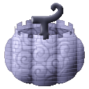
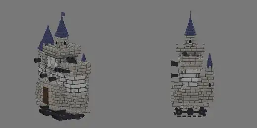
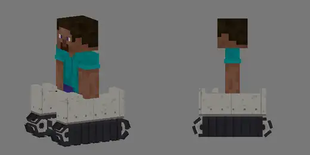
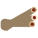
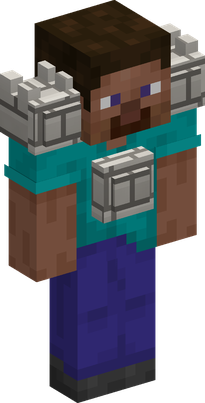
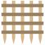
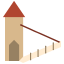
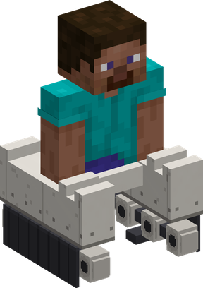
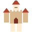
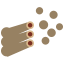

# Shiro Shiro no Mi

{ .mod-icon }

| | |
|---|---|
| **Type** | Paramecia |
| **Theme** | Castle |
| **Box** | { .box-icon } Golden |
| **Chance per opening** | golden **2.32%**, iron **0.116%**, wooden **0.006%** ([how it works](index.md#box-odds)) |
| **Abilities** | 7: 7 active, 0 passive |

In 3D: drag to turn, scroll or pinch to zoom.

<!-- animations -->
??? example "Animations"

    

    <figure markdown="span">
      { loading=lazy }
      <figcaption>Big Father</figcaption>
    </figure>
    <figure markdown="span">
      { loading=lazy }
      <figcaption>Castle Tank</figcaption>
    </figure>
    

<!-- /animations -->

Found in the base mod's **golden Devil Fruit box**. Eat it and its abilities appear in the ability menu, grouped under the fruit.

!!! note "About the values"
    The values are those of the ability's tooltip in game, with the base mod's default settings. Damage is shown on the base mod's scale, as in the ability screen.

## Open the Doors { #shiro-open-doors }

{ .ability-icon } *Active*

The castle inside the user's body has two doors, the ability mode key switches between them

Open the Doors: anyone who right clicks the user goes in, and the user right clicks their own animals and summons to send them in

Into the Castle: the user goes in, their body stays outside and does not move. Use it again or go through the portal to come back, if the body is hit the user is brought back and takes the hit

Use it while crouching, in either mode, to throw out everyone inside who is not an ally

Open the Doors

Into the Castle

| Stat | Value |
|---|---|
| Cooldown | 2 s |
| Most Creatures Inside | 10 |
| Cooldown | 5 s |

## Body Cannons { #shiro-body-cannons }

{ .ability-icon } *Active*

{ .form-picture }

Cannons come out of the user's shoulders and chest and fire 3 cannonballs where the user looks

Each shot takes a cannonball from a chest put in the castle inside the user, without one it is a weak shot

| Stat | Value |
|---|---|
| Damage type | Projectile, Physical |
| Haki | Imbuing |
| Cooldown | 6 s |
| Cannonballs | 3 |
| Damage per Ball | 12 |
| Damage Without a Ball | 6 |

## Portcullis { #shiro-portcullis }

{ .ability-icon } *Active*

As Big Father, a castle portcullis falls on each enemy in a wide cone in front of the user and hurts everyone under it

| Stat | Value |
|---|---|
| Damage type | Blunt, Indirect |
| Haki | Special |
| Cooldown | 8 s |
| Damage | 18 |
| Range | 25 blocks (line) |
| Cone Angle | 70 ° |
| Most Portcullises | 6 |

## Drawbridge { #shiro-drawbridge }

{ .ability-icon } *Active*

As Big Father, a drawbridge slams down in front of the user, enemies under it are hurt and thrown away

| Stat | Value |
|---|---|
| Damage type | Blunt, Indirect |
| Haki | Special |
| Cooldown | 6 s |
| Damage | 14 |
| Range | 16 blocks (line) |

## Castle Tank { #shiro-castle-tank }

{ .ability-icon } *Active*

{ .form-picture }

The user's legs turn into tank treads, the user rolls much faster and crushes and throws away the enemies in the way, also as Big Father

It lasts 30 seconds, 10 as Big Father, use it again to stop sooner

| Stat | Value |
|---|---|
| Damage type | Blunt, Physical |
| Haki | Hardening |
| Cooldown | 5 s |
| Damage | 14 |
| Speed (blocks/s) | 6.8 |
| Speed as Big Father (blocks/s) | 5.5 |
| Duration (s) | 30 |
| Duration as Big Father (s) | 10 |

## Big Father { #shiro-big-father }

{ .ability-icon } *Active*

The user becomes a giant walking fortress covered with cannons, the fortress takes the hits instead of the user and its cannons fire by themselves at enemies nearby

Use it again to stop. The less is left of the fortress the longer the cooldown, if it is destroyed everyone inside the castle is thrown out next to the user

| Stat | Value |
|---|---|
| Damage type | Projectile, Physical |
| Haki | Imbuing |
| Cooldown | 10–120 s |
| Cooldown, Whole to Destroyed | 10–120 s |
| Fortress Endurance | 300 |
| Cannon Damage | 10 |
| Cannon Reach | 16 |
| Walking Speed (blocks/s) | 1.5 |
| Reach (blocks) | 9.5 |

**Stats while active**

| Stat | Value |
|---|---|
| Step Height | +1.5 |
| Punch Damage | +10 |
| Fall Resistance | +20 |
| Speed | x0.35 |
| Knockback Resistance | +1 |
| Entity Reach | +6.52 |
| Block Reach | +9.78 |

## Big Volley { #shiro-big-volley }

{ .ability-icon } *Active*

As Big Father every cannon of the fortress fires at once where the user looks, each shot takes a cannonball from a chest put in the castle and is weak without one

| Stat | Value |
|---|---|
| Damage type | Projectile, Physical |
| Haki | Imbuing |
| Cooldown | 20 s |
| Cannonballs | 12 |
| Damage per Ball | 14 |
| Damage Without a Ball | 7 |
