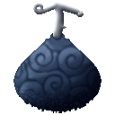
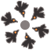
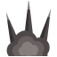
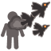
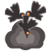
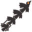

# Susu Susu no Mi

{ .mod-icon }

| | |
|---|---|
| **Type** | Logia |
| **Theme** | Soot |
| **Box** | { .box-icon } Golden |
| **Chance per opening** | golden **2.32%**, iron **0.116%**, wooden **0.006%** ([how it works](index.md#box-odds)) |
| **Abilities** | 8: 6 active, 2 passive |
| **Effects applied** | { .effect-mini }[Murder of Crows](../effects.md#effect-murder-of-crows) |

Found in the base mod's **golden Devil Fruit box**. Eat it and its abilities appear in the ability menu, grouped under the fruit.

!!! note "About the values"
    The values are those of the ability's tooltip in game, with the base mod's default settings. Damage is shown on the base mod's scale, as in the ability screen.

## Logia Invulnerability Susu { #logia-invulnerability-susu }

{ .ability-icon } *Passive*

Allows the user to avoid attacks by instinctively transforming parts of their body into their specific element

The user's body is made of soot

| Stat | Value |
|---|---|
| Haki | Special |

## Susu Hiko { #susu-hiko }

{ .ability-icon } *Passive*

The user turns into a cloud of soot allowing them to fly, the speed is higher while not in combat

## Karasusu { #karasusu }

{ .ability-icon } *Active*

The user makes 3 crows of soot out of their body, they stay with the user and attack whoever hits the user or gets hit by them. Only Haki, Seastone and water can kill a crow and a killed crow is lost until the next use

Use the ability again to call the crows back

| Stat | Value |
|---|---|
| Damage type | Physical |
| Haki | Special |
| Cooldown | 10 s |
| Cooldown, All Lost | 30 s |
| Crows | 3 |
| Peck Damage | 4 |

## Karasu Renkon { #karasu-renkon }

{ .ability-icon } *Active*

Karasu Renkon, the user sends a murder of soot crows on the target they look at, the crows cover it and peck it again and again

Rakuro, soot crows whirl around the user hurting the enemies close to them, then they dive beak first on the target the user looks at. Every hit of Rakuro slows a lot

Use the alt mode key to switch between the two

Karasu Renkon

Rakuro

| Stat | Value |
|---|---|
| Damage type | Physical, Indirect |
| Haki | Special |
| Cooldown | 15 s |
| Pecks | 8 |
| Peck Damage | 2 |
| Total Damage | 16 |
| Range | 24 blocks (line) |
| Cooldown | 16 s |
| Whirl Damage | 6 |
| Dive Damage | 14 |
| Range | 24 blocks (line) |
| Slowness IV | 3 s |

## Obelisusu { #obelisusu }

{ .ability-icon } *Active*

The user dashes past the enemies as soot leaving soot at their feet, then obelisks of soot shoot up under them, piercing them and throwing them up

| Stat | Value |
|---|---|
| Damage type | Physical, Indirect |
| Haki | Special |
| Cooldown | 18 s |
| Damage | 16 |
| Range | 12 blocks (line) |

## Karasu Hiko { #karasu-hiko }

{ .ability-icon } *Active*

Applies { .effect-mini }[Murder of Crows](../effects.md#effect-murder-of-crows)

The user comes apart into a murder of soot crows and flies fast where they look, nothing can hit them until they form again. Water and Seastone make them form again

Use the ability again to form again sooner

| Stat | Value |
|---|---|
| Cooldown | 30 s |
| Hold | 6 s |

## Shokuro { #shokuro }

{ .ability-icon } *Active*

Kokuro, the user sends a swarm of soot crows on a small area in front of them

Shokuro, the user sends a wide rush of soot crows in front of them

The enemies hit are hurt and slowed a lot. Use the alt mode key to switch between the two

Kokuro

Shokuro

| Stat | Value |
|---|---|
| Damage type | Physical, Indirect |
| Haki | Special |
| Cooldown | 10 s |
| Damage | 10 |
| Range | 4 blocks (area) |
| Cooldown | 16 s |
| Damage | 12 |
| Range | 10–5 blocks (cone) |
| Slowness IV | 3 s |

## Gokuro { #gokuro }

{ .ability-icon } *Active*

Hijona Kokuu, the user shoots a dense murder of soot crows in a straight line

Gokuro, soot crows swirl over the user then keep falling on the place the user looks at, use the ability again to stop it

The enemies hit are hurt and slowed a lot. Use the alt mode key to switch between the two

Hijona Kokuu

Gokuro

| Stat | Value |
|---|---|
| Damage type | Physical, Indirect |
| Haki | Special |
| Cooldown | 12 s |
| Damage | 12 |
| Range | 16 blocks (line) |
| Cooldown | 24 s |
| Hold | 5 s |
| Damage Every 0.5 s | 3 |
| Range | 6 blocks (area) |
| Slowness IV | 3 s |
