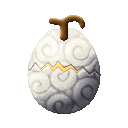
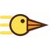
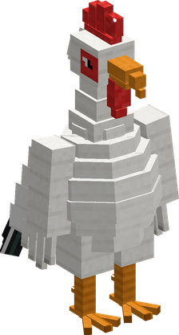

# Tama Tama no Mi

{ .mod-icon }

| | |
|---|---|
| **Type** | Zoan |
| **Box** | { .box-icon } Wooden |
| **Chance per opening** | wooden **1.81%** ([how it works](index.md#box-odds)) |
| **Abilities** | 5: 4 active, 1 passive |
| **Effects applied** | { .effect-mini }[Yolk](../effects.md#effect-yolk) |

In 3D: drag to turn, scroll or pinch to zoom.

Found in the base mod's **wooden Devil Fruit box**. Eat it and its abilities appear in the ability menu, grouped under the fruit.

!!! note "About the values"
    The values are those of the ability's tooltip in game, with the base mod's default settings. Damage is shown on the base mod's scale, as in the ability screen.

## Peck { #tama-peck }

{ .ability-icon } *Active*

As a chick or a rooster the user pecks the enemy in front of them with their beak. The rooster hits harder

| Stat | Value |
|---|---|
| Damage type | Physical |
| Haki | Hardening |
| Cooldown | 5 s |
| Damage | 8–10 |
| Range | 3.5 blocks (line) |

## Dash { #tama-chick-dash }

{ .ability-icon } *Active*

As a chick or a rooster the user leans forward and runs much faster for a few seconds

| Stat | Value |
|---|---|
| Cooldown | 12 s |
| Hold | 5 s |

## Wing Flurry { #tama-wing-flurry }

{ .ability-icon } *Active*

As a rooster the user beats their wings and throws back all enemies in front of them

| Stat | Value |
|---|---|
| Damage type | Physical, Indirect |
| Element | Wind |
| Haki | Special |
| Cooldown | 10 s |
| Range | 5 blocks (area) |
| Damage | 10 |

## Crow { #tama-crow }

{ .ability-icon } *Active*

As a rooster the user crows so loud that all enemies around them are shaken, slowing and weakening them for a moment

| Stat | Value |
|---|---|
| Cooldown | 20 s |
| Range | 10 blocks (area) |
| Shaken Lasts | 5 s |

## Three Lives { #tama-lives }

{ .ability-icon } *Passive*

{ .form-picture }

Applies { .effect-mini }[Yolk](../effects.md#effect-yolk)

The user is an egg with 3 lives. A blow that would kill them cracks them instead. They become a yolk for 5 seconds then are born again in the next form, first a fast chick then a strong rooster. Killed as a rooster the user dies for real

The yolk can't move, attack or use abilities and any hit kills it for real

The user can't choose their form. After 10 minutes without losing a life the user is an egg again with all 3 lives

Egg

Chick

Rooster

| Stat | Value |
|---|---|
| Armor | +4 |
| Speed | x1.35 |
| Fist Damage | +2 |
| Fist Damage | +4 |
| Armor | +6 |
| Armor Toughness | +3 |
| Knockback Resistance % | +30 |
