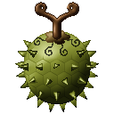
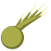
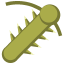
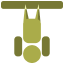

# Toge Toge no Mi

{ .mod-icon }

| | |
|---|---|
| **Type** | Paramecia |
| **Theme** | Spike |
| **Box** | { .box-icon } Wooden |
| **Chance per opening** | wooden **1.81%** ([how it works](index.md#box-odds)) |
| **Abilities** | 8: 8 active, 0 passive |
| **Transformations** | [Stinger Hedgehog](#toge-stinger-hedgehog) |

Found in the base mod's **wooden Devil Fruit box**. Eat it and its abilities appear in the ability menu, grouped under the fruit.

!!! note "About the values"
    The values are those of the ability's tooltip in game, with the base mod's default settings. Damage is shown on the base mod's scale, as in the ability screen.

## Stinger Finger { #toge-stinger-finger }

{ .ability-icon } *Active*

The user stretches their fingers into long spikes and slashes the enemies in front twice, against a wall the spikes dig a passage through it

With the alternate mode both hands turn into one big spike each and stab the enemy in front again and again

Spikes get stuck in wool, carpets and leather armour and the user can't move for a moment

Stinger Finger

Double Stinger

| Stat | Value |
|---|---|
| Damage type | Fist, Physical |
| Haki | Hardening |
| Cooldown | 6 s |
| Damage | 8 |
| Max Targets | 3 |
| Reach | 6 blocks |
| Cooldown | 10 s |
| Stabs | 5 |
| Total Damage | 18 |
| Reach | 3 blocks |

## Stinger Hedgehog { #toge-stinger-hedgehog }

{ .ability-icon } *Active · Transformation*

The user rolls up into a ball of spikes like a sea urchin and rolls over the enemies, the ones who hit it by hand get spiked back

Falling on enemies from up high hurts them a lot more

| Stat | Value |
|---|---|
| Damage type | Physical |
| Haki | Hardening |
| Movement Speed | +60 % |
| Damage on Contact | 6 |
| Damage when Falling on Them | 12 |
| Damage Back to a Hand Blow | 4 |

## Sewing Stinger { #toge-sewing-stinger }

{ .ability-icon } *Active*

The user grows short spikes under their feet and runs faster

With the alternate mode a long spike grows under each foot, the user walks up high on them like stilts and tramples the enemies under and next to their feet

Spiked Soles

Sewing Stinger

| Stat | Value |
|---|---|
| Damage type | Physical |
| Haki | Hardening |
| Cooldown | 25 s |
| Duration | 15 s |
| Movement Speed | +40 % |
| Movement Speed | +30 % |
| Height | +1.5 blocks |
| Damage per Step | 4 |

## Stinger Step { #toge-stinger-step }

{ .ability-icon } *Active*

The user stomps with dozens of spikes under their foot, they come out of the ground all around and throw back the enemies near

| Stat | Value |
|---|---|
| Damage type | Physical |
| Haki | Hardening |
| Cooldown | 10 s |
| Range | 3 blocks (area) |
| Damage | 9 |

## Sea Urchin Stinger { #toge-sea-urchin-stinger }

{ .ability-icon } *Active*

The user turns their hair into a ball of spikes and charges head first, the enemies in the way are thrown back and stone walls get a round hole punched through

| Stat | Value |
|---|---|
| Damage type | Physical |
| Haki | Hardening |
| Cooldown | 14 s |
| Range | 12 blocks (line) |
| Damage | 11 |

## Toge Toge Doping { #toge-doping }

{ .ability-icon } *Active*

The user stabs spikes into their own shoulders like acupuncture, it hurts them but their arms swell up huge and strong, they hit harder and run faster and the ones who hit them by hand get spiked

Stinger Flail can only be used like this

| Stat | Value |
|---|---|
| Damage type | Physical |
| Haki | Hardening |
| Cooldown | 120 s |
| Duration | 30 s |
| Health Cost | 4 |
| Punch Damage | +5 |
| Movement Speed | +20 % |
| Damage Back to a Hand Blow | 3 |

## Stinger Flail { #toge-stinger-flail }

{ .ability-icon } *Active*

While under Toge Toge Doping, spikes grow all along the user's swollen arms and they swing them like clubs at all the enemies in front

| Stat | Value |
|---|---|
| Damage type | Fist, Blunt, Physical |
| Haki | Hardening |
| Cooldown | 5 s |
| Range | 4.5 blocks (area) |
| Damage | 14 |

## Toge Grip { #toge-grip }

{ .ability-icon } *Active*

The user drives spikes into the ceiling and hangs on it upside down with their hands free, or into a wall and climbs it, crouching holds them still

Using it again or jumping lets go

| Stat | Value |
|---|---|
| Cooldown | 4 s |
