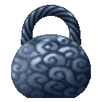
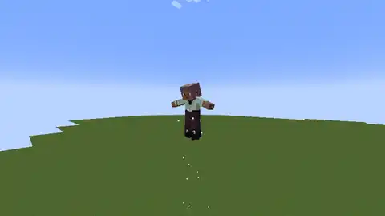
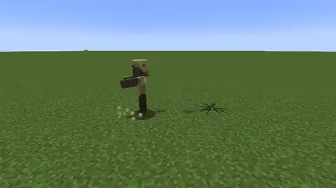
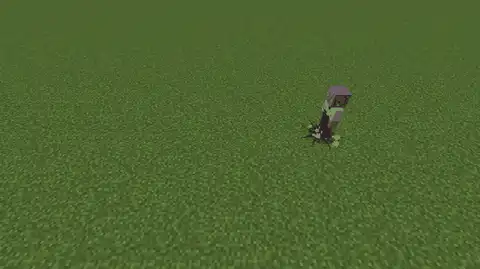
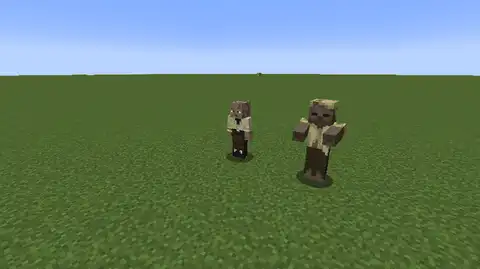
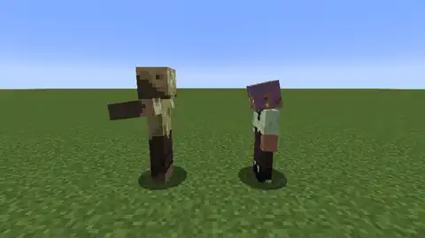
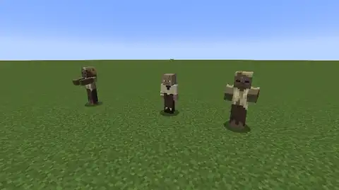
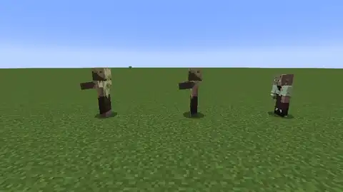
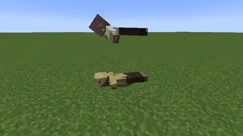

# Ton Ton no Mi

{ .mod-icon }

| | |
|---|---|
| **Type** | Paramecia |
| **Theme** | Weight |
| **Box** | { .box-icon } Iron |
| **Chance per opening** | iron **1.37%**, wooden **0.069%** ([how it works](index.md#box-odds)) |
| **Abilities** | 7: 7 active, 0 passive |

<!-- animations -->
??? example "Animations"

    Taken in game, at size 1, third person.

    

    <figure markdown="span">
      { loading=lazy }
      <figcaption>Float</figcaption>
    </figure>
    <figure markdown="span">
      { loading=lazy }
      <figcaption>Heavy Body</figcaption>
    </figure>
    <figure markdown="span">
      { loading=lazy }
      <figcaption>Heavy Body: footprints</figcaption>
    </figure>
    <figure markdown="span">
      { loading=lazy }
      <figcaption>Vise</figcaption>
    </figure>
    <figure markdown="span">
      { loading=lazy }
      <figcaption>Senton Knuckle</figcaption>
    </figure>
    <figure markdown="span">
      { loading=lazy }
      <figcaption>Hyakuton Stomp</figcaption>
    </figure>
    <figure markdown="span">
      { loading=lazy }
      <figcaption>Manton Tackle</figcaption>
    </figure>
    <figure markdown="span">
      { loading=lazy }
      <figcaption>Senton Press</figcaption>
    </figure>
    

<!-- /animations -->

Found in the base mod's **iron Devil Fruit box**. Eat it and its abilities appear in the ability menu, grouped under the fruit.

!!! note "About the values"
    The values are those of the ability's tooltip in game, with the base mod's default settings. Damage is shown on the base mod's scale, as in the ability screen.

## Float { #float }

{ .ability-icon } *Active*

The user removes their weight and floats into the air, from where a Vise can be used. Using it again lets the user down and they take no fall damage when they land.

| Stat | Value |
|---|---|
| Cooldown | 2–7 s |
| Hold | 10 s |

## Vise { #vise }

{ .ability-icon } *Active*

While in the air, the user becomes many tonnes heavy and falls straight down on the enemies below. The higher the fall the more damage it deals, landing on nobody hurts the user.

The heavier the weight, the more damage in a bigger area, but the longer the cooldown. The two heaviest leave a crater. The ability mode key picks the weight before use.

| Stat | Jutton Vise | Hyakuton Vise | Hakai no Senton Vise | Jigoku no Manton Vise |
|---|---|---|---|---|
| Damage type | Blunt, Physical | Blunt, Physical | Blunt, Physical | Blunt, Physical |
| Haki | Hardening | Hardening | Hardening | Hardening |
| Cooldown | 8 s | 15 s | 30 s | 60 s |
| Damage | 6–16 | 10–24 | 14–30 | 20–36 |
| Range | 3 blocks (area) | 4 blocks (area) | 6 blocks (area) | 8 blocks (area) |
| Self Damage on a Miss | 2 | 2 | 2 | 2 |

## Heavy Body { #heavy-body }

{ .ability-icon } *Active*

Makes the user very heavy, they take no knockback and less damage but moves slowly and can barely jump. Landing on enemies damages them. Floating turns it off.

| Stat | Value |
|---|---|
| Cooldown | 2 s |
| Hold | ∞ s |

**Stats while active**

| Stat | Value |
|---|---|
| Knockback Resistance | +1 |
| Speed | -0.04 |
| Jump Height | -0.6 |
| Armor Toughness | +4 |
| Armor | +8 |

## Senton Knuckle { #senton-knuckle }

{ .ability-icon } *Active*

While on the ground, the user becomes 1000 tonnes heavy right when their punch lands, dealing heavy damage to the enemies in front of them and sending them flying.

| Stat | Value |
|---|---|
| Damage type | Blunt, Physical |
| Haki | Hardening |
| Cooldown | 10 s |
| Charge | under 1 s |
| Damage | 22 |
| Range | 3.5 blocks (line) |

## Hyakuton Stomp { #hyakuton-stomp }

{ .ability-icon } *Active*

While on the ground, the user becomes 100 tonnes heavy and stomps, creating a shockwave that damages all nearby enemies standing on the ground, launching them into the air and slowing them.

| Stat | Value |
|---|---|
| Damage type | Blunt, Physical, Indirect |
| Haki | Hardening |
| Cooldown | 12 s |
| Charge | under 1 s |
| Damage | 14 |
| Range | 5 blocks (area) |

## Manton Tackle { #manton-tackle }

{ .ability-icon } *Active*

The user dashes forward with all their weight, damaging all enemies in their path and pushing them aside.

| Stat | Value |
|---|---|
| Damage type | Blunt, Physical |
| Haki | Hardening |
| Cooldown | 15 s |
| Damage | 20 |

## Senton Press { #senton-press }

{ .ability-icon } *Active*

The user grabs the enemy in front of them, becomes 1000 tonnes heavy and falls on it, dealing heavy damage and pinning it to the ground for a few seconds.

| Stat | Value |
|---|---|
| Damage type | Blunt, Physical |
| Haki | Hardening |
| Cooldown | 20 s |
| Charge | under 1 s |
| Pinned | 3 s |
| Damage | 26 |
