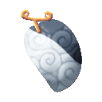
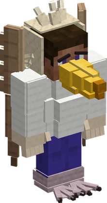
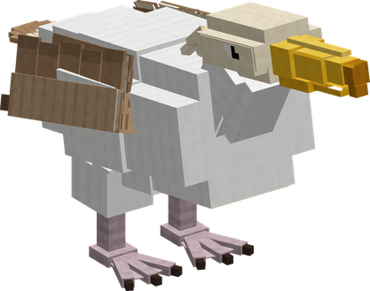
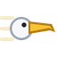
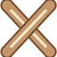

# Tori Tori no Mi, Model: Albatross

{ .mod-icon }

| | |
|---|---|
| **Type** | Zoan |
| **Box** | { .box-icon } Wooden |
| **Chance per opening** | wooden **1.93%** ([how it works](index.md#box-odds)) |
| **Abilities** | 6: 4 active, 2 passive (1 hidden, not in the ability menu) |
| **Transformations** | [Albatross Assault Point](#albatross-assault-point), [Albatross Fly Point](#albatross-fly-point) |

In 3D: drag to turn, scroll or pinch to zoom.

Found in the base mod's **wooden Devil Fruit box**. Eat it and its abilities appear in the ability menu, grouped under the fruit.

!!! note "About the values"
    The values are those of the ability's tooltip in game, with the base mod's default settings. Damage is shown on the base mod's scale, as in the ability screen.

## Albatross Assault Point { #albatross-assault-point }

{ .ability-icon } *Active · Transformation*

{ .form-picture }

Transforms the user into an albatross hybrid, which can fly for a very long time and still use weapons

## Albatross Fly Point { #albatross-fly-point }

{ .ability-icon } *Active · Transformation*

{ .form-picture }

Transforms the user into a great albatross, which flies for a very long time, faster over water and in the rain, and can carry another player on its back

## Albatross Flight { #albatross-flight }

*Passive*

!!! info "Hidden ability"
    It does not appear in the ability menu.

Requires Albatross Hybrid or Albatross to be active.

## Albatross Rideable { #albatross-rideable }

{ .ability-icon } *Passive*

Allows another player to ride on the albatross's back.

Requires Albatross to be active.

## Beak Strike { #albatross-beak-strike }

{ .ability-icon } *Active*

The user throws themselves at the target and strikes it with their long beak, pushing it back

| Stat | Value |
|---|---|
| Damage type | Physical |
| Haki | Hardening |
| Cooldown | 8 s |
| Damage | 14 |

## Wing Wall { #albatross-wing-wall }

{ .ability-icon } *Active*

As a hybrid the user crosses their long wings in front of them. While it is held the hits from the front are much weaker and projectiles from the front are stopped. The user can't attack while guarding

| Stat | Value |
|---|---|
| Cooldown | 12 s |
| Hold | 5 s |
| Damage Blocked from the Front | 70 % |
