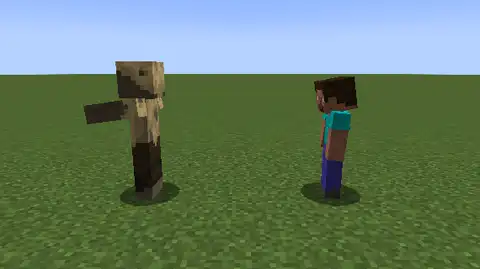
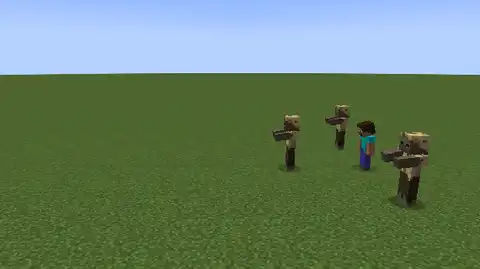
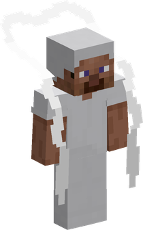
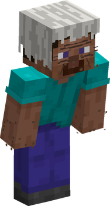

# Toshi Toshi no Mi

{ .mod-icon }

| | |
|---|---|
| **Type** | Paramecia |
| **Theme** | Age |
| **Box** | { .box-icon } Golden |
| **Chance per opening** | golden **2.16%**, iron **0.108%**, wooden **0.005%** ([how it works](index.md#box-odds)) |
| **Abilities** | 12: 11 active, 1 passive |
| **Transformations** | [Distortion Future](#distortion-future), [Distortion Future: Nika Mitaina Mirai](#nika-mitaina-mirai), [Atashi Ga Ichiban Jiyuna Mirai](#atashi-ga-ichiban-jiyuna-mirai), [Child Self](#child-self) |
| **Effects applied** | { .effect-mini }[Aged](../effects.md#effect-aged), [Rotting Gear](../effects.md#effect-rotting-gear), { .effect-mini }[Younger](../effects.md#effect-younger) |

<!-- animations -->
??? example "Animations"

    Taken in game, at size 1, third person.

    

    <figure markdown="span">
      { loading=lazy }
      <figcaption>Roshi</figcaption>
    </figure>
    <figure markdown="span">
      { loading=lazy }
      <figcaption>Old Age Wave</figcaption>
    </figure>
    <figure markdown="span">
      { loading=lazy }
      <figcaption>Child Self: Old Self (ALT)</figcaption>
    </figure>
    

<!-- /animations -->

In 3D: drag to turn, scroll or pinch to zoom.

Found in the base mod's **golden Devil Fruit box**. Eat it and its abilities appear in the ability menu, grouped under the fruit.

!!! note "About the values"
    The values are those of the ability's tooltip in game, with the base mod's default settings. Damage is shown on the base mod's scale, as in the ability screen.

## Conviction { #toshi-conviction }

{ .ability-icon } *Passive*

The user's belief in their futures, up to 100. It rises when they land blows and beat enemies, and falls when they get hurt or stop fighting. Taking on a future costs conviction, and the future lasts while some is left.

## Distortion Future { #distortion-future }

{ .ability-icon } *Active · Transformation*

Applies { .effect-mini }[Aged](../effects.md#effect-aged), { .effect-mini }[Younger](../effects.md#effect-younger)

The user ages into a possible future of theirs, big and muscular, they hit harder and take less damage.

Each future costs conviction to start and every second, and ends when none is left. Crouching, the user ages the enemy they touch instead, or gives a child they made its age back.

{ .effect-mini }With the **Alt key** it is **Distortion Future: Kyojin Mitaina Mirai**: Kyojin Mitaina Mirai is a future like a giant, the user grows as big as a giant, but it costs the most and cannot last.

| Stat | Distortion Future | Distortion Future: Kyojin Mitaina Mirai |
|---|---|---|
| Cooldown | 10 s | 60 s |
| Conviction to Start | 10 | 40 |
| Conviction a Second | 1 | 5 |
| Punch Damage | +12 | +8 |
| Damage Taken | -30 % | — |
| Size | 1.45 x | 4 x |
| Touch Reach | 4 blocks | 4 blocks |
| Touch Conviction Cost | 15 | 15 |
| Touch Cooldown | 5 s | 5 s |

## Distortion Future: Nika Mitaina Mirai { #nika-mitaina-mirai }

{ .ability-icon } *Active · Transformation*

{ .form-picture }

The user ages into a future like Nika, their arms stretch and their fist inflates, they reach further, jump higher and take no fall damage. It allows Tokudai!! "Nika no Punch". It costs conviction to start and every second, and ends when none is left.

| Stat | Value |
|---|---|
| Cooldown | 10 s |
| Conviction to Start | 30 |
| Conviction a Second | 2 |
| Punch Damage | +8 |
| Reach | +4 |

## Tokudai!! "Nika no Punch" { #tokudai-nika-no-punch }

{ .ability-icon } *Active*

In a future like Nika, the user inflates their fist, coats it with Armament Haki and throws it forward, hitting every enemy in a line and sending them flying.

Needs Armament Haki mastery

| Stat | Value |
|---|---|
| Damage type | Fist, Physical |
| Haki | Hardening |
| Cooldown | 12 s |
| Cast Time | 0.3 s |
| Haki Cost | 150 |
| Range | 10 blocks (line) |
| Damage | 39 |

## Atashi Ga Ichiban Jiyuna Mirai { #atashi-ga-ichiban-jiyuna-mirai }

{ .ability-icon } *Active · Transformation*

The user ages into the freest future they can imagine, like Nika's awakened form, much stronger, faster and tougher, and Tokudai!! "Nika no Punch" is open. It needs full conviction and empties it, and afterwards the user is exhausted and cannot take on any future for a while.

| Stat | Value |
|---|---|
| Cooldown | 300 s |
| Conviction to Start | 100 |
| Punch Damage | +16 |
| Damage Taken | -39 % |
| Duration | 30 s |
| Exhausted After | 30 s |

## Toshi Tsuki { #toshi-tsuki }

{ .ability-icon } *Active*

Applies { .effect-mini }[Younger](../effects.md#effect-younger)

The user thrusts what they hold into the enemy in front of them. It takes the blow of the held object and becomes a child, small and weak, its lost years spilling out as jewels. A creature stays a child for good, a player or a boss only for a while. An aged enemy gets its age back instead.

| Stat | Value |
|---|---|
| Haki | Imbuing |
| Cooldown | 10 s |
| Cast Time | 0.2 s |
| Range | 4 blocks (line) |
| Size of the Child | 61 % |
| Damage of the Child | -45 % |
| Childhood on Players | 90 s |

## Oil Shock { #oil-shock }

{ .ability-icon } *Active*

Applies [Rotting Gear](../effects.md#effect-rotting-gear)

The user ages metal until it rusts and breaks. Aimed at an enemy, their metal weapon and armor lose half their durability. Aimed at a block, the metal blocks around it crumble to dust.

| Stat | Value |
|---|---|
| Cooldown | 7 s |
| Cast Time | 0.1 s |
| Range | 5 blocks (line) |
| Durability Lost | -50 % |

## NDE { #nde }

{ .ability-icon } *Active*

Applies { .effect-mini }[Aged](../effects.md#effect-aged)

The user fires a shot, from a gun in their hand or with bare hands. It deals no damage, the enemy it hits ages into a skeleton for an instant, then stands shaken, unable to move or attack, and a creature runs away afterwards. The enemy stays old for a while after.

| Stat | Value |
|---|---|
| Cooldown | 14 s |
| Cast Time | 0.2 s |
| Range | 30 blocks (line) |
| Shaken | 3 s |
| Aged For | 10 s |

## Roshi { #roshi }

{ .ability-icon } *Active*

The user lays a hand on the enemy in front of them and pushes its years to the end. An aged enemy takes a heavy blow and an aged creature that is weak enough dies of old age, an enemy that is not aged takes a lighter blow.

| Stat | Value |
|---|---|
| Haki | Special |
| Cooldown | 12 s |
| Cast Time | 0.3 s |
| Range | 4 blocks (line) |
| Damage | 12 |
| Damage on the Aged | 30 |
| Aged Creature Dies Under | 30 health |

## Old Age Wave { #old-age-wave }

{ .ability-icon } *Active*

Applies { .effect-mini }[Aged](../effects.md#effect-aged), { .effect-mini }[Younger](../effects.md#effect-younger)

The user shines with their power and every enemy around them grows old and takes some damage. A child the user made gets its age back instead.

| Stat | Value |
|---|---|
| Haki | Special |
| Cooldown | 40 s |
| Cast Time | 0.4 s |
| Range | 6 blocks (area) |
| Damage | 8 |
| Speed of the Aged | -33 % |
| Damage of the Aged | -40 % |
| Health of the Aged | -25 % |
| Jump of the Aged | -30 % |
| Old Age on Players | 90 s |

## Rejuvenation { #rejuvenation }

{ .ability-icon } *Active*

The user takes years off an ally in front of them, or off themselves if nobody is there. It heals them and takes away old age, slowness, weakness and poison. Another player has to crouch to take it, and on the user it costs conviction.

| Stat | Value |
|---|---|
| Cooldown | 20 s |
| Cast Time | 0.3 s |
| Health Given Back | 8 |
| Ally Reach | 4 blocks |
| Conviction on Self | 20 |

## Child Self { #child-self }

{ .ability-icon } *Active · Transformation*

{ .form-picture }

The user takes back their real age and is a child again, small and quick, and creatures notice them from half as far, but they have less health and their blows are weaker.

Marines who do not already hunt the user ignore them in either body until they strike.

{ .effect-mini }With the **Alt key** it is **Old Self**: Old Self makes the user an old woman instead, slower but harder to hurt and to push around. Marines who chase the user lose them if they get far enough away.

| Stat | Child Self | Old Self |
|---|---|---|
| Cooldown | 5 s | 5 s |
| Speed | +60 % | — |
| Jump Height | +1.5 blocks | — |
| Max Health | -30 % | — |
| Damage Dealt | -30 % | — |
| Noticed From | 50 % | — |
| Speed of the Old Self | — | -20 % |
| Armor | — | +4 |
| Knockback Resistance | — | +50 % |
| Hunters Lose You At | — | 8 blocks |
