# Uma Uma no Mi, Model: Pegasus

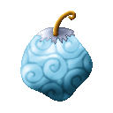{ .mod-icon }

| | |
|---|---|
| **Type** | Mythical Zoan |
| **Box** | { .box-icon } Golden |
| **Chance per opening** | golden **2.32%**, iron **0.116%**, wooden **0.006%** ([how it works](index.md#box-odds)) |
| **Abilities** | 11: 9 active, 2 passive (1 hidden, not in the ability menu) |
| **Transformations** | [Pegasus Assault Point](#pegasus-assault-point), [Pegasus Fly Point](#pegasus-fly-point) |

In 3D: drag to turn, scroll or pinch to zoom.

<!-- animations -->
??? example "Animations"

    

    <figure markdown="span">
      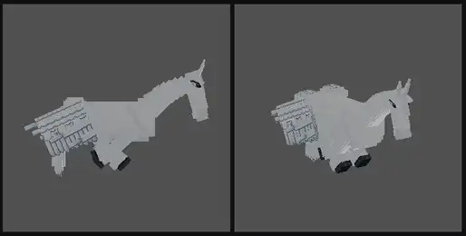{ loading=lazy }
      <figcaption>Pegasus: gallop</figcaption>
    </figure>
    <figure markdown="span">
      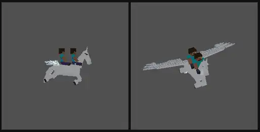{ loading=lazy }
      <figcaption>Pegasus: flight</figcaption>
    </figure>
    <figure markdown="span">
      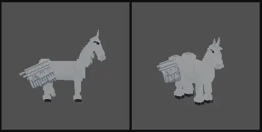{ loading=lazy }
      <figcaption>Pegasus: kick</figcaption>
    </figure>
    <figure markdown="span">
      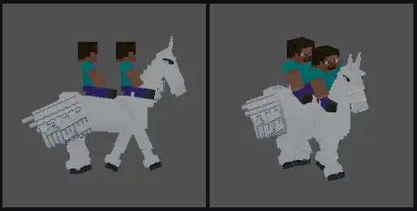{ loading=lazy }
      <figcaption>Pegasus: ridden</figcaption>
    </figure>
    <figure markdown="span">
      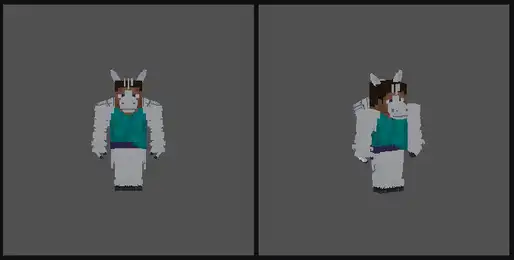{ loading=lazy }
      <figcaption>Hybrid: wing blow</figcaption>
    </figure>
    

<!-- /animations -->

Found in the base mod's **golden Devil Fruit box**. Eat it and its abilities appear in the ability menu, grouped under the fruit.

!!! note "About the values"
    The values are those of the ability's tooltip in game, with the base mod's default settings. Damage is shown on the base mod's scale, as in the ability screen.

## Pegasus Assault Point { #pegasus-assault-point }

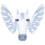{ .ability-icon } *Active · Transformation*

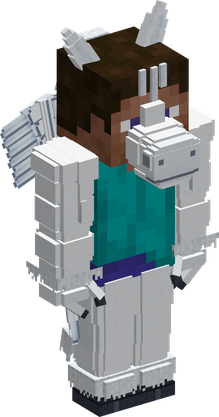{ .form-picture }

Transforms the user into a Pegasus hybrid, which flies and fights with hooves and wings

## Pegasus Fly Point { #pegasus-fly-point }

{ .ability-icon } *Active · Transformation*

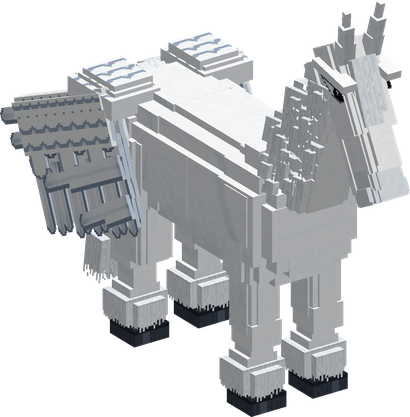{ .form-picture }

Transforms the user into a Pegasus, a winged war horse that flies and carries two other players on its back

## Pegasus Flight { #pegasus-flight }

*Passive*

!!! info "Hidden ability"
    It does not appear in the ability menu.

Requires Pegasus Assault Point or Pegasus Fly Point to be active.

## Pegasus Rideable { #pegasus-rideable }

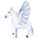{ .ability-icon } *Passive*

Allows two other players to ride on the Pegasus's back. They keep fighting with their abilities and weapons

Requires Pegasus Fly Point to be active.

## Charge { #pegasus-charge }

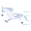{ .ability-icon } *Active*

The user gallops forward on the ground or in the air, running through every enemy in front of them and throwing them aside. The riders stay on

| Stat | Value |
|---|---|
| Damage type | Physical |
| Haki | Hardening |
| Cooldown | 12 s |
| Damage | 22 |

## Hoof Kick { #pegasus-hoof-kick }

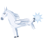{ .ability-icon } *Active*

The user bucks and kicks behind them with their hooves, throwing back every enemy there

| Stat | Value |
|---|---|
| Damage type | Physical |
| Haki | Hardening |
| Cooldown | 9 s |
| Damage | 24 |
| Range | 3–4.5 blocks (area) |

## Wing Gust { #pegasus-wing-gust }

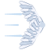{ .ability-icon } *Active*

The user opens their wings wide and beats them forward, pushing every enemy in front far away

| Stat | Value |
|---|---|
| Damage type | Physical |
| Haki | Special |
| Cooldown | 10 s |
| Damage | 8 |
| Range | 6–8 blocks (area) |

## Dive { #pegasus-dive }

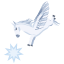{ .ability-icon } *Active*

The user leaps into the air if on the ground, then dives on the enemy they look at or the spot they aim at. Every enemy around the landing is hit and thrown out

| Stat | Value |
|---|---|
| Damage type | Physical |
| Haki | Hardening |
| Cooldown | 30 s |
| Damage | 34 |
| Range | 30 blocks (line) |

## Rearing { #pegasus-rearing }

{ .ability-icon } *Active*

The user rears up and crashes their front hooves down, the shock throws up every enemy in front

| Stat | Value |
|---|---|
| Damage type | Physical |
| Haki | Hardening |
| Cooldown | 12 s |
| Damage | 18 |
| Range | 4–5.5 blocks (area) |

## Tailwind { #pegasus-tailwind }

{ .ability-icon } *Active*

The user beats their wings and a wind carries them, their riders and their pets faster for a while

Other players must be crouching to be carried

| Stat | Value |
|---|---|
| Cooldown | 40 s |
| Movement Speed | +40 % |
| Duration | 10 s |
| Range | 10 blocks (area) |

## Feather Volley { #pegasus-feather-volley }

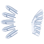{ .ability-icon } *Active*

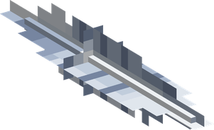{ .form-picture }

The user beats their wings and a fan of feathers flies where they look, each one cutting the first enemy it meets

| Stat | Value |
|---|---|
| Damage type | Projectile |
| Haki | Special |
| Cooldown | 12 s |
| Damage | 36 |
| Feathers | 9 |
| Range | 30 blocks (line) |
