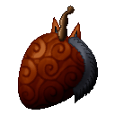
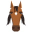
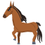
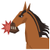
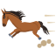

# Uma Uma no Mi

{ .mod-icon }

| | |
|---|---|
| **Type** | Zoan |
| **Box** | { .box-icon } Iron |
| **Chance per opening** | iron **1.48%**, wooden **0.074%** ([how it works](index.md#box-odds)) |
| **Abilities** | 5: 4 active, 1 passive |
| **Transformations** | [Uma Heavy Point](#uma-heavy-point), [Uma Walk Point](#uma-walk-point) |

Found in the base mod's **iron Devil Fruit box**. Eat it and its abilities appear in the ability menu, grouped under the fruit.

!!! note "About the values"
    The values are those of the ability's tooltip in game, with the base mod's default settings. Damage is shown on the base mod's scale, as in the ability screen.

## Uma Heavy Point { #uma-heavy-point }

{ .ability-icon } *Active · Transformation*

Transforms the user into a horse hybrid, a strong horse man with hooves and a mane.

## Uma Walk Point { #uma-walk-point }

{ .ability-icon } *Active · Transformation*

Transforms the user into a big horse that runs fast and can carry another player on its back

## Uma Rideable { #uma-rideable }

{ .ability-icon } *Passive*

Allows another player to ride on the horse's back. The rider keeps fighting with their abilities and weapons and holds on at the gallop

Requires Uma Walk Point to be active.

## Uma Kamitsuki { #uma-kamitsuki }

{ .ability-icon } *Active*

While in a horse form, the user bites the enemy in front of them. The bite hurts more if that enemy just hit the user's rider or an ally

| Stat | Value |
|---|---|
| Damage type | Physical |
| Haki | Hardening |
| Cooldown | 8 s |
| Damage | 20 |
| Damage on Who Hit an Ally | 30 |

## Kakeashi { #kakeashi }

{ .ability-icon } *Active*

While in the full horse form, the user gallops very fast and climbs high steps without jumping, the rider stays on. It uses up the stamina gauge which fills back at rest

With the alternate mode Fumitsubushi the user tramples the creatures smaller than them on the way, they get hurt, knocked down and thrown aside. Trampling uses the stamina faster

Fumitsubushi

| Stat | Value |
|---|---|
| Damage type | Physical |
| Haki | Hardening |
| Speed | +60 % |
| Climbs Steps Of | 1.5  blocks |
| Full Stamina | 12 s |
| Stamina Refill | 15 s |
| Damage | 10 |
| Knocked Down | 1.5 s |
