# Uo Uo no Mi, Model: Seiryu

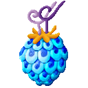{ .mod-icon }

| | |
|---|---|
| **Type** | Mythical Zoan |
| **Box** | { .box-icon } Golden |
| **Chance per opening** | golden **2.32%**, iron **0.116%**, wooden **0.006%** ([how it works](index.md#box-odds)) |
| **Abilities** | 13: 11 active, 2 passive (1 hidden, not in the ability menu) |
| **Transformations** | [Seiryu Heavy Point](#seiryu-heavy-point), [Seiryu Fly Point](#seiryu-fly-point) |
| **Effects applied** | [Kaen Daiko](../effects.md#effect-kaen-daiko) |

In 3D: drag to turn, scroll or pinch to zoom.

<!-- animations -->
??? example "Animations"

    

    <figure markdown="span">
      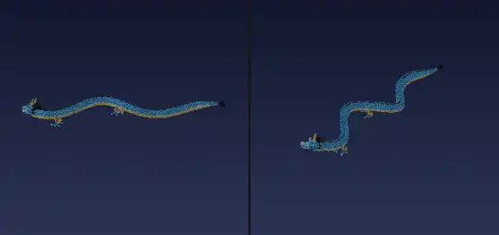{ loading=lazy }
      <figcaption>Dragon: flight</figcaption>
    </figure>
    <figure markdown="span">
      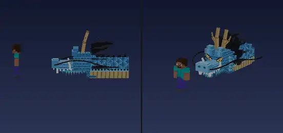{ loading=lazy }
      <figcaption>Bolo Breath</figcaption>
    </figure>
    <figure markdown="span">
      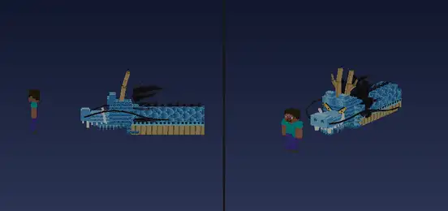{ loading=lazy }
      <figcaption>Shoryu: Kaen Hakke</figcaption>
    </figure>
    <figure markdown="span">
      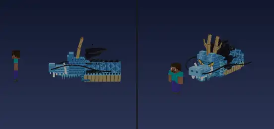{ loading=lazy }
      <figcaption>Dragon Storm</figcaption>
    </figure>
    <figure markdown="span">
      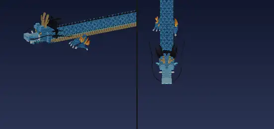{ loading=lazy }
      <figcaption>Tatsumaki</figcaption>
    </figure>
    <figure markdown="span">
      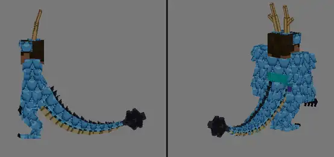{ loading=lazy }
      <figcaption>Hybrid: double jump</figcaption>
    </figure>
    <figure markdown="span">
      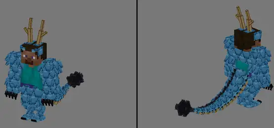{ loading=lazy }
      <figcaption>Hybrid: tail grab</figcaption>
    </figure>
    

<!-- /animations -->

Found in the base mod's **golden Devil Fruit box**. Eat it and its abilities appear in the ability menu, grouped under the fruit.

!!! note "About the values"
    The values are those of the ability's tooltip in game, with the base mod's default settings. Damage is shown on the base mod's scale, as in the ability screen.

## Seiryu Heavy Point { #seiryu-heavy-point }

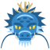{ .ability-icon } *Active · Transformation*

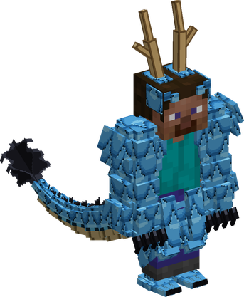{ .form-picture }

Transforms the user into a dragon hybrid with scales, claws and a long tail. Jumping again in the air kicks with the tail for a second jump, and the user takes no fall damage

## Seiryu Fly Point { #seiryu-fly-point }

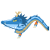{ .ability-icon } *Active · Transformation*

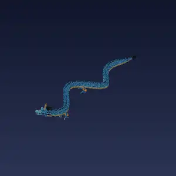{ .form-picture }

Transforms the user into the azure dragon, a huge flying serpent 45 blocks long with scales that take most blows. It needs room to transform

| Stat | Value |
|---|---|
| Max Health in Dragon Form | +50 % |

## Seiryu Scales { #seiryu-scales }

{ .ability-icon } *Passive*

While in a dragon form the user's scales take no damage from fire or lava, and the user never stays on fire

Requires Seiryu Heavy Point or Seiryu Fly Point to be active.

## Flame Clouds { #seiryu-flight }

*Passive*

!!! info "Hidden ability"
    It does not appear in the ability menu.

Requires Seiryu Fly Point to be active.

## Bolo Breath { #seiryu-bolo-breath }

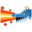{ .ability-icon } *Active*

The user breathes a great beam of fire that burns every enemy in it and blows up where it hits, breaking blocks and setting fires. As the dragon the beam is much longer and wider and ends with a spread of fireballs

| Stat | Value |
|---|---|
| Damage type | Indirect |
| Element | Fire |
| Haki | Special |
| Cooldown | 18–40 s |
| Hold | 2 s |
| Damage | 32–72 |
| Range | 18–72 blocks (line) |
| Fireballs of the Dragon | 6 |

## Kaifu { #seiryu-kaifu }

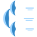{ .ability-icon } *Active*

The user throws a fan of wind blades that cut the first enemy they meet. The dragon throws more of them and bigger

| Stat | Value |
|---|---|
| Damage type | Projectile |
| Element | Wind |
| Haki | Special |
| Cooldown | 10 s |
| Damage | 12–18 |
| Blades | 3–5 |

## Tail Grab { #seiryu-tail-grab }

{ .ability-icon } *Active*

The user wraps their tail around the enemy they look at and squeezes it. As the dragon it is Whisker Grab, a whisker catching the enemy from further away. Use the ability again to throw it, it gets hurt if it hits a wall

| Stat | Value |
|---|---|
| Damage type | Physical |
| Haki | Hardening |
| Cooldown | 15 s |
| Hold | 3 s |
| Damage | 26–22 |
| Range | 6–18 blocks (line) |

## Seiryu Bite { #seiryu-bite }

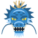{ .ability-icon } *Active*

The user bites the enemies right in front of the mouth. As the dragon it is Dragon Bite, the great jaws snapping on every enemy at the muzzle

| Stat | Value |
|---|---|
| Damage type | Physical |
| Haki | Hardening |
| Cooldown | 7 s |
| Damage | 22–36 |
| Range | 6–15 blocks (line) |

## Seiryu Claws { #seiryu-claws }

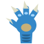{ .ability-icon } *Active*

The user rakes their claws across the enemies in front of them and pushes them away. As the dragon it is Dragon Claws, all four legs swiping at the enemies close to them

| Stat | Value |
|---|---|
| Damage type | Physical |
| Haki | Hardening |
| Cooldown | 6 s |
| Damage | 18–28 |
| Range | 6–15 blocks (area) |

## Dragon Tail Sweep { #seiryu-tail-sweep }

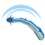{ .ability-icon } *Active*

While in the dragon form, the user swings their tail round in front of them and sends flying the enemies in a wide arc

| Stat | Value |
|---|---|
| Damage type | Physical |
| Haki | Hardening |
| Cooldown | 10 s |
| Damage | 28 |
| Range | 19.5 blocks (area) |

## Tatsumaki { #seiryu-tatsumaki }

{ .ability-icon } *Active*

While in the dragon form, the user raises tornadoes, press the Alt key to switch between the two

Tatsumaki is 3 tornadoes in front of the user that pull the enemies towards the jaws, which bite them

Tatsumaki Kaifu is a great tornado where the user looks that pulls the enemies round and throws wind blades at the ones around

| Stat | Value |
|---|---|
| Damage type | Indirect |
| Element | Wind |
| Haki | Special |
| Cooldown | 25–30 s |
| Hold | 4–5 s |
| Damage | 40–48 |
| Range | 25.5–60 blocks (area) |

## Dragon Storm { #seiryu-storm }

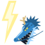{ .ability-icon } *Active*

While in the dragon form, the user calls a storm, press the Alt key to switch between the two

With Thunder Roar the user roars and lightning strikes the nearest enemies

With Hail Storm a storm cloud gathers where the user looks and hail beats down on the enemies under it and slows them

| Stat | Value |
|---|---|
| Damage type | Indirect |
| Element | Lightning |
| Haki | Special |
| Cooldown | 25 s |
| Damage | 32–48 |
| Range | 48 blocks (area) |
| Bolts | 6 |

## Kaen Daiko { #seiryu-kaen-daiko }

{ .ability-icon } *Active*

Applies [Kaen Daiko](../effects.md#effect-kaen-daiko)

While in the dragon form, a giant dragon of fire wraps the user. Melee blows without Haki can't touch the user and burn the one who strikes, enemies against the body burn too

Use it again while it burns for Kaen Hakke, the user lunges forward jaws first, biting and burning every enemy on the way, then the fire goes out

Water puts it out

| Stat | Value |
|---|---|
| Damage type | Indirect |
| Element | Fire |
| Haki | Special |
| Cooldown | 30 s |
| Hold | 20 s |
| Damage | 4–40 |
| Range | 27.2 blocks (line) |
