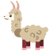
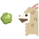
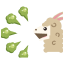

# Ushi Ushi no Mi, Model: Alpaca

{ .mod-icon }

| | |
|---|---|
| **Type** | Zoan |
| **Box** | { .box-icon } Wooden |
| **Chance per opening** | wooden **1.53%** ([how it works](index.md#box-odds)) |
| **Abilities** | 8: 7 active, 1 passive |
| **Transformations** | [Alpaca Heavy Point](#alpaca-heavy-point), [Alpaca Walk Point](#alpaca-walk-point) |
| **Effects applied** | { .effect-mini }[Spat On](../effects.md#effect-spat-on) |

Found in the base mod's **wooden Devil Fruit box**. Eat it and its abilities appear in the ability menu, grouped under the fruit.

!!! note "About the values"
    The values are those of the ability's tooltip in game, with the base mod's default settings. Damage is shown on the base mod's scale, as in the ability screen.

## Alpaca Heavy Point { #alpaca-heavy-point }

{ .ability-icon } *Active · Transformation*

Transforms the user into an alpaca hybrid, sturdy in thick wool and hard to push back.

## Alpaca Walk Point { #alpaca-walk-point }

{ .ability-icon } *Active · Transformation*

Transforms the user into a white alpaca, a quick and sure-footed runner.

## Alpaca Spit { #alpaca-spit }

{ .ability-icon } *Active*

Applies { .effect-mini }[Spat On](../effects.md#effect-spat-on)

While in an alpaca form, the user spits a green glob where they look. A player hit sees green spit over the middle of their screen and feels sick, a creature hit forgets its target for a while

{ .effect-mini }With the **Alt key** it is **Sticky Spit**: the user spits a thick glob of chewed grass. The enemy hit gets slowed and a sticky green puddle stays where it lands, it slows whoever walks in it

| Stat | Alpaca Spit | Sticky Spit |
|---|---|---|
| Damage type | Projectile | Projectile |
| Haki | Imbuing | Imbuing |
| Cooldown | 8 s | 10 s |
| Charge | 0.3 s | 0.3 s |
| Damage | 5 | 3 |
| Slowed |  | 40% |
| Sticky Puddle |  | 5 s |

## Woolly Kick { #woolly-kick }

{ .ability-icon } *Active*

While in an alpaca form, the user kicks with the hind legs behind them like a real alpaca, so the user has to show their back to the enemy. Enemies behind get hurt and thrown away

| Stat | Value |
|---|---|
| Damage type | Physical |
| Haki | Hardening |
| Cooldown | 10 s |
| Damage | 14 |
| Kick Reach (behind) | 2  blocks |

## Neck Ram { #neck-ram }

{ .ability-icon } *Active*

While in an alpaca form, the user charges forward head down. The first enemy in the way gets hit, thrown back and knocked down for a moment

| Stat | Value |
|---|---|
| Damage type | Physical |
| Haki | Hardening |
| Cooldown | 10 s |
| Damage | 10 |
| Knocked Down | 0.75  seconds |

## Guard Stomp { #guard-stomp }

{ .ability-icon } *Active*

While in an alpaca form, the user rears up and stomps the ground with the front feet. Enemies around get hurt and thrown in the air

{ .effect-mini }With the **Alt key** it is **Pronk**: the user crouches and leaps very high with stiff legs. Where the user lands enemies around get hurt and thrown away, the user takes no fall damage from the leap

| Stat | Guard Stomp | Pronk |
|---|---|---|
| Damage type | Physical | Physical |
| Haki | Hardening | Hardening |
| Cooldown | 12 s | 12 s |
| Damage | 12 | 10 |
| Stomp Radius | 3 blocks | 3 blocks |

## Spit Volley { #spit-volley }

{ .ability-icon } *Active*

Applies { .effect-mini }[Spat On](../effects.md#effect-spat-on)

While in an alpaca form, the user chews for a moment, then sprays 5 globs of spit in a fan before them. Each glob does what Alpaca Spit does

| Stat | Value |
|---|---|
| Damage type | Projectile |
| Haki | Imbuing |
| Cooldown | 30 s |
| Charge | 1 s |
| Damage | 25 |

## Thick Wool { #thick-wool }

{ .ability-icon } *Passive*

While in an alpaca form, the thick wool takes a quarter of the damage from close blows and falls, but it burns and fire hurts a quarter more

Requires Alpaca Heavy Point or Alpaca Walk Point to be active.
