# Uta Uta no Mi

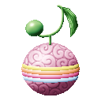{ .mod-icon }

| | |
|---|---|
| **Type** | Paramecia |
| **Theme** | Song |
| **Box** | 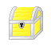{ .box-icon } Golden |
| **Chance per opening** | golden **2.26%**, iron **0.113%**, wooden **0.006%** ([how it works](index.md#box-odds)) |
| **Abilities** | 9: 8 active, 1 passive |
| **Transformations** | [Knight Form](#knight-form) |
| **Effects applied** | { .effect-mini }[Absorbed](../effects.md#effect-absorbed), 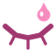{ .effect-mini }[Exhausted](../effects.md#effect-exhausted), 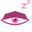{ .effect-mini }[Just Woken](../effects.md#effect-just-woken), { .effect-mini }[Puppet](../effects.md#effect-puppet), { .effect-mini }[Stuffed Toy](../effects.md#effect-stuffed-toy), { .effect-mini }[Wide Awake](../effects.md#effect-wide-awake) |

In 3D: drag to turn, scroll or pinch to zoom.

<!-- animations -->
??? example "Animations"

    Taken in game, at size 1.

    

    <figure markdown="span">
      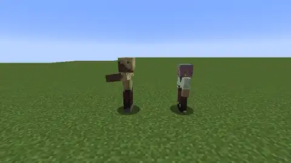{ loading=lazy }
      <figcaption>Song</figcaption>
    </figure>
    <figure markdown="span">
      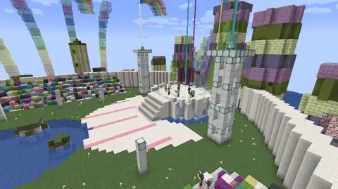{ loading=lazy }
      <figcaption>Uta World: the stage</figcaption>
    </figure>
    <figure markdown="span">
      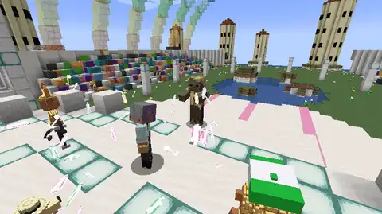{ loading=lazy }
      <figcaption>Knight Form</figcaption>
    </figure>
    <figure markdown="span">
      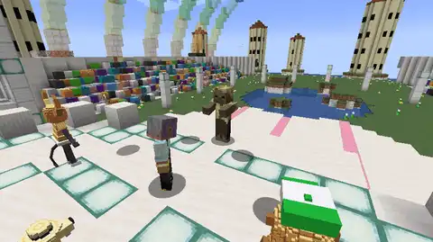{ loading=lazy }
      <figcaption>Musical Note Soldiers</figcaption>
    </figure>
    <figure markdown="span">
      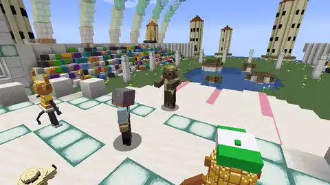{ loading=lazy }
      <figcaption>Staff</figcaption>
    </figure>
    <figure markdown="span">
      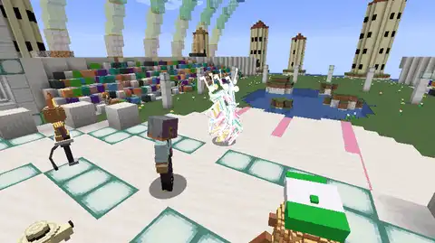{ loading=lazy }
      <figcaption>Toy</figcaption>
    </figure>
    <figure markdown="span">
      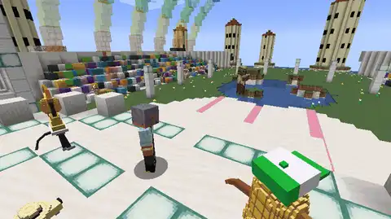{ loading=lazy }
      <figcaption>Trick or Treat</figcaption>
    </figure>
    <figure markdown="span">
      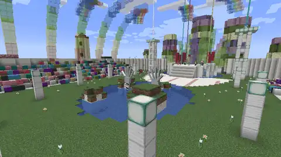{ loading=lazy }
      <figcaption>Tot Musica</figcaption>
    </figure>
    

<!-- /animations -->

Found in the base mod's **golden Devil Fruit box**. Eat it and its abilities appear in the ability menu, grouped under the fruit.

!!! note "About the values"
    The values are those of the ability's tooltip in game, with the base mod's default settings. Damage is shown on the base mod's scale, as in the ability screen.

## Song { #uta-song }

{ .ability-icon } *Active*

Applies { .effect-mini }[Absorbed](../effects.md#effect-absorbed), { .effect-mini }[Exhausted](../effects.md#effect-exhausted), { .effect-mini }[Just Woken](../effects.md#effect-just-woken), { .effect-mini }[Puppet](../effects.md#effect-puppet), { .effect-mini }[Wide Awake](../effects.md#effect-wide-awake)

The user sings for a few seconds. Every player still in range at the end is sent to Uta World with the user, their bodies stay asleep where they stood. A hit interrupts the song. Nobody under a silence hears it

Up to 16 creatures in range are sent to Uta World too and fight for the user there, the others and bosses only fall asleep. A hit on a sleeping body wakes its player, a hit on the user's body ends the dream for everyone. A silence that falls on a sleeping body wakes its player too

A player or creature defeated in the dream wakes up and takes heavy damage, and so does the user. While alone in the dream, the user can use this again to end it

Uta World is built of its own blocks, which nothing breaks: Dream Stage, Dream Floor, Dream Wall, Dream Frame, Dream Curtain and Dream Light.

| Stat | Value |
|---|---|
| Cooldown | 30–120 s |
| Charge | 3 s |
| Range | 16 blocks (area) |

## Musical Note Soldiers { #note-soldiers }

{ .ability-icon } *Active*

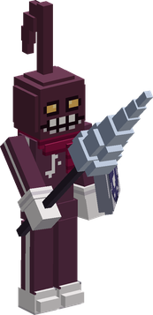{ .form-picture }

In Uta World, the user calls soldiers shaped like musical notes that fight for the user. A soldier that is struck down scatters into notes and forms again

| Stat | Value |
|---|---|
| Cooldown | 30 s |
| Damage | 7 |
| Soldiers | 4 |
| Fat Soldier Damage | 5 |
| Note Damage | 4 |
| Soldier Time | 25 s |

## Staff { #uta-staff }

{ .ability-icon } *Active*

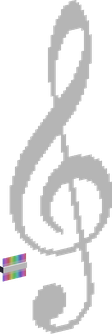{ .form-picture }

Applies { .effect-mini }[Stuffed Toy](../effects.md#effect-stuffed-toy)

In Uta World, the user pins the enemy looked at on a musical staff, where it cannot move or strike. Using it again releases the enemy

With the mode key the user turns the enemy looked at into a stuffed toy instead, it cannot move, strike or use abilities until something hits it

| Stat | Value |
|---|---|
| Damage type | Indirect |
| Haki | Special |
| Charge | 0 s |
| Cooldown | 16 s |
| Hold | 4 s |
| Damage | 6 |
| Range | 14 blocks (line) |
| Toy Time | 4 s |

## Trick or Treat { #trick-or-treat }

{ .ability-icon } *Active*

In Uta World, the user rides a giant musical note that rams forward where the user is looking, hitting and throwing aside every enemy in its way

| Stat | Value |
|---|---|
| Damage type | Blunt |
| Haki | Special |
| Charge | 0 s |
| Cooldown | 12 s |
| Damage | 12 |
| Range | 24.2 blocks (line) |

## Parade Float { #parade-float }

{ .ability-icon } *Active*

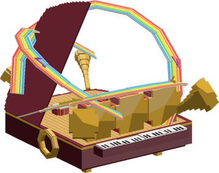{ .form-picture }

In Uta World, the user calls a flying parade float and rides it where the user is looking. Allies can get on it with a right click

| Stat | Value |
|---|---|
| Cooldown | 30 s |
| Flight Time | 20 s |
| Seats | 4 |

## Dream Healing { #uta-heal }

{ .ability-icon } *Active*

In Uta World, the user heals the ally looked at, or the user with no ally in sight. Nothing of it follows into the real world

| Stat | Value |
|---|---|
| Cooldown | 20 s |
| Range | 16 blocks (line) |
| Healing | 30 % |

## Knight Form { #knight-form }

{ .ability-icon } *Active · Transformation*

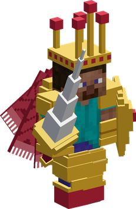{ .form-picture }

Applies { .effect-mini }[Absorbed](../effects.md#effect-absorbed), { .effect-mini }[Exhausted](../effects.md#effect-exhausted), { .effect-mini }[Just Woken](../effects.md#effect-just-woken), { .effect-mini }[Puppet](../effects.md#effect-puppet), { .effect-mini }[Wide Awake](../effects.md#effect-wide-awake)

In Uta World, the user puts on golden armour with a lance and a shield, becoming tougher and hitting harder and from further away

## Tot Musica { #tot-musica }

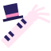{ .ability-icon } *Active*

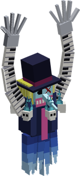{ .form-picture }

Applies { .effect-mini }[Absorbed](../effects.md#effect-absorbed), { .effect-mini }[Exhausted](../effects.md#effect-exhausted), { .effect-mini }[Just Woken](../effects.md#effect-just-woken), { .effect-mini }[Puppet](../effects.md#effect-puppet), { .effect-mini }[Wide Awake](../effects.md#effect-wide-awake)

In Uta World, the user sings the forbidden song. Tot Musica appears, absorbs the user and attacks everyone in the dream. The user can do nothing more and the voice gauge empties twice as fast

If Tot Musica is defeated, the dream ends and the user is defeated with it. It must be used twice in a row to confirm

| Stat | Value |
|---|---|
| Tot Musica Health | 300 |

## Voice { #uta-voice }

{ .ability-icon } *Passive*

The user's dream lasts as long as the user's voice. The dream empties the gauge and ends when it is empty, the gauge fills again over time

A full voice is a dream of 5 minutes, half that once Tot Musica is called. An empty voice is full again after 100 seconds

In the dream the user flies freely, the creatures taken by the song fight for the user there
