# Wapu Wapu no Mi

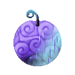{ .mod-icon }

| | |
|---|---|
| **Type** | Paramecia |
| **Theme** | Warp |
| **Box** | { .box-icon } Iron |
| **Chance per opening** | iron **1.37%**, wooden **0.069%** ([how it works](index.md#box-odds)) |
| **Abilities** | 8: 8 active, 0 passive |

<!-- animations -->
??? example "Animations"

    Taken in game, at size 1.

    

    <figure markdown="span">
      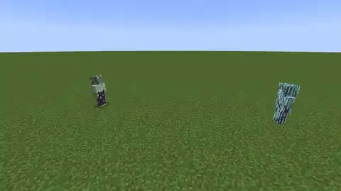{ loading=lazy }
      <figcaption>Warp</figcaption>
    </figure>
    <figure markdown="span">
      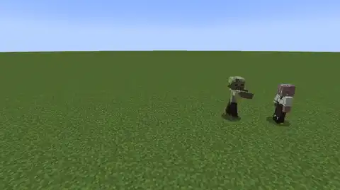{ loading=lazy }
      <figcaption>Warp Other</figcaption>
    </figure>
    <figure markdown="span">
      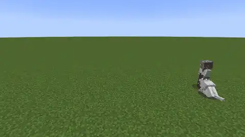{ loading=lazy }
      <figcaption>Group Warp</figcaption>
    </figure>
    <figure markdown="span">
      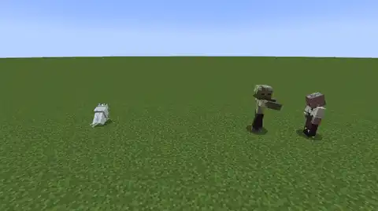{ loading=lazy }
      <figcaption>Scatter</figcaption>
    </figure>
    <figure markdown="span">
      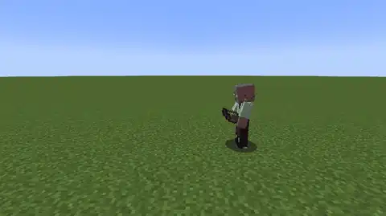{ loading=lazy }
      <figcaption>Warp Shot</figcaption>
    </figure>
    <figure markdown="span">
      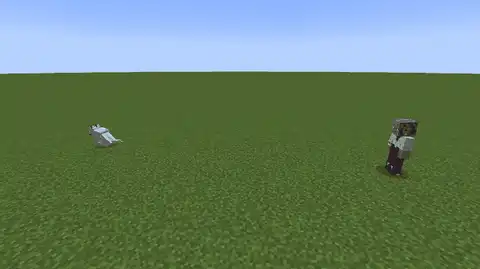{ loading=lazy }
      <figcaption>Catch</figcaption>
    </figure>
    <figure markdown="span">
      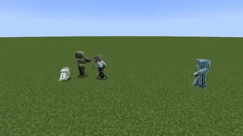{ loading=lazy }
      <figcaption>Behind the Back</figcaption>
    </figure>
    <figure markdown="span">
      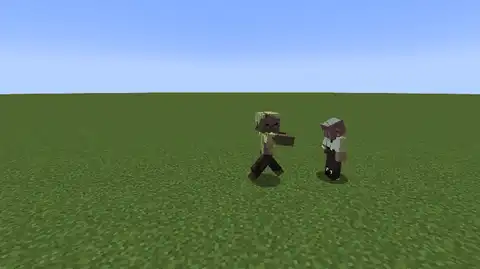{ loading=lazy }
      <figcaption>Reflex Warp</figcaption>
    </figure>
    

<!-- /animations -->

Found in the base mod's **iron Devil Fruit box**. Eat it and its abilities appear in the ability menu, grouped under the fruit.

!!! note "About the values"
    The values are those of the ability's tooltip in game, with the base mod's default settings. Damage is shown on the base mod's scale, as in the ability screen.

## Warp { #wapu-warp }

{ .ability-icon } *Active*

The user warps in an instant to where they look. They land on the ground, or in the air at the end of their sight and fall

| Stat | Value |
|---|---|
| Cooldown | 4 s |
| Range | 40 blocks (line) |

## Warp Other { #wapu-warp-other }

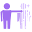{ .ability-icon } *Active*

The user touches the enemy in front of them and warps it to where they look. In the air, it falls. Bosses are too strong for it

| Stat | Value |
|---|---|
| Cooldown | 12 s |
| Charge | 0 s |
| Range | 24 blocks (line) |
| Touch | 3  blocks |

## Group Warp { #wapu-group-warp }

{ .ability-icon } *Active*

The user warps where they look with the allies around them

A player must be crouching to be taken

| Stat | Value |
|---|---|
| Cooldown | 30 s |
| Charge | 0 s |
| Range | 40 blocks (line) |
| Takes Allies Within | 5  blocks |

## Catch { #wapu-catch }

{ .ability-icon } *Active*

The user warps the ally they look at to their side, even from far away. An ally caught while falling takes no fall damage

A player must be crouching to be caught

| Stat | Value |
|---|---|
| Cooldown | 20 s |
| Charge | 0 s |
| Range | 64 blocks (line) |

## Warp Shot { #wapu-warp-shot }

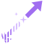{ .ability-icon } *Active*

For a while every projectile the user fires vanishes and comes out behind the enemy they look at, flying at its back

| Stat | Value |
|---|---|
| Charge | 0 s |
| Cooldown | 30 s |
| Hold | 10 s |
| Range | 64 blocks (line) |

## Reflex Warp { #wapu-reflex-warp }

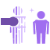{ .ability-icon } *Active*

For a moment the user is on guard. The first hit or shot that comes misses them and they warp behind the one who dealt it

| Stat | Value |
|---|---|
| Charge | 0 s |
| Cooldown | 20 s |
| Hold | 5 s |
| Behind the Attacker | 3  blocks |

## Behind the Back { #wapu-behind-the-back }

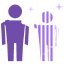{ .ability-icon } *Active*

The user warps behind the enemy they look at, facing its back. Their next hit on it right after is stronger

| Stat | Value |
|---|---|
| Cooldown | 10 s |
| Next Blow | 150 % |
| Time to Strike | 2 s |
| Range | 24 blocks (line) |

## Scatter { #wapu-scatter }

{ .ability-icon } *Active*

Every enemy and projectile around the user is warped a few blocks away from them, each one somewhere else

Their own pets and crouching allies stay. Bosses are too strong for it

| Stat | Value |
|---|---|
| Cooldown | 20 s |
| Charge | 0 s |
| Sent | 4–8  blocks |
| Range | 6 blocks (area) |
