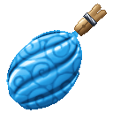

# Woshu Woshu no Mi

{ .mod-icon }

| | |
|---|---|
| **Type** | Paramecia |
| **Theme** | Laundry |
| **Box** | { .box-icon } Wooden |
| **Chance per opening** | wooden **1.53%** ([how it works](index.md#box-odds)) |
| **Abilities** | 4: 4 active, 0 passive |
| **Effects applied** | { .effect-mini }[Calmed](../effects.md#effect-calmed), { .effect-mini }[Hung Out](../effects.md#effect-hung-out), { .effect-mini }[Laundry](../effects.md#effect-laundry), { .effect-mini }[Wrung](../effects.md#effect-wrung) |

Found in the base mod's **wooden Devil Fruit box**. Eat it and its abilities appear in the ability menu, grouped under the fruit.

!!! note "About the values"
    The values are those of the ability's tooltip in game, with the base mod's default settings. Damage is shown on the base mod's scale, as in the ability screen.

## Sentaku { #woshu-sentaku }

{ .ability-icon } *Active*

Applies { .effect-mini }[Laundry](../effects.md#effect-laundry)

The user grabs the one in front of them and washes them like laundry. Once washed through they come out flat and limp like cloth, they cant hit, cant use abilities and move slowly. Armament Haki makes it last half as long

| Stat | Value |
|---|---|
| Cooldown | 18 s |
| Range | 3 blocks (line) |
| Hold | 2 s |
| Laundry For | 8 s |

## Tenpiboshi { #woshu-tenpiboshi }

{ .ability-icon } *Active*

Applies { .effect-mini }[Hung Out](../effects.md#effect-hung-out)

The user hangs the one in front of them out to dry on a clothesline. They stay stuck in the air until the time is out or the line breaks, every hit on the line wears it out, theirs too. [Laundry](../effects.md#effect-laundry) stays hung longer. Armament Haki makes it last half as long

{ .effect-mini }With the **Alt key** it is **Long Line**: a long line, up to 3 bodies in front of the user at once, for half the time

| Stat | Tenpiboshi | Long Line |
|---|---|---|
| Cooldown | 20 s | 20 s |
| Charge | 0.25 s | 0.25 s |
| Range | 6 blocks (line) | 6 blocks (line) |
| Hung Out For | 6 s | 3 s |
| Hung Out For, if Laundry | 10 s | 5 s |
| Bodies on the Line | 1 | 3 |
| Line Health | 20 | 20 |

## Zokin Shibori { #woshu-zokin-shibori }

{ .ability-icon } *Active*

Applies { .effect-mini }[Wrung](../effects.md#effect-wrung)

The user wrings the one in front of them like a cloth, what they hold in their main hand falls. [Laundry](../effects.md#effect-laundry) gets wrung harder, both their hands drop what they hold and they stop being laundry

| Stat | Value |
|---|---|
| Damage type | Physical |
| Haki | Hardening |
| Cooldown | 12 s |
| Charge | 0 s |
| Range | 3 blocks (line) |
| Damage | 6 |
| Damage on Laundry | 10 |

## Senshin { #woshu-senshin }

{ .ability-icon } *Active*

Applies { .effect-mini }[Calmed](../effects.md#effect-calmed)

The user washes the heart of laundry or of someone hung out to dry. A creature stops being hostile for a long time unless it gets hit, a boss only forgets its target for a moment and a player cant hurt the user until the user hits them

| Stat | Value |
|---|---|
| Cooldown | 30 s |
| Charge | 0 s |
| Range | 6 blocks (line) |
| Creature at Peace For | 300 s |
| Boss Loses its Target For | 5 s |
| Player Calmed For | 6 s |
